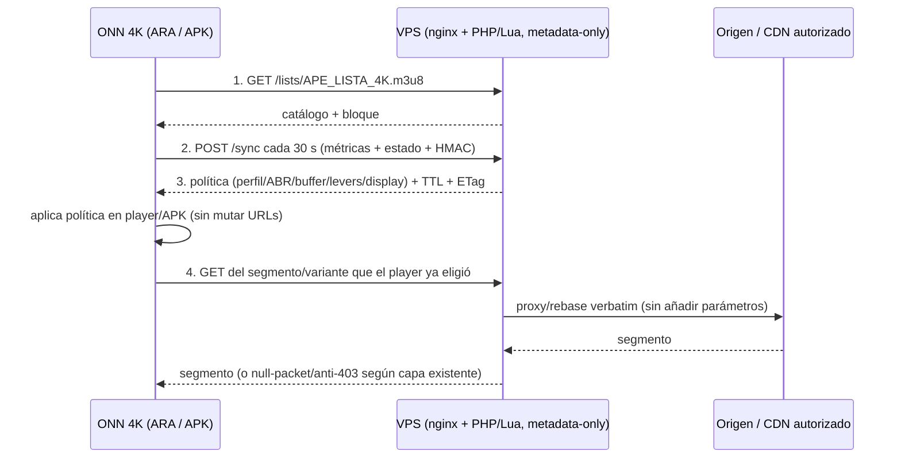

# ARA-X — protocolo de sincronización bidireccional `ARA ⇄ VPS`

Versión: `2` (D3 · 2026-10-30) · Fecha: 2026-10-30 · Scope: `ara-x/spec/**`
Estado: **contrato v2 implementable + cliente de referencia, schemas, mock, tests y endpoint PHP/nginx
staged, verificados en local**. `/sync` sigue **404 en producción** hasta la ventana del owner.
No se tocó el VPS. La extensión v2 se especifica en el §13.

---

## 1. Línea base medida (no supuesta)

| Endpoint | Resultado 2026-10-30 | Uso |
|---|---|---|
| `POST /sync` | **404** | **No existe**; este documento lo define. |
| `GET /ara/version` | **200** `{"versionCode":6,"versionName":"2.3.0-noWG","sha256":"…","size":27625887,"apk":"/ara/agent.apk"}` | Onboarding/versión del APK |
| `GET /ara/events` | **401** sin Bearer | SSE de telemetría (auth existente) |
| `POST /a/cfg` | loopback-only (`allow 127.0.0.1; deny all`) | Config por sesión, TTL en `lua_shared_dict` |
| `GET /a/<…>` | **200** `text/plain` | Atributos por canal (`#EXTATTRFROMURL`) |
| `GET /health` | **200** `OK` | Health check |
| VPS | nginx **1.24.0**, `ape-crystal-rust` **inactive**, sin pipeline Crystal 5 fases | Plano real = metadata-only |

**Consecuencia:** el VPS **no remuxea, no transcodifica y no escribe píxeles**. `/sync` sólo puede
transportar **decisiones de metadata/QoE** y config para el device. Cualquier paso “4. Re-request
segmento con parámetros óptimos” que implique reescribir la URL del segmento queda **prohibido**:
rompe firmas/tokens del proveedor y viola la doctrina SHIELDED (URLs verbatim).

---

## 2. Topología real (corregida)



**Cambio clave:** el paso 4 no “re-pide con parámetros óptimos”; el device **no** inyecta query
params en la URL del proveedor. La selección de variante la hace el `GET`/ABR existente y el VPS.

---

## 3. Endpoints

### 3.1 `POST /sync` (device → VPS)

- **Auth:** `X-ARA-Key-Id` + `X-ARA-Sig` (HMAC-SHA256) + `X-ARA-Sync-Version: 1`.
- **Body:** JSON UTF-8 ≤ **16 KB**, `Content-Type: application/json`.
- **Cadencia:** 30 s ± 20 % jitter; nunca más de 1 req/5 s por device.
- **No bloquea playback:** request independiente y pequeño; timeout cliente 3 s.
- **Respuestas:** `200` política; `204` sin cambios (mismo `policy_etag`); `401` firma/key;
  `409` replay/secuencia; `413` body grande; `429` rate; `503` no disponible.
- **Caché:** `Cache-Control: no-store`; sin cookies; sin redirects.

### 3.2 `GET /lists/…` (device → VPS)

Sin cambios. El bloque ARA-X es metadata inerte (ver `ARA_X_PLAYLIST_BLOCK.md`).

### 3.3 `POST /a/cfg` (VPS interno, loopback)

Sigue siendo **interno** (`127.0.0.1`). El device **no** lo llama. La política de `/sync` se
materializa aquí para que `ape_attr.lua` la sirva en `/a/<…>` y el APK la lea.

### 3.4 `/ara/events` (SSE existente)

Se mantiene como canal de telemetría de alta frecuencia (eventos), no como canal de política.
`/sync` es el canal de control de 30 s; no se solapan.

---

## 4. Firma HMAC (canonical, cross-language)

### 4.1 Request

```
canonical = "ARA-X-SYNC-V1\n" + device_id + "\n" + seq + "\n" + ts + "\n" + nonce + "\n" + sha256_hex(raw_body)
sig       = hmac_sha256_hex(secret, canonical)
```

- `device_id`, `seq`, `ts`, `nonce` van **dentro del body** y se firman junto con el hash del body
  crudo. El servidor lee `php://input` sin re-serializar.
- `seq` entero monótono por device (persistido en el device y en el VPS).
- `ts` Unix segundos; ventana de skew **±300 s**.
- `nonce` hex de 16-64 chars; el servidor rechaza reuso dentro de la ventana.
- `secret` por dispositivo; **nunca** en la lista, ni en logs, ni en la respuesta.

### 4.2 Response

```
canonical = "ARA-X-SYNC-RESP-V1\n" + device_id + "\n" + req_seq + "\n" + resp_ts + "\n" + sha256_hex(raw_body)
```

El cliente verifica `X-ARA-Sig` de la respuesta antes de aplicar nada. Si no verifica, descarta la
política y usa la última buena (o el safe-default).

Vector de prueba determinista (incluido en `tests/sync_contract.test.js`):

```
secret   = ara-x-test-secret
device   = onn4k-001 · seq=7 · ts=1700000000 · nonce=abc123def4567890
body     = {"hello":"ara-x"}
bodyHash = b6779f1db95a683d9319f6729e4ca4032dbb55b229999b55e09d9c00245a4ea3
sig      = 0e5851ac8086b730f3cbd22d138ececaaebc140b8b4c6582c590c0b078ad68be
respSig  = 2f00f129bb601a8a913db5bfae0d3e32fd2343141a7208b31500cf0e9b9ecf17
```

---

## 5. Request (resumen del schema)

`ara-x/vps/schema/sync_request.schema.json` (draft 2020-12, autocontenido, sin `$ref`):

```json
{
  "v": 1,
  "type": "ara_x_sync",
  "device_id": "onn4k-001",
  "seq": 7,
  "ts": 1700000000,
  "nonce": "abc123def4567890",
  "client": { "app": "ape-crystal-agent", "version": "2.3.0-noWG", "soc": "amlogic_s905x4", "android": 11, "player": "exoplayer" },
  "metrics": {
    "window_s": 30,
    "cpu_temp_c": 62.5, "gpu_temp_c": 60.0, "thermal_throttled": false,
    "gpu_load_pct": 41, "vpu_load_pct": 55, "ram_available_pct": 38,
    "frame_drop_ratio": 0.002, "stutter_probability": 0.08,
    "buffer_health_pct": 82, "rebuffer_ms": 0,
    "bitrate_bps": 25000000, "rtt_ms": 28, "loss_pct": 0.0, "bandwidth_bps": 42000000,
    "source": { "resolution": "1920x1080", "codec": "hvc1.2.4.L123.B0", "fps": 25, "hdr": "SDR" },
    "content": { "motion_score": 22, "film_grain": 0.35, "scene_complexity": 48, "dark_ratio": 0.12 }
  },
  "state": {
    "active_profile": "P2",
    "profile_blend": { "P0": 0, "P1": 0, "P2": 1, "P3": 0, "P4": 0, "P5": 0 },
    "policy_etag": "sha256:aaaaaaaaaaaaaaaaaaaaaaaaaaaaaaaaaaaaaaaaaaaaaaaaaaaaaaaaaaaaaaaa",
    "levers": { "pq_ai_sr_enable": 1 }
  }
}
```

Límites: strings acotados, porcentajes `0..100`, ratios `0..1`, `seq ≥ 1`, `ts > 0`, body ≤ 16 KB.

---

## 6. Response (política) — resumen y guards

`ara-x/vps/schema/sync_response.schema.json`, ejemplo completo en
`ara-x/vps/schema/device_policy.example.json`.

```json
{
  "v": 1,
  "type": "ara_x_policy",
  "device_id": "onn4k-001",
  "seq": 7,
  "ts": 1700000000,
  "valid_until": 1700000030,
  "policy_etag": "sha256:bbbb…",
  "profile": {
    "active": "P2",
    "blend": { "P0": 0, "P1": 0.2, "P2": 0.8, "P3": 0, "P4": 0, "P5": 0 },
    "reason": "thermal_headroom_low"
  },
  "player": { "buffer_s": 45, "abr_bw_factor": 0.78, "reconnect_attempts": 156, "live_delay_s": 10, "max_bitrate_bps": 25000000, "min_bitrate_bps": 6000000 },
  "device": { "allowed": true, "soc": "amlogic_s905x4", "thermal_target_c": 70, "levers": { "pq_ai_sr_enable": 1, "ai_sr_level": 3 } },
  "display": { "mode": "4k", "wire_resolution": "3840x2160", "eight_k": "presentation_only", "hdr_hint": "PQ" },
  "controls": { "sync_next_s": 30, "flags": ["thermal_headroom_low"], "degrade_mask": 0 },
  "ref": { "list_version": "2026-10-29T11:54:23Z", "lab_exported_at": "2026-10-26T01:31:05" }
}
```

### Guards obligatorios (cliente y servidor)

1. **Nunca wire 8K en SoC sin decode 8K** (`amlogic_s905x4`, `firetv_mt8696`, …):
   `display.wire_resolution != "7680x4320"` y `display.eight_k == "presentation_only"`.
2. **Levers** sólo de la allowlist existente (`ape_vpp_levers` / `ape_ff_settings_ns_map`):
   `pq_ai_sr_enable, ai_sr_level, ai_pq_mode, aipq_enable, pq_sharpness_enable, pq_ai_dnr_enable,
   pq_dnr_enable, pq_nr_enable, pq_ai_fbc_enable, pq_hdr_enable, pq_hdr_mode, match_content_frame_rate,
   minimal_post_processing_allowed`.
3. **Blend** P0-P5, pesos `0..1`, suma `1 ± 1e-6`.
4. **Sin URLs** en la política (0 claves `url`/`uri`/`segment*`): el device no reescribe segmentos.
5. `valid_until > ts` y `valid_until - ts ≤ 120 s`.
6. `max_bitrate_bps ≤ 80 Mbps` y `min_bitrate_bps ≥ 1 Mbps`; `buffer_s ∈ [5,120]`.

Si cualquier guard falla ⇒ se descarta la política y se aplica `safeDefaultPolicy()`.

---

## 7. Cadencia, backoff y offline

- Cadencia base **30 s**, jitter ±20 % (determinista con RNG inyectable).
- Fallo de red/5xx: backoff exponencial `5 s → 1.6× → cap 120 s`, con jitter.
- `401/409`: no reintentar en bucle; re-enrolar o resetear `seq` (una vez).
- `429`: respetar `Retry-After`.
- Offline: usar última política buena **mientras `valid_until` no expire**; al expirar,
  `safeDefaultPolicy()` (P2, sin levers, buffer 45 s) — **nunca** mantener una política agresiva vieja.
- La cadencia nunca debe preceder al primer frame: el primer `/sync` va tras `first_frame`.

---

## 8. Matriz de errores

| HTTP | Significado | Acción cliente |
|---|---|---|
| 200 | Política nueva | Verificar firma → validar guards → aplicar |
| 204 | Sin cambios (`policy_etag`) | Mantener política actual; renovar `valid_until` local |
| 401 | Firma inválida / key desconocida | Parar sync, re-enrolar; no rotar UA |
| 409 | `seq`/nonce replay | Resetear secuencia con `/ara/enroll`, una vez |
| 413 | Body > 16 KB | Recortar métricas; nunca subir el límite |
| 429 | Rate limit | `Retry-After`, luego cadencia normal |
| 503 | VPS no disponible | Backoff; safe-default si expira TTL |
| timeout | Red | Backoff; no bloquear el player |

---

## 9. Seguridad

- Clave por dispositivo (`key_id` + secret) provisionada por enrolamiento existente
  (`/ara/enroll`; bloqueantes B2/B3 aún abiertos) o por archivo local del APK. **Nunca** en la lista.
- Rotación de clave ≤ 90 días; el servidor acepta la anterior 24 h.
- Sin SSRF: el device **no** envía URLs para que el VPS las busque.
- Sin secretos en logs: `access_log` con `$uri` y sin body; redacción de `Authorization`/`X-ARA-*`.
- Body ≤ 16 KB, `client_max_body_size 16k`, `limit_req` **sólo** en `/sync`
  (**3 r/m + burst 6**, zona `ara_sync`; R6-D3-RATE-01), jamás en el path de reproducción (autopista).
- **v2**: `Authorization: Bearer` **no** autentica `/sync`; solo `X-ARA-Key-Id` + `X-ARA-Sig`.
  Detalle completo, replay/idempotencia y matriz de tests en el §13.
- Sin `ngx.exit` en fases Lua; mutadores con `pcall` y passthrough-on-error.
- Anti-403 intacto: **nunca** rotar User-Agent por un 403 (invalida la sesión Xtream).

---

## 10. Despliegue (staged, requiere ventana)

1. Archivos nuevos (staged en el repo): `ara-x/vps/php/ara-sync.php`,
   `ara-x/vps/nginx/ara-sync.conf`, `ara-x/vps/nginx/ara-sync-zone.conf`,
   `ara-x/vps/php/config/ara-sync-keys.example.json`.
2. Destinos en el VPS (solo con ventana + autorización):
   `/var/www/html/prisma/api/ara-sync.php`, `/etc/nginx/snippets/prisma-ara-sync.conf`,
   `/etc/nginx/conf.d/00-ara-sync-zone.conf`; include del snippet dentro del server 443 **después**
   del bloque ARA de `snippets/ape-meta-public.conf` (tras `include snippets/prisma-ara-enroll.conf;`).
   El manifiesto activo es `_vps_stage/deploy/manifest.tsv` (+ workflow `deploy-vps.yml`), no el mapa
   legacy `tools/cicd/vps_deploy_map.json` (ver R3-R1).
3. Estado fuera del webroot, `0600`: `/etc/ara-x/sync-keys.json`,
   `/var/lib/ara-x/artifact.json`, `/var/lib/ara-x/content.json`, `/var/lib/ara-x/sync.db`.
4. Canary: `X-ARA-Sync-Mode: shadow` (calcula y loguea `device/seq/etag`; **no** sirve política ni
   toca seq/nonce) 24 h.
5. Rollback: quitar el `include` y `reload`; el PHP puede quedar inaccesible sin efecto.
6. Health: `POST /sync` sin firma ⇒ **401** (no 404/502); `GET /sync` ⇒ **405**; `/health` 200.
7. Persistencia: `ara_sync_state`, `ara_sync_nonce`, `ara_sync_replay` (SQLite `0600`,
   purge replay 120 s / nonce 600 s, tope 256 filas por device).
8. **NO-GO de producción** hasta cerrar R6-F01..F04 y los `R4-F01..F04` documentados en §13.10.


**Nada de esto se ejecutó.** No hubo escritura en el VPS, ni reload, ni deploy.

---

## 11. Aceptación (local, ya ejecutable)

- Vectores HMAC del §4 reproducen exactamente.
- Replay/skew: `ts` fuera de ±300 s o `seq` no monótono ⇒ rechazo.
- Guards: política con wire 8K en S905X4, lever fuera de allowlist, blend que no suma 1 o clave
  `url` ⇒ rechazo.
- Offline: política expirada ⇒ `safeDefaultPolicy()` (P2, sin levers).
- Schemas: request/policy válidos contra JSON Schema; mutaciones obligatorias fallan.
- Sin URLs en la política (test recursivo de claves).

Comandos:

```powershell
node ara-x/scripts/gen_sync_schemas.js --check
node --check ara-x/vps/client/ara_sync_client.js
node --test ara-x/tests/sync_contract.test.js ara-x/tests/sync_e2e.test.js ara-x/tests/sync_security.test.js
```

---

## 12. Dependencias abiertas (equipo)

- ~~Recon VPS real (R3)~~ **cerrado**: R3 fijó el meta-plane, la fachada 443, el manifiesto activo y
  el drift repo↔VPS (`ara-x/reports/R3_vps_sync_reality.md`).
- ~~Telemetría/players (R4)~~ **cerrado**: enmienda de honestidad aplicada en v2 (`prov/age_ms/conf`,
  `content.*` = LAB SSOT).
- ~~Actuadores (R5)~~ **cerrado**: 13 levers VPP y vocabulario canónico de SoC tomados del
  `actuator_allowlist.json`.
- ~~Seguridad (R6)~~ **cerrado como requisitos**: implementados en v2 (auth, replay/idempotencia,
  anti-SSRF, rate solo `/sync`, headers, minimización) y verificados por la matriz de 23 casos.
- ~~Identidad del artefacto (R1)~~ **cerrado**: `ref.artifact_sha256` + `generation_id` + `list_version`;
  ETag (gzip) y `Range` (200 chunked) descartados como identidad (§13.5).
- **Enrolamiento (B2/B3)**: sin store de claves por dispositivo no hay `/sync` (503/401); el modo
  token-only sigue **deshabilitado**.
- **D5/I1**: la política todavía usa reglas fijas (P2/P3 + tiers); el ADC fuzzy+Thompson+térmico
  reemplazará `computePolicy` sin cambiar el contrato.

---

## 13. D3 — contrato v2 (honestidad R4, actuadores R5, seguridad R6, identidad R1)

> Estado: **staged**. `/sync` sigue **404** en producción. Este §13 es normativo para v2 y prevalece
> sobre los ejemplos v1 de §5/§6 cuando haya conflicto. Schemas generados desde
> `ara-x/vps/schema/sync_features.json` por `ara-x/scripts/gen_sync_schemas.js` (el test compara
> byte a byte; editar un schema a mano sin el catálogo rompe el contrato).

### 13.1 Versionado y compatibilidad

| Regla | v2 |
|---|---|
| `v` | **2** (el servidor v2 rechaza `v=1`; no hay reinterpretación silenciosa) |
| Canónico HMAC | **sin cambios**: `ARA-X-SYNC-V1\n{device_id}\n{seq}\n{ts}\n{nonce}\n{sha256_hex(raw_body)}` (R6-D3-AUTH-02) |
| Canónico respuesta | **sin cambios**: `ARA-X-SYNC-RESP-V1\n{device_id}\n{req_seq}\n{resp_ts}\n{sha256_hex(raw_body)}` |
| Firma | HMAC-SHA256 hex 64 lowercase sobre el body **crudo**; la respuesta firma el body **completo**, campos nuevos incluidos |
| Dirección | device → VPS por **443/TLS**; el device **nunca** usa `/a/` ni `/a/cfg` para política |

### 13.2 Request v2 — campos

```jsonc
{
  "v": 2, "type": "ara_x_sync",
  "device_id": "onn4k-001",          // pseudónimo estable, NO serial de hardware
  "seq": 7, "ts": 1700000000,
  "nonce": "abc123def4567890",       // 16..64 hex lowercase, single-use
  "client": {
    "app": "ape-crystal-agent", "version": "2.3.0-noWG",
    "soc": "s905x4",                 // CANÓNICO: mt8696|amlogic|s905x4|s905x3
    "soc_raw": "amlogic_s905x4",     // opcional, solo diagnóstico (R5 GAP-01)
    "android": 11, "player": "exoplayer", "player_version": "1.6.15"
  },
  "ref": {                           // identidad del catálogo cargado (R1, §13.5)
    "artifact_sha256": "<64 hex>", "generation_id": "gen-…", "list_version": "2026-10-30T22:07:37Z"
  },
  "session": { "playback_state": "playing", "list_version": "2026-10-30T22:07:37Z", "started_at": 1700000000 },
  "metrics": {
    "window_s": 30, "conf": 0.85,
    "features": {
      "vst_ms": { "value": 850, "prov": "measured_device", "age_ms": 0, "conf": 0.9 },
      "cpu_temp_c": { "value": null, "prov": "unavailable", "age_ms": null, "conf": null },
      "pm_thermal_status": { "value": 1, "prov": "measured_device", "age_ms": 0, "conf": 0.9 }
      // … catálogo completo en sync_features.json
    },
    "source": { "resolution": "1920x1080", "codec": "hvc1.2.4.L123.B0", "fps": 25, "hdr": "SDR", "prov": "measured_device", "age_ms": 400 }
  },
  "events": [ { "type": "decoder_error", "code": "MediaCodec", "prov": "measured_device", "age_ms": 2000 } ],
  "capabilities": { "super_resolution": false, "frame_interp": false, "glsl": true, "media_enhance_api": true, "soc_8k": "", "prov": "measured_device" },
  "state": { "active_profile": "P2", "profile_blend": { "P2": 1 }, "policy_etag": "sha256:…", "levers": { } }
}
```

| Campo | Obligatorio | Regla |
|---|---|---|
| `client.soc` | sí | enum canónico R5; `soc_raw` es diagnóstico, **nunca** se usa para el gate |
| `ref.*` | sí | sha256 64 hex + `generation_id`/`list_version` token seguro; rechaza ETag/`bytes`/URLs |
| `metrics.features` | sí (1..40) | objeto cerrado; cada clave ∈ catálogo; entrada exacta `{value, prov, age_ms, conf}` |
| `metrics.source` | sí | `resolution`, `codec`, `fps`, `hdr`, `prov`, `age_ms`; sin claves extra |
| `events[]` | no (≤8) | `type` ∈ `decoder_error, device_capabilities, startup_error, playback_stall, thermal_event`; `code` opcional del enum; `message_hash` sha256 opcional, **sin texto libre** |
| `capabilities` | no | booleanos + `soc_8k` corto; `prov` obligatoria; nunca evidencia de SR sintético (R5 GAP-05) |
| `state.levers` | no | clave ∈ allowlist VPP (13) y valor entero -1000..1000; si no, 400 |
| `state.apply` | no | **ack L3 D4** (≤1 KB, cerrado): `st` ∈ 5 estados, `rs` enum, `etag`, `soc{m,src,c,g,alias?}`, `th{prov,st,steps,tier}`, `cad`, `ap` ≤16 líneas (`<ns> <key> <int>`), `un`, `sk[]`, `cl[]`, `df[]`, `hl[]`, `ap_trunc?`; sin URLs ni credenciales (cierra **D4-F02**) |
| Prohibido | — | cualquier clave URL (`url/uri/segment*/fetch_url/manifest_url/callback/webhook`) en cualquier profundidad; `channel_id`, título, credenciales, IP (R6-D3-DATA-01) |

### 13.3 Honestidad de la telemetría (R4 §6)

1. **Cuádruple obligatorio** `value/prov/age_ms/conf`. Sin los cuatro, la muestra no existe.
2. **`value=null` ⇔ `prov=unavailable`**. Un sensor no leído **nunca** se envía como 0 (INV-6).
3. **`prov` en request** ∈ `{measured_device, measured_server, derived, modeled, unavailable}`.
   `lab_ssot` queda **prohibido en el request**: `content.*` es del VPS.
4. **Sensores ADB-only** (`cpu_temp_c`, `gpu_temp_c`, `gpu_load_pct`, `vpu_load_pct`): non-null solo con
   `prov=measured_device`; en la práctica, `null`+`unavailable` hasta la campaña ADB autorizada.
5. **`pm_thermal_status`** (PowerManager, API 29+, sin ADB) es el termómetro portable: enum
   `0..6|unknown`; `unknown` **no** significa frío.
6. **`content.*`** (motion/film_grain/scene_complexity/dark_ratio) solo en la respuesta, con
   `prov=lab_ssot`, `age_ms` ≤ 7 días y `conf`; fuente = LAB SSOT (`ref.lab_exported_at`). Resuelve
   R4-F03 sin que el device invente contenido.
7. **`age_ms > 2 × cadencia`** ⇒ el consumidor marca `stale_<feature>` (R4 §6.4); el contrato no
   prohíbe el valor, prohíbe **fingir frescura**.

### 13.4 Response v2 — política

| Bloque | Campos | Guard |
|---|---|---|
| `profile` | `active` P0..P5, `blend` suma 1±1e-6, `reason` enum | P0/P1 nunca si el gate SoC falló |
| `player` | buffer 5..120, abr 0.5..0.98, reconnect 1..500, delay 1..60, bitrate 1..80 Mbps, min ≤ max | sin URLs |
| `device` | `allowed`, `soc` canónico, `thermal_target_c` 55..85, `levers` ∈ allowlist(13) | gate fail-closed |
| `display` | `mode` native/4k/8k_emulated, `wire_resolution` ∈ {720p,1080p,1440p,2160p} (**nunca 7680**), `min_resolution`, `never_downscale`, `eight_k` ∈ {presentation_only,disabled}, `hdr_hint` SDR/PQ/HLG | **S905X4/S905X3/MT8696: `never_downscale=true` y `min_resolution=3840x2160`** |
| `fps` | `target` ∈ {24,30,60}, `current` 1..240 o null, `min=24` | `target ≥ min`; `fps` es la primera palanca de degradación |
| `thermal` | `status` 0..6/unknown, `limits{light,moderate,severe,critical}` 55..85 estrictamente crecientes | `unknown` ≠ frío |
| `processing` | `tier` ∈ {minimal,balanced,quality,max_image} | térmico ⇒ `minimal` |
| `degrade` | `order` ≤3 de {fps,processing,resolution} | **`resolution` prohibido** en SoC sin wire-8K |
| `content` | 4 números + `prov=lab_ssot` + `age_ms` + `conf` | opcional; si falta, no se inventa |
| `controls` | `sync_next_s` 10..120, `flags` ≤16, `degrade_mask` 0..65535 | `flags` puede incluir `thermal_guard`, `stability_guard`, `artifact_mismatch`, `soc_unknown` |
| `ref` | `artifact_sha256`, `generation_id`, `list_version`, `lab_exported_at` | identidad del catálogo (§13.5) |

La política **nunca** contiene URLs, ni cambia `CODECS`, ni muta la URL del segmento: el VPS sigue
seleccionando variante y el VPP del device aplica el post-proceso.

**`amlogic` es 4K-only** (D4-F01 residual): el vocabulario canónico incluye la familia `amlogic` y, al
no existir evidencia de decode 8K, se trata como `no_wire_8k` junto con `s905x4/s905x3/mt8696`; por
tanto exige `never_downscale=true`, `min_resolution=3840x2160` y prohíbe `resolution` en
`degrade.order`. Un SoC desconocido nunca es canónico: la política de fallback usa `allowed=false`.

### 13.5 Identidad del artefacto (R1) — ETag y Range NO sirven

El catálogo es **polimórfico**: 30 familias de tags UA/SPOOF rotan entre generaciones (R1 §0.8). Por eso:

- **`ref.artifact_sha256`** = sha256 (64 hex) de los bytes **descomprimidos** que el device cargó.
  Es la única identidad fiable, y **solo vale intra-generación**.
- **`ref.generation_id`** = identificador opaco de generación publicado por el pipeline de listas
  (p. ej. `gen-<epoch ms>-<UTC>`), token seguro ≤64.
- **`ref.list_version`** = ancla de publicación (p. ej. `2026-10-30T22:07:37Z`).
- **El ETag HTTP de `/lists/` es el tamaño del gzip** (`W/"6ae51529-9b2a1b7"` = 162.701.751 B;
  R1 F-19/§1.2): **no** identifica el contenido servido y **no** se usa para cache ni para /sync.
- **`Range: bytes=0-0` devuelve `200` + `Transfer-Encoding: chunked`**, nunca `206` (R1 §1.2):
  no hay descarga reanudable ni verificación por partes. Para verificar identidad: **GET completo →
  sha256 local → comparar con `ref`**.
- Si el `ref` del request no coincide con el del servidor, la respuesta vuelve **200** con la política
  vigente y `flags: ["artifact_mismatch"]`; el device debe **re-descargar completo** y re-sincronizar.
  Un `policy_etag` igual **no** demuestra que el catálogo local sea de la misma generación.

### 13.6 Seguridad R6 — mapeo requisito → implementación

| Requisito | Implementación |
|---|---|
| AUTH-01/05/06/07/08 | store `/etc/ara-x/sync-keys.json` (0600, fuera del webroot), `key_id`→secret ≥32 B, binding `device_ids`, `retires_at` (ventana 24 h), 401 uniforme, **503** si el store falta/está vacío; sin fallback a `ARA_TOKEN`/`APE_ENROLL_SECRET` |
| AUTH-02/03/04 | canónico V1 sobre body crudo, `hash_equals`, 64 hex lowercase; body ≤16.384 B (413), `application/json` o 415, JSON/campo desconocido 400; nada de auth en query |
| REPLAY-01..03 | `ts` ±300 s; nonce 16..64 hex, single-use por device 600 s (solo se guarda `sha256(nonce)`); `seq` estrictamente monótono (huecos permitidos) |
| REPLAY-04 | cache `(device_id, seq, body_sha256)` → respuesta firmada 120 s; reintento idéntico ⇒ **200 + `X-ARA-Idempotent: 1`**; mismo `seq` con otro body ⇒ 409; cache expirado ⇒ 409 |
| REPLAY-05 | SQLite `ara_sync_state`, `ara_sync_nonce`, `ara_sync_replay`; `BEGIN IMMEDIATE`; purge replay 120 s / nonce 600 s; tope 256 filas/device; DB 0600 |
| REPLAY-06..08 | cliente `SyncStateStore` persiste `seq`/nonce antes de enviar, reintenta el **mismo** body, incrementa solo tras 200/204 verificado; `validateResponseFreshness` exige mismo `device_id`/`seq`, `ts` ±30 s, `valid_until>now` y ≤ `ts+120`; un 204 sin cuerpo no se aplica |
| SSRF-01..05 | `additionalProperties:false` en todos los objetos + guard recursivo de claves URL; **cero** funciones de red (gate estático = 0); sin redirects ni `resolver`; SQL con prepared statements; errores genéricos sin eco |
| RATE-01..04 | `limit_req_zone $binary_remote_addr zone=ara_sync rate=3r/m`; `limit_req burst=6 nodelay` **solo** en `location = /sync`; `limit_req_status 429` + `Retry-After: 30`; playback (`/lists/`, `.m3u8`, `.ts`, `.m4s`, `/cdn/`, `/meta/`) sin límites nuevos |
| NET-01..04 | solo 443 (el :80 redirige y no acepta POST), POST único (405), `client_max_body_size 16k`, `fastcgi_hide_header X-Powered-By`, timeouts 10 s, sin CORS, `no-store` + `nosniff` |
| DATA-01..05 | sin URL/canal/título/credencial/IP en body o respuesta; `device_id` pseudónimo; logs sin body/nonce/firma/IP (`log_format ara_sync_log '$time_iso8601 $status $request_time'`); `ref` con patrón seguro |
| SCHEMA-01..07 | catálogo único + schemas generados; SoC canónico; `never_downscale`/`min_resolution`/`degrade` guardados; validación **antes** de firmar; levers allowlist; `v=2` explícito (sin reinterpretar v1) |

### 13.7 Máquina de estados de `/sync` (orden exacto)

```
1 rate-limit nginx (3r/m burst 6)            → 429 + Retry-After (nunca antes de auth en PHP)
2 método != POST                              → 405
3 Content-Type != application/json            → 415
4 body > 16.384 B                             → 413
5 JSON inválido / campo desconocido / regla   → 400
6 key_id desconocido / device mismatch / HMAC → 401 uniforme
7 ts fuera de ±300 s                          → 401
8 replay (device,seq) con MISMO body_hash ≤120 s → 200 idéntico + X-ARA-Idempotent: 1
9 nonce reusado ≤600 s                        → 409
10 seq <= last_seq                            → 409
11 política inválida (guards)                 → 500 (nunca se firma) + safe-default en el device
12 OK: firma, guarda nonce+replay+seq, responde 200
```

Shadow (`X-ARA-Sync-Mode: shadow`): tras 6-7 calcula y loguea `device/seq/etag`, responde **204 sin
cuerpo** y **no** toca seq/nonce/replay.

### 13.8 Rate-limit y autopista

- Zona dedicada `ara_sync` (3 r/m + burst 6) **solo** en `location = /sync`.
- 429 con `Retry-After: 30`; el cliente aplica backoff 5 s→120 s sin bloquear el player.
- Cero límites nuevos en `/lists/`, `.m3u8`, segmentos, `/cdn/` ni `/meta/`.
- Gate: `grep -c 'limit_req '` en el nginx staged = 1 (el de `/sync`).

### 13.9 Endpoint staged (no desplegado)

| Artefacto | Estado |
|---|---|
| `ara-x/vps/php/ara-sync.php` | staged; `php -l` **PASS** vía stdin (VPS, sin escribir archivo); sin funciones de red (gate = 0) |
| `ara-x/vps/nginx/ara-sync.conf` | staged; `nginx -t` **NOT_RUN** (requiere ventana) |
| `ara-x/vps/nginx/ara-sync-zone.conf` | staged; zona + `log_format` sin IP |
| `ara-x/vps/php/config/ara-sync-keys.example.json` | formato del store; sin secretos reales |
| `ara-x/vps/schema/sync_features.json` | catálogo canónico (features, content, eventos, SoC, levers) |
| `ara-x/scripts/gen_sync_schemas.js` | genera ambos schemas; `--check` falla con drift |

### 13.10 Hallazgos pre-existentes y NO-GO de producción

| ID | Estado D3 | Impacto |
|---|---|---|
| **R4-F01** `decoder_error`/`device_capabilities` fuera de `VALID_EVENT_TYPES` en `conviva-event.php` | **NO corregido** (fuera de scope: `IPTV_v5.4_MAX_AGGRESSION/vps/**`). **Mitigado** en `/sync`: el enum de `events[]` los acepta; el rollback PQ→SDR por esa vía sigue inalcanzable en el plano QoE | producción **NO-GO** hasta corregir el plano QoE o encaminar el evento por `/sync` |
| **R4-F02** motor QoE de navegador cableado a `m3u8-generated` | **NO corregido** (frontend, fuera de scope) | `/sync` no depende de ese motor; el device mide su propio player |
| **R4-F03** schema v1 exigía 11 magnitudes no medibles | **CORREGIDO en v2**: nullable + `prov/age_ms/conf`, `content.*` movido a LAB SSOT | — |
| **R4-F04** `err4xx/err5xx/redirect_count/seg_latency_ms` sin columnas | **NO corregido** (persistencia QoE existente) | `/sync` los acepta como features `prov=measured_server`; no garantiza histórico |
| **R6-F01..F04** CORS `*` en `/lists/`, cache pública, `/a/` sin rate-limit, capacidad `/a/2` reutilizable | **NO corregidos** (decisión/ventana del owner) | producción **NO-GO** |
| **R3-R1** mapa legacy `tools/cicd` re-desplegaría el pipeline Crystal | **NO corregido** | deploy solo por `_vps_stage/deploy` + workflow |
| **D4-F01** guard wire-8K con SoC no canónico | **CERRADO** por v2: `soc` canónico + `no_wire_8k` incluye `amlogic` + `wire_resolutions` sin 7680 | tests de wire 8K / never_downscale / min_resolution / degrade |
| **D4-F02** el ack L3 no cabía en `state` | **CERRADO**: `state.apply` schema-generado (5 estados, enums D4, ≤1 KB, sin URLs) | `sync_contract.test.js` (schema + cliente) |
| **D4-F03** 14 de las 29 claves del APK no son alcanzables desde ninguna política | **DOCUMENTADO como gap**; el catálogo acepta 13 levers VPP y **no se inventan** levers para cubrirlas | `actuator_allowlist.json` + `sync_features.json#levers.vpp` |
| **D4-F04** `device_capabilities` sigue 400 en el endpoint QoE | **NO corregido** (R4-F01); el ack operativo va por **heartbeat L2** (`heartbeat.data.caps.apply={st,rs,m,etag8}` → `ara_heartbeats.caps_json`); `/sync` acepta `capabilities` y el enum de `events[]` | §13.2, §13.6 |
| **t24 I3-LUA** módulo Lua `/sync` (depende de t9/t15) | **FUERA DE ESTE ENTREGABLE**: D3 entrega PHP staged; el módulo Lua se mantiene separado, sin `/lists/` y sin `resty.http` | nota de coordinación |

**Regla:** `/sync` puede desplegarse cuando el owner abra ventana y se cierren/acepten F-01..F-04;
mientras tanto el contrato, el cliente, el mock y el endpoint quedan **staged** y verificados localmente.

### 13.11 Canal real y aceptación

- **El APK llama `POST /sync`** (no `/a/cfg`). `/a/cfg` sigue siendo **loopback del VPS**
  (`allow 127.0.0.1; deny all`) y **no** es consumible por el device (R5: corrección de modelo).
- Aceptación post-deploy: `POST /sync` sin firma ⇒ **401**; `GET /sync` ⇒ **405**; `/health` 200;
  `/ara/events` sigue 401 sin Bearer; `/lists/APE_LISTA_4K.m3u8` sigue 200 sin límites nuevos.
- **Matriz de tests**: 23 casos de seguridad (`sync_security.test.js`) + contrato v2 + E2E
  (`sync_e2e.test.js`) + playlist = **74/74 PASS**; schemas sin drift; `php -l` PASS vía stdin.
- **Bloqueo de scope**: `_vps_stage/**` y `IPTV_v5.4_MAX_AGGRESSION/vps/**` están fuera del write-scope
  de `ara-x-dynamic-controller`; el deploy del snippet/manifiesto requiere autorización del owner u
  otro workstream dueño.

