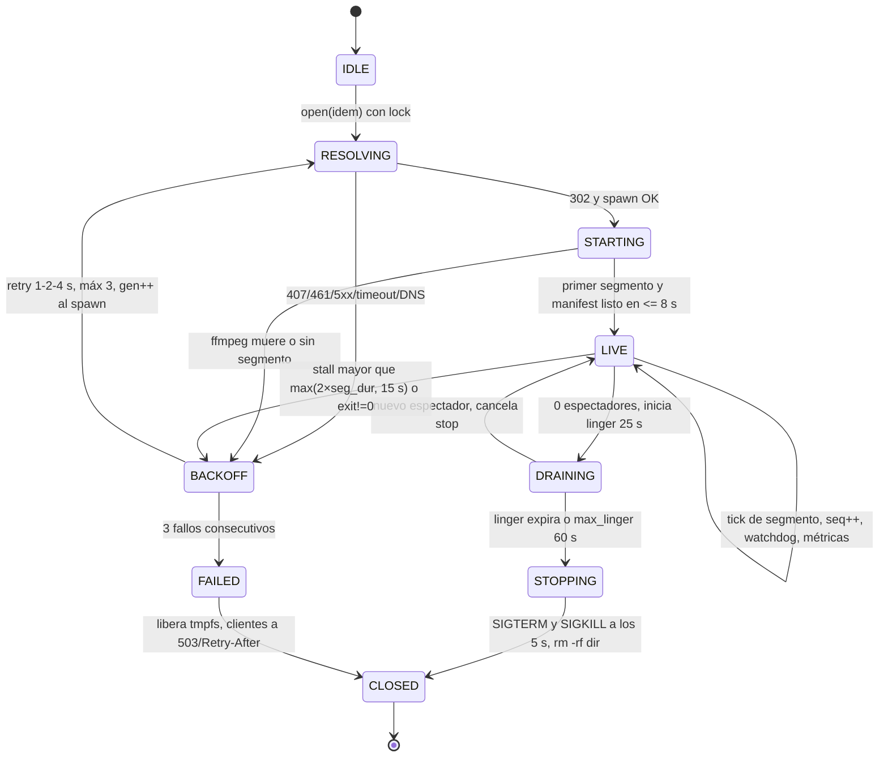

# MEDIA FAN-OUT — Gate de factibilidad medido + diseño de sesión single-flight

> **W1 · t1 · 2026-10-25 (America/Bogota) · VPS `178.156.147.234` (`ubuntu-2gb-ash-1`)**
>
> **Método:** SSH root **solo lectura** sobre producción + escrituras efímeras únicamente en `/tmp`
> y `/dev/shm` (limpiadas al terminar). **No se recargó nginx, no se tocó systemd, no se modificó
> ningún archivo de producción.** Las mediciones del proveedor se hicieron **desde el VPS**, no desde
> el PC, con la cuenta autorizada del propietario; credenciales y tokens **redactados** en todo el
> documento.
>
> **Veredicto corto:**
>
> | Capacidad | Veredicto |
> |---|---|
> | Remux `-c copy` + fan-out single-flight (1 upstream por canal) | **GO** |
> | 2 perfiles/sesión compartiendo la MISMA ingesta (original por defecto) | **GO** (perfil original) |
> | 4K escalado por **transcode CPU** en este VPS | **NO-GO** (medido: x265 0,356× realtime) |
> | 4K escalado por GPU | **NO-GO hoy**: no hay GPU (virtio; VAAPI falla); queda gated para nodo GPU |
> | HDR passthrough si la fuente es HDR | **GO condicionado a probe** (0 HDR en la muestra de 12 canales) |
> | Etiquetar HDR lo escalado/remuxeado | **NO-GO — prohibido** |
> | LL-HLS / latencia < 4 s con remux-only | **NO-GO global** (GOP de fuente 1–10 s según canal) |

---

## 0. Resumen ejecutivo

1. El VPS es un **KVM de 3 vCPU AMD EPYC-Rome @2,0 GHz, 3 819 MiB RAM, sin GPU de códec**
   (el `/dev/dri` presente es un `Virtio 1.0 GPU`; VAAPI no inicializa). ffmpeg 6.1.1 trae
   encoders de hardware *compilados* (nvenc/qsv/vaapi), pero **no hay hardware detrás**: no
   debe confundirse "encoder disponible en ffmpeg" con "GPU presente".
2. **Remux es baratísimo y cabe de sobra:** 1,08 % de un core por sesión (0,65 s CPU por 60 s de
   contenido), ~65 MiB RSS, ~5 Mbps de egress por espectador. El límite real no es CPU: es
   **memoria/tmpfs y ancho de banda de salida**.
3. **Transcode 4K en tiempo real no cabe, con números:** libx265 1080p→2160p `ultrafast` rinde
   **8,9 fps = 0,356×** y consume **7,6 core·s por segundo de contenido**; con 3 vCPU el techo
   físico es **0,39×**. Incluso libx264 4K (1,5 core·s/s, 8 bits) deja el host sin headroom y
   degrada calidad. **NO-GO.**
4. **Proveedor medido:** `302` con ticket en `Location` para UA de player; **`461` para el UA por
   defecto de curl**; **`509` = ticket caducado/usado fuera de TTL** (no se reprodujo como rechazo
   de segunda conexión: 5 sesiones concurrentes fueron aceptadas); **`407`** al usar un ticket en
   un host CDN distinto del que lo emitió. El ticket vive **30–60 s** y se **refresca al volver a
   pedir el playlist**; hay que refrescar ≤ 20–25 s y **pinnear el host CDN**.
5. **La fuente no es 4K ni HDR en la muestra:** 12/12 canales (incluidos 6 etiquetados "4K")
   son **1920x1080, SDR, 8 bits** (11 AVC + 1 HEVC Main). El "4K" del catálogo es **upscale**,
   no fuente. Por eso el perfil 4K es opcional y el HDR solo puede passthrough si un probe lo
   demuestra.
6. **Diseño:** coordinador nginx/ngx_http_lua (sin OpenResty, sin `lua-resty-lock/http`) que
   mantiene el registro de sesiones en `shared dict` y habla con un **supervisor** por Unix socket;
   el supervisor es la autoridad de lifecycle y spawnea **un ffmpeg remux por canal**; ventana
   deslizante en tmpfs; fencing por **generación**; TTL linger; límites duros. Todo validable en
   `_vps_stage` en W2.

---

## 1. Hardware real medido

Comandos: `nproc`, `lscpu`, `free -m`, `swapon --show`, `df -hT`, `mount`, `ls -l /dev/dri`,
`lspci`, `nvidia-smi`, `vainfo`, `ffmpeg -version`, `ffmpeg -encoders/-decoders/-hwaccels`.

| Recurso | Medido | Nota |
|---|---|---|
| vCPU | **3** × AMD EPYC-Rome @ 2,0 GHz, 1 thread/core, KVM full | flags AVX2; **sin AVX-512** |
| RAM | **3 819 MiB** total; 797–824 MiB usados; **~2 995 MiB disponibles**; buff/cache 2 650–2 698 MiB | base medida en reposo |
| Swap | 2 047 MiB (`/swapfile`), 34–99 MiB usados | **tmpfs no es swappable** |
| Disco | `/dev/sda1` ext4 **38 G**, 24 G usados, **13 G libres (66 %)** | suficiente para logs, no para ventanas |
| `/dev/shm` | **1,9 GiB** tmpfs (`size=50 % RAM` por defecto), 36 KiB usados, 1 % | montaje `rw,nosuid,nodev,inode64` |
| `/run` | 391 MiB tmpfs | demasiado pequeño para la ventana; ver diseño §6 |
| GPU | **Red Hat Virtio 1.0 GPU** (`/dev/dri/card0`, `renderD128`); **sin `nvidia-smi`, sin `vainfo`** | **no hay motor de códec** |
| VAAPI | `libva: .../virtio_gpu_drv_video.so init failed` → `resource allocation failed` → `Device creation failed: -5` | **NO-GO hardware** |
| Kernel / systemd | 6.8.0-124-generic / **systemd 255**, cgroup v2 (`cpuset cpu io memory hugetlb pids rdma misc`) | soporta `MemoryMax`, `CPUQuota`, `WatchdogSec` |
| Límites | `ulimit -n` 1 048 576; `file-max` 2 097 152; `somaxconn` 65 535; `pid_max` 4 194 304; `nf_conntrack_max` 65 536; puertos efímeros 10240–65535 | holgado para el diseño |
| Red | `eth0` virtio, `speed=-1` (no reporta); ruta default con `initcwnd 400 initrwnd 400`; `wg0` 10.200.0.1/24, `advmss 1340` | plan Hetzner CPX21 = 1 Gbit/s nominal (compartido) |
| tmpfs write | 256 MiB en 0,0807 s = **3,3 GB/s** | el cuello no es la escritura |
| nginx loopback TLS | 28 326 917 B en 0,0802 s = **353 MB/s** (gzip on; loopback) | mide CPU de nginx, no NIC |

### 1.1 ffmpeg / códecs

| Elemento | Medido |
|---|---|
| ffmpeg / ffprobe | **6.1.1-3ubuntu5** (libavutil 58.29.100, libavcodec 60.31.102) |
| Encoders SW | `libx264`, `libx265`, `libsvtav1`, `libaom-av1`, `libvpx*` |
| Encoders HW *compilados* | `h264_vaapi`, `hevc_vaapi`, `av1_vaapi`, `h264_qsv`, `hevc_qsv`, `av1_qsv`, `h264_nvenc`, `hevc_nvenc`, `av1_nvenc` |
| Decoders HW *compilados* | `h264_qsv/hevc_qsv`, `h264_cuvid/hevc_cuvid`, `*_v4l2m2m` |
| `-hwaccels` | vdpau, cuda, vaapi, qsv, drm, opencl, vulkan |
| **Hardware real para usar esos encoders** | **ninguno**: VAAPI falla con el virtio GPU; no hay NVENC/QSV; `vainfo` ausente |

> **Trampa documentada:** `ffmpeg -encoders` mostrando `hevc_nvenc` **no** significa que exista
> NVENC. En este host cualquier intento `-c:v hevc_vaapi` muere en `init_hw_device`. El diseño
> §6 gatea el perfil 4K por una **prueba de encode real** (no por la lista de encoders).

---

## 2. Stack de coordinación disponible (medido)

| Componente | Medido | Implicación de diseño |
|---|---|---|
| nginx | **1.24.0 (Ubuntu)** | no es OpenResty; `nginx -V` sin `--add-module` custom |
| ngx_http_lua | **0.10.26-2** (`libnginx-mod-http-lua`), cargado vía `modules-enabled/50-mod-http-lua.conf` | hay `ngx.shared.DICT`, `ngx.timer`, cosockets, `ngx.sleep` |
| lua-resty-core / lrucache | 0.1.28 / 0.13 | OK para FFI/caché |
| **lua-resty-http / lua-resty-lock** | **AUSENTES** | **no** usar `resty.http` ni `resty.lock`; single-flight con `dict:add` + supervisor como autoridad |
| Shared dicts ya en uso | `circuit_metrics 10m`, `lab_config 1m`, `ape_flags 1m`, `ape_qoe 1m`, `ape_hosts 1m` | añadir `mf_sessions/mf_locks/mf_stats` con nombre propio (sin colisión) |
| Redis | 7.0.15 **up**, 944 KB usados, `maxmemory=0`, `DBSIZE=0` | **opcional** para persistir fencing/estado; no dependencia dura |
| nginx workers | **3** (RSS 14–20 MiB) | `worker_connections 20000` → 60 k conexiones |
| `limit_conn` existente | `limit_conn_zone $xtream_account zone=xtream_slot:10m` (prod) | el coordinador **no debe** pelearse con el shield; usar zona propia |
| `systemd` | 255 | `Type=notify` + `WatchdogSec`, `MemoryMax`, `CPUQuota`, `RuntimeDirectory` |
| DNS en el VPS | `line.tivi-ott.net` → CNAME `xox.dia-zo.top` → **89.37.116.214** (proveedor real) | desde el VPS **no** aplica el hijack de los dispositivos |

> **Consecuencia:** el coordinador se implementa con **ngx_http_lua puro** (sin resty-lock/http)
> y un **supervisor local** (proceso systemd) que es la única autoridad de lifecycle. Lua nunca
> hace `fork/exec` de ffmpeg ni procesa video.

---

## 3. Comportamiento del proveedor medido desde el VPS

Host: `line.tivi-ott.net` (cuenta del propietario, **credenciales y tokens redactados**).
Cuenta: `auth=1`, `status=Active`, `is_trial=0`, `exp_date=1795053126` = **2026-11-19 01:52:06 UTC**,
`max_connections=1`, `active_cons=0` en reposo, formatos `m3u8,ts,rtmp`.

### 3.1 Matriz de respuestas (medido)

| Petición | UA / condición | Resultado medido |
|---|---|---|
| `GET /live/<u>/<p>/<id>.m3u8` | `VLC/3.0.20 LibVLC/3.0.20` | **302 Found**, TTFB **382 ms**, `Location: http://<cdn>:80/live/play/<token>/<id>` |
| misma, UA por defecto de curl | `curl/8.x` | **461** (sin reason phrase), TTFB 338 ms, cuerpo vacío |
| misma, UA vacío | `User-Agent:` (borrado) | **302** |
| misma, UA `okhttp/4.12.0`, `Lavf/60.16.100`, `ffmpeg`, `Mozilla/5.0` | — | **302** |
| misma, segundo `GET` con ticket fresco | — | **200** con playlist (6 segmentos) |
| mismo ticket usado en **otro host CDN** | 7 hosts (1 emisor + 6 ajenos) | **407 Proxy Authentication Required** en los 6 ajenos; **200** solo en el host emisor |
| ticket sin uso durante **65 s** | — | **509** |
| ticket usado a edad **0 s / 30 s** | — | **200** |
| ticket usado a edad **60 / 90 / 120 / 150 s** (un solo uso por ticket) | — | **509** |
| mismo ticket reusado cada ≤ 30 s durante 120 s | — | **200** (refresco deslizante) |
| **5 sesiones ffmpeg concurrentes** (5 canales, 8 s) | VLC UA | **las 5 exit 0, 0 errores HTTP; `active_cons` = 1** |
| **2 sesiones ffmpeg concurrentes mismo canal** (20 s) | VLC UA | **ambas 200**, sin 509 |
| 4 `GET` paralelos de `.ts` | VLC UA | **302** los 4 |
| canal `1198` | VLC UA | **405** (canal caído/movido; no confundir con 461/509) |

Cabeceras representativas (redactadas):

```
# 302 (ticket emitido)
HTTP/1.1 302 Found
Server: CDN PROXY SERVICE
Location: http://<cdn-a>:80/live/play/<TOKEN-80-B64>/<id>
Pragma: public
Cache-Control: public, must-revalidate, proxy-revalidate

# 461 (UA no permitido)
HTTP/1.1 461
Server: CDN PROXY SERVICE
Content-Type: text/html; charset=UTF-8
Transfer-Encoding: chunked
Connection: keep-alive

# 509 (ticket caducado)
HTTP/1.1 509
Date: ...
Content-Type: text/html; charset=UTF-8
Connection: close

# 407 (ticket usado en CDN ajeno)
HTTP/1.1 407 Proxy Authentication Required
Date: ...
Content-Type: text/html; charset=UTF-8
Connection: close
```

### 3.2 Semántica real de los códigos (medida, no supuesta)

| Código | Qué significa **realmente** según la medición |
|---|---|
| **302** | El proveedor emite un **ticket opaco** (80 chars base64 → 32 bytes binarios, sin timestamp legible) y redirige al CDN (`/live/play/<token>/<id>`). |
| **461** | **UA blacklist**: se dispara con el UA por defecto `curl/…`; **no** con UA vacío, ffmpeg (`Lavf`), okhttp, VLC ni navegador. Regla: el worker debe usar UA de player. |
| **509** | **Ticket inválido/caducado** (o reutilizado fuera del TTL). **No** se comportó como "segunda conexión": 5 sesiones concurrentes fueron aceptadas de forma sostenida 8 s. **No se probó > 60 s para no abusar del plan `max_connections=1`.** |
| **407** | Ticket **válido solo en el host CDN que lo emitió**. Usarlo en otro CDN = `407`. |
| **405** | Canal no disponible en ese nodo (p. ej. 1198). |

> **Lectura operativa:** el `max_connections=1` del panel **no está siendo enforcing de forma fiable
> en la capa CDN** para HLS en ventanas cortas. Eso **no** autoriza a abrir más conexiones: el
> contrato del plan es 1, y la prueba crítica del proyecto exige exactamente 1. El coordinador
> **debe** garantizar single-flight por diseño, no confiar en el 509 del proveedor.

### 3.3 Playlist y segmentos (medido)

| Propiedad | Valor medido |
|---|---|
| `#EXT-X-TARGETDURATION` | 10–12 s |
| Segmentos listados | 6 |
| URI de segmento | relativa: `/hls/<md5-32hex>/<id>_<seq>.ts` (host = host CDN del ticket) |
| `Content-Type` segmento | `video/mp2t`, primer byte `0x47` (TS sync) |
| Tamaño segmento (~10 s) | 1,2 MB – 9,25 MB |
| Bitrate de canal (muestra) | 0,99 – **7,64 Mbps**; media ≈ 5 Mbps |
| GOP / keyframes | **varía por canal**: ~0,96 s (ch3), ~1,2 s (ch47), 5 s (ch894968), ≥10 s (ch701) |

### 3.4 TTL del ticket — modelo medido

- Ticket **con TTL corto**: válido a los **30 s**, muerto a los **60 s** → TTL nominal **30–60 s**.
- Reuso **cada ≤30 s**: sigue vivo a los **120 s** → **cada `GET` exitoso del playlist refresca el TTL**.
- Inactividad **65 s**: **509**.
- **Conclusión:** refrescar/renovar cada **≤20–25 s** (margen 2×). El demuxer HLS de ffmpeg
  reabre el playlist periódicamente y renueva el ticket solo; aun así, el supervisor debe
  detectar 407/509 y re-resolver.

---

## 4. La fuente real: 12 canales muestreados

Primer segmento de cada canal, `ffprobe` del stream de video:

| id | Nombre | Códec | Perfil | Resolución | pix_fmt | transfer / primaries | fps | Mbps |
|---:|---|---|---|---|---|---|---|---:|
| 47 | KLAN MACEDONIA **4K** | h264 | High | **1920x1080** | yuv420p | bt709 / bt709 | 25 | 6,91–7,64 |
| 701 | TRT SPOR **4K** | h264 | Main | **1920x1080** | yuv420p | unknown / unknown | 25 | 1,72 |
| 702 | A SPOR **4K** | **hevc** | **Main (8 bit)** | **1920x1080** | yuv420p | bt709 / bt709 | 25 | 2,71 |
| 707 | EUROSPORT 2 **4K** | h264 | High | **1920x1080** | yuv420p | bt709 / bt709 | 25 | 0,99 |
| 708 | EUROSPORT 1 **4K** | h264 | High | **1920x1080** | yuv420p | bt709 / bt709 | 25 | — |
| 711 | S SPORT 2 **4K** | h264 | Main | **1920x1080** | yuv420p | unknown / unknown | 25 | — |
| 3 | TOP CHANNEL FHD | h264 | High | 1920x1080 | yuv420p | bt709 / bt709 | 50 | 3,78 |
| 5 | TOP CHANNEL HD | h264 | High | 1920x1080 | yuv420p | unknown / unknown | — | — |
| 6 | VIZION PLUS FHD | h264 | Main | 1920x1080 | yuv420p | unknown / bt709 | — | — |
| 9 | KLAN TV FHD | h264 | High | 1920x1080 | yuv420p | bt709 / bt709 | — | — |
| 12 | KLAN KOSOVA FHD | h264 | Main | 1920x1080 | yuv420p | unknown / unknown | — | — |
| 15 | KTV KOHAVISION FHD | h264 | Main | 1920x1080 | yuv420p | bt709 / bt709 | — | — |

**Hallazgos duros:**

1. **Ningún canal muestreado es 4K real.** Los 6 canales etiquetados "4K" son 1080p.
2. **Ningún canal muestreado es HDR ni 10-bit.** `color_transfer` es `bt709` o `unknown`
   (no `smpte2084`, no `arib-std-b67`); `pix_fmt=yuv420p` (8 bit).
3. Predomina **AVC**; un solo **HEVC Main 8-bit** (702). No hay Main10/HDR/DV en la muestra.
4. El "perfil 4K" del sistema, por tanto, **es upscale 1080p→2160p = transcode** (no remux)
   en todos los casos muestreados. Y **no puede etiquetarse HDR** (no hay HDR que preservar).

> Muestra: 12 canales de 23 510 del catálogo actual (la lista viva solo contiene URLs
> `line.tivi-ott.net`). Es una muestra, no un censo; por eso la política HDR se decide **por
> probe en cada sesión**, no por lista.

---

## 5. Matemática de capacidad (números medidos)

### 5.1 Remux `-c copy` — medición por sesión

Comando representativo (idéntico al del worker salvo rutas):

```bash
ffmpeg -hide_banner -nostdin -loglevel warning \
  -user_agent "VLC/3.0.20 LibVLC/3.0.20" -rw_timeout 15000000 \
  -i "http://line.tivi-ott.net/live/<u>/<p>/<id>.m3u8" \
  -map 0:v:0? -map 0:a:0? -c copy \
  -f hls -hls_time 6 -hls_list_size 6 -hls_flags delete_segments \
  -hls_segment_filename "/dev/shm/mf_stage/seg%03d.ts" /dev/shm/mf_stage/ch.m3u8
```

| Medición | Canal 894968 (60 s contenido) | Canal 47 "4K" (20 s) | 3 sesiones concurrentes |
|---|---:|---:|---:|
| CPU user+sys | **0,65 s** (0,29+0,36) | 0,21 s | 0,20+0,17+0,27 = 0,64 s |
| **CPU por segundo de contenido** | **1,08 % de un core** | 1,05 % | 1,07 % total (≈0,36 %/sesión en ventana corta) |
| CPU sobre 3 cores | 0,36 % | 0,35 % | 0,36 % |
| RSS máximo | **66 460 KiB ≈ 65 MiB** | 61 584 KiB | 61,6–73,6 MiB |
| Elapsed (con catch-up) | 32,47 s para 60 s (1,94×) | 2,21 s para 20 s (9×) | 2,0–2,7 s para 20 s |
| Salida de video/audio | 36 672 kB + 938 kB / 60 s | — | — |
| **Bitrate de salida** | **5,01 Mbps** | ~7,6 Mbps | 1,7–7,6 Mbps |
| Bytes retenidos en ventana (6 seg) | 26,5 MB | 9,8 MB | 4,0–10,4 MB |

**Fórmulas:**

```
cores_por_sesión_1x   = CPU_user+sys / segundos_de_contenido
                      = 0,65 / 60            = 0,0108 cores   (remux)
cores_para_N_sesiones = N × 0,0108 × (1 + 0,25 overhead nginx/supervisor)

mem_sesión            = RSS_ffmpeg + bytes_ventana + buffers_nginx
                      = 65 MiB     + 40–70 MiB    + ~4 MiB
                      ≈ 110–140 MiB
```

**Techo por CPU:** `3 cores / 0,0108 = 277 sesiones` teóricas. **La CPU no es el límite.**

### 5.2 Presupuesto de memoria y tmpfs

Datos base: RAM total **3 819 MiB**, disponible **~3 017 MiB**, base de servicios **~800 MiB**.
Reserva de seguridad **400 MiB**. Presupuesto para fan-out ≈ **2 200–2 600 MiB**.

| Concepto | Valor | Fuente |
|---|---:|---|
| ffmpeg remux RSS | 65 MiB | medido |
| Ventana tmpfs (6 seg × 10 s × ~0,7 MB/s) | ~42 MiB | medido por segmentos |
| Ventana tmpfs (8 seg × 10 s, peor caso 7 Mbps) | ~70 MiB | cálculo conservador |
| Buffers nginx por cliente (TCP + salida) | ~0,06 MiB | `output_buffers 2 32k` |
| **Total por sesión (ventana 6 seg)** | **~111 MiB** | 65 + 42 + 4 |
| **Total por sesión (ventana 8 seg)** | **~139 MiB** | 65 + 70 + 4 |

| Límite | Cálculo | Resultado |
|---|---:|---:|
| Sesiones por CPU | 277 × 0,75 (reserva) | **> 200** (no vinculante) |
| Sesiones por memoria (ventana 6 seg) | 2 600 / 111 | **~23** |
| Sesiones por memoria (ventana 8 seg) | 2 600 / 139 | **~18** |
| Sesiones por tmpfs (cap 1,2 GB, 70 MiB/sesión) | 1 200 / 70 | **~17** |
| **Techo seguro simultáneo** | min(18, 17) − margen | **16** |
| **Recomendado producción** | deja ≥ 800 MiB libres | **12** |
| Arranque staging | validación incremental | **6–8** |

### 5.3 Egress (fan-out)

`egress = Σ_sesiones (bitrate_canal × espectadores)`

| Escenario | Cálculo | Mbps | Veredicto (1 Gbit/s nominal) |
|---|---|---:|---|
| 12 sesiones × 5 Mbps, 1 espectador c/u | 12 × 5 | 60 | GO |
| 12 sesiones × 5 Mbps, 10 espectadores c/u | 120 × 5 | 600 | GO (60 % del puerto) |
| 12 sesiones × 5 Mbps, 20 espectadores c/u | 240 × 5 | 1 200 | **NO** (satura) |
| 1 canal 4K real 25 Mbps × 20 | 20 × 25 | 500 | GO (limitado por fuente/CPU) |
| 4K real 25 Mbps × 40 | 40 × 25 | 1 000 | **NO** (borde del puerto) |

**Recomendación:** `MAX_TOTAL_VIEWERS = 120` (deja 30–40 % de margen para picos y para el
tráfico de control). `MAX_VIEWERS_PER_SESSION = 24`.

### 5.4 Transcode 4K en tiempo real — por qué NO cabe (cifras)

Fórmula: `cores_por_stream_1x = (user+sys) / segundos_de_contenido`.
Disponible: **3 cores**, con reserva 30 % → **2,1 cores útiles**.

| Prueba | fps | speed | CPU % | core·s / s contenido | Cores para 1× | Techo en 3 vCPU | RSS |
|---|---:|---:|---:|---:|---:|---:|---:|
| **x265 1080p→2160p**, `ultrafast`, 3 thr (contenido real) | **8,9** | **0,356×** | 269 % | **7,61** | 7,6 | **0,39×** | 542 MiB |
| x265 2160p30 sintético, `ultrafast` | 12 | 0,412× | 264 % | **6,42** | 6,4 | 0,47× | 480 MiB |
| x265 2160p30 sintético, `medium` | 5,9 | 0,194× | 245 % | **12,62** | 12,6 | 0,24× | 572 MiB |
| **x264 1080p→2160p**, `ultrafast` (real) | 39 | 1,56× | 230 % | **1,50** | 1,5 | 2,0× (1 stream) | 243 MiB |
| x264 2160p30 sintético, `ultrafast` | 68 | 2,26× | 204 % | 0,92 | 0,9 | 3,3× | 181 MiB |
| **remux `-c copy`** (referencia) | ~997× | — | 103 % | **0,0108** | 0,01 | >200 | 61 MiB |

**Lectura numérica:**

- Un solo stream 4K HEVC en tiempo real exige **7,6 cores** (contenido real); el VPS tiene **3**.
  Máximo alcanzable: `3 / 7,61 = 0,394×`. Es decir, **5 s de video consumen 5 × 7,61 ≈ 38 s de
  CPU**: a 3 cores eso son **12,7 s de pared por cada 5 s de video**; el buffer crece sin límite
  y el directo se retrasa hasta romper. **NO-GO.**
- Incluso x264 4K `ultrafast` (8 bits, calidad pobre): 1× consume **1,5 cores = 50 % del host**;
  dos streams = **100 %**, sin CPU para nginx/ingesta/supervisor. Y `ultrafast` a 4K no mejora
  la imagen frente al AI-SR del dispositivo. **NO-GO como producto.**
- La memoria también rompe: 542 MiB (x265) o 243 MiB (x264) por sesión; 2 sesiones x265 =
  1 084 MiB solo de encoder, más ventanas tmpfs. **NO-GO.**
- **No hay GPU**: VAAPI no inicializa (virtio), no hay `nvidia-smi`/`vainfo`. Cualquier promesa
  de 4K por hardware en este host es falsa.

### 5.5 Sobre LL-HLS / latencia

- El GOP de la fuente **no es uniforme**: ~1 s (ch3), 1,2 s (ch47), 5 s (ch894968), ≥10 s (ch701).
- Con `-c copy` **no se puede acortar el GOP**; los segmentos quedan limitados por keyframes.
  Para canales con GOP 10 s, el segmento mínimo realista es 10 s → latencia G2G ≈ 15–25 s.
- Para canales con GOP ~1 s sí se pueden hacer segmentos de 2–4 s → latencia G2G ≈ 6–10 s.
- **LL-HLS real (partes < 1 s) no es alcanzable con remux-only de forma general**; requiere
  GOP corto en origen (no controlable) o transcode (NO-GO). No prometer < 4 s.

---

## 6. Diseño de sesión single-flight

### 6.1 Componentes

```
player ── HTTPS ──► nginx (ngx_http_lua)  ──►  supervisor (systemd, UDS)
                       │  shared dict              │  spawn/kill, cgroups, watchdog
                       │  - sesiones/estado/gen    │  autoridad de lifecycle
                       │  - lock single-flight     ▼
                       │  - contadores QoE     ffmpeg remux (1 por canal)
                       │                            │  -c copy
                       └── sirve segmentos ◄── tmpfs /run/mediafanout/<idem>/<gen>/
                           (sendfile)              index.m3u8 + segNNNNN.ts
```

- **nginx/ngx_http_lua**: atiende manifests y segmentos, registra espectadores, aplica fencing,
  métricas. **NO procesa video, no hace fork, no bloquea** (pcall en todo; fase access solo
  con lookups en dict + UDS con timeout 200 ms).
- **supervisor** (`mf-supervisor.service`, `Type=notify`): idempotencia, generaciones, spawn de
  ffmpeg en cgroup propio, watchdog de progreso, watermarks de tmpfs, backoff. Es la **fuente de
  verdad**; el shared dict es caché reconstruible.
- **ffmpeg worker** (`mf-<idem>.scope`): un proceso por canal, `-c copy`, HLS a tmpfs.
- **tmpfs** dedicado: `run-mediafanout.mount` (`/run/mediafanout`, `size=1200M`, `mode=0750`,
  `uid=mediafanout`, `gid=www-data`). No usar `/dev/shm` global (compartido con nginx_cache y otros).

### 6.2 Clave de idempotencia (proveedor + canal)

```
idem      = normalize(provider_id) || "|" || normalize(channel_id)
provider_id = host canónico del proveedor, sin scheme y con puerto solo si no es 80/443
              ej. "line.tivi-ott.net"
channel_id  = id numérico del stream en la URL del proveedor
              ej. "894968"
idem        = "line.tivi-ott.net|894968"
path_key    = sha256(idem)[0:16]          # solo para nombres de directorio/URL
```

**Excluido a propósito** de la clave: usuario/password (rotables), host CDN y token (efímeros),
perfil de salida (original/4K **deben** compartir ingesta), códec/HDR (se detectan), cliente.

Propiedades:
- Dos peticiones simultáneas de cualquier cliente/perfil/códec → **misma** `idem` → **misma**
  sesión y **misma** generación.
- Cambiar de host CDN o renovar token **no** crea sesión nueva (misma `idem`).
- Reinicio del worker **sí** crea generación nueva (misma `idem`), y eso es fencing, no sesión nueva.

### 6.3 Single-flight sin `lua-resty-lock`

`lua-resty-lock` no está instalado; se usa `ngx.shared` + supervisor (autoridad final):

```lua
-- access_by_lua: /mf/<key>/live.m3u8
local dict = ngx.shared.mf_locks
local ok, err = dict:add("sf:" .. idem, 0, 5)   -- TTL 5 s
if ok then
    local resp = call_supervisor("open", {idem = idem, provider = provider_id,
                                          channel = channel_id})  -- UDS, timeout 2 s
    if not resp or resp.state == "FAILED" then
        dict:delete("sf:" .. idem)
        return ngx.exit(503)                    -- Retry-After: 1
    end
    dict:set("sf:" .. idem, resp.gen, 5)
    return serve_manifest(resp)
else
    -- perdedor: esperar estado (máx 2 s, 40 × 50 ms)
    for _ = 1, 40 do
        local st = session_state(idem)          -- dict caché
        if st and (st.state == "LIVE" or st.state == "STARTING") then
            return attach_and_serve(st)
        end
        ngx.sleep(0.05)
    end
    return ngx.exit(503)                        -- Retry-After: 1
end
```

- El supervisor `open` es **idempotente**: si la sesión ya existe en `STARTING/LIVE` devuelve la
  misma generación; si está `DRAINING`, cancela el stop y devuelve la misma generación.
- Si dos workers nginx ganan el lock a la vez (expiración TTL), el supervisor (single-threaded)
  serializa y solo arranca **un** ffmpeg. El lock es una optimización, no la garantía.

### 6.4 Diagrama de estados de la sesión



```
ASCII (para terminal):

  open ──► RESOLVING ──302/spawn──► STARTING ──1er seg──► LIVE ──0 viewers──► DRAINING
             │                        │                    │  ▲                 │
             │407/461/5xx             │exit/stall          │  └─nuevo viewer──┘
             ▼                        ▼                    ▼
          BACKOFF ◄────────────── BACKOFF ◄────────── BACKOFF
             │ retry≤3                 │                    │ linger 25 s
             ▼                         ▼                    ▼
          RESOLVING                 FAILED               STOPPING ──► CLOSED
```

**Fencing por generación:**

- `gen` se incrementa **siempre** que el supervisor arranca un worker (incluye reinicio tras
  crash, reinicio de nginx o del supervisor).
- El manifest lleva `#EXT-X-MF-GEN:<gen>` (tag desconocido para players = ignorado, RFC 8216 §6.3.1).
- Las URLs de segmento llevan `gen` en el path: `/mf/<key>/<gen>/segNNNNN.ts`.
- Si el cliente pide un `gen` viejo: **302** al manifest vivo + `X-MF-Jump-To-Live: 1`; si pide
  un MSN fuera de ventana: **302** al manifest vivo. Nunca se sirve un segmento de una generación
  muerta (evita timestamps saltados y secuencias mezcladas).
- Persistencia: el supervisor guarda `gen` en `/run/mediafanout/state.json` (atomic rename); nginx
  reconstruye el dict desde el supervisor si se reinicia. Redis (presente) es **opcional**.

### 6.5 Ventana deslizante, buffers y jump-to-live

| Parámetro | Valor propuesto | Base |
|---|---|---|
| Segmento objetivo | `max(4 s, GOP_fuente)`; típico 4–10 s | GOP medido 1–10 s; `-c copy` no acorta GOP |
| Segmentos en ventana | **8** | ~48–80 s de historia; cubre jitter de player |
| `-hls_list_size` | 8 | el manifest lista 8; el resto se borra |
| Ventana por sesión (hard) | **80 MiB** | peor caso 8 × 10 s × 7,6 Mbps ≈ 76 MiB |
| `-hls_flags` | `delete_segments+independent_segments` | disco acotado; cortes en keyframe |
| Buffer por cliente | socket TCP + `output_buffers 2 32k` | **no** hay cola ilimitada por cliente |
| Jump-to-live | cliente pide MSN < min(ventana) o `gen` viejo → **302** al live + header | descarte explícito, nunca "buffer infinito" |
| Heartbeat de espectador | key `c:<idem>:<client_id>` con TTL **30 s**, refrescada en cada playlist/segmento | el gauge se recalcula cada 10 s (≤160 keys) |

**Prohibiciones explícitas:** no `hls_list_size 0`, no `-hls_flags append_list`, no ventana sin
`delete_segments`, no acumular segmentos "por si acaso", no `proxy_buffering` sin cota.

### 6.6 Límites estrictos (propuesta cerrada)

| Límite | Valor | Por qué (medido) |
|---|---:|---|
| `MAX_SESSIONS` (producción) | **12** (staging 6–8) | 12 × ~139 MiB ≈ 1,7 GB + base 0,8 GB ≈ 2,5 GB de 3,8 GB |
| `MAX_SESSIONS` (techo duro) | **16** | 16 × ~139 MiB ≈ 2,2 GB + base 0,8 GB ≈ 3,0 GB; deja ~0,7 GB |
| `MAX_VIEWERS_PER_SESSION` | **24** | egress y aislamiento |
| `MAX_TOTAL_VIEWERS` | **120** | 120 × 5,5 Mbps ≈ 660 Mbps < 1 Gbit/s |
| **Conexiones upstream por canal** | **1 (exacto)** | contrato del plan + prueba crítica |
| `MAX_UPSTREAM_CONNECTIONS` total | = sesiones activas | invariante verificable |
| tmpfs high / hard | **1 000 / 1 200 MiB** | RAM y swap |
| Ventana por sesión (hard) | **80 MiB** | peor caso 7,6 Mbps × 80 s |
| `MemoryMax` por ffmpeg | **180 MiB** | RSS medido 65 MiB + margen |
| `CPUQuota` por ffmpeg | **60 %** de un core | remux usa ~1,1 %; el límite solo evita runaway |
| Refresco de token | **≤ 20–25 s** | TTL medido 30–60 s |
| Timeout de resolución 302 | **2 s** | TTFB medido 0,38 s |
| Stall del worker | `max(2×seg_dur, 15 s)` sin segmento nuevo → restart `gen++` | GOP 10 s |
| Retry/backoff | 1 s, 2 s, 4 s; máx 3 → `FAILED` | no martillar al proveedor |
| Linger tras último espectador | **25 s** (máx 60 s) | evita churn de zap |
| Timeout de arranque | **8 s** hasta primer segmento | medido |
| FDs supervisor | `LimitNOFILE=65536` | 12 ffmpeg × ~60 FD |
| Conexiones nginx | `worker_connections 20000` × 3 | ya configurado |

### 6.7 Ciclo de arranque y apagado (systemd / watchdog)

| Unidad | Función | Claves |
|---|---|---|
| `run-mediafanout.mount` | tmpfs 1 200 MiB en `/run/mediafanout` | `mode=0750,uid=mediafanout,gid=www-data` |
| `mf-supervisor.service` | autoridad de sesiones | `Type=notify`, `WatchdogSec=15`, `Restart=on-failure`, `RestartSec=2`, `User=mediafanout`, `Group=www-data`, `NoNewPrivileges=yes`, `ProtectSystem=strict`, `ReadWritePaths=/run/mediafanout /run/mediafanout-state`, `LimitNOFILE=65536`, `TasksMax=512` |
| `mf-<idem>.scope` (transient) | 1 ffmpeg por sesión | `MemoryMax=180M`, `CPUQuota=60%`, `TasksMax=32`, `RuntimeMax` no |
| `nginx.service` | coordinador (Lua) | `lua_shared_dict mf_sessions 16m; mf_locks 4m; mf_stats 4m;` |

- **Watchdog del supervisor** (cada 5 s): `sd_notify(WATCHDOG=1)`; comprueba `kill(pid,0)`,
  mtime del manifest < stall, `gen` actual, RSS del scope, bytes tmpfs, y que
  `upstream_connections == sessions` (invariante single-flight). Si falla: `gen++`, SIGTERM,
  respawn, backoff; tras 3 → `FAILED` + `sd_notify("STATUS=...")`.
- **Watchdog de nginx**: el timer de métricas (5–10 s) detecta sesiones cuyo estado no avanza;
  no reinicia nada por sí solo (el supervisor es la autoridad).
- **Apagado**: `systemctl stop mf-supervisor` → supervisa SIGTERM a hijos, espera 5 s, SIGKILL,
  borra `/run/mediafanout/<idem>`; clientes reciben 503/`Retry-After` y, al volver, `gen++`.

### 6.8 Métricas (shared dict + `/metrics`)

| Métrica | Tipo | Invariante/objetivo |
|---|---|---|
| `mf_sessions_active` | gauge | ≤ MAX_SESSIONS |
| `mf_upstream_connections` | gauge | **== sessions_active** (prueba crítica) |
| `mf_viewers` | gauge | ≤ MAX_TOTAL_VIEWERS |
| `mf_sessions_started_total` | counter | — |
| `mf_sessions_failed_total` | counter | — |
| `mf_segments_served_total` | counter | — |
| `mf_jump_to_live_total` | counter | >0 indica clientes lentos/drops |
| `mf_fence_rejects_total` | counter | mide reinicios/fencing |
| `mf_token_refresh_fail_total` | counter | 407/509 del proveedor |
| `mf_worker_stall_seconds` | gauge | 0 esperado |
| `mf_tmpfs_bytes` | gauge | < high watermark |
| `mf_ffmpeg_rss_bytes` | gauge | < 12 × 180 MiB |

Todo en `lua_shared_dict mf_stats 4m` + snapshot del supervisor; formato Prometheus en
`/_mf/metrics` (solo loopback / allowlist). **No** se toca el observer QoE existente.

### 6.9 Perfil 4K (opcional, gated) y compartición de la MISMA ingesta

- **Default = original/remux.** El perfil 4K solo se activa con `?profile=4k` **y**:
  1. capacidad de dispositivo declarada por el cliente (`?h=2160&hdr=...`),
  2. probe de hardware del supervisor (`GPU_ENCODE=ok`),
  3. medida de encode `≥ 1,5×` realtime en ese host.
- En **este** host `GPU_ENCODE=fail` (VAAPI init failed) → el coordinador responde
  **412 Precondition Failed** con `X-MF-Reason: gpu-unavailable`; no arranca ningún transcode.
- Cuando exista un nodo GPU, la ingesta **sigue siendo una sola conexión**: el worker remux
  original escribe también un **mezzanine local** (`-f tee` hacia FIFO/segmento local); el encoder
  4K lee **ese** mezzanine, nunca el proveedor. Así se cumple "dos perfiles, una ingesta".
- El perfil 4K nunca cambia el `gen` de la sesión base; su salida va a
  `<dir>/4k/<gen>/` y comparte reloj/sequence con el original (alineación por segmento).
- 4K solo publica variante si el encoder demuestra `encode_speed ≥ 1,5×`; si baja de `1,2×`,
  se retira la variante y el player cae al original (degradación, nunca freeze).

---

## 7. Política HDR truthful

**Regla madre:** el HDR se **hereda** de la fuente; **nunca se inventa**. Remuxear no crea HDR.
Escalar no crea HDR. Etiquetar HDR algo SDR es un freeze/color-shift garantizado.

### 7.1 Probe obligatorio en `open()` (por sesión)

```bash
ffprobe -v error -select_streams v:0 -show_streams -of json <primer-segmento>
# parsear: codec_name, profile, width, height, pix_fmt,
#          color_space, color_transfer, color_primaries, side_data_list
```

| Evidencia | Interpretación |
|---|---|
| `color_transfer=smpte2084` + `color_primaries=bt2020` + `pix_fmt` 10-bit | **HDR10 (PQ) real** |
| `color_transfer=arib-std-b67` | **HLG real** |
| side_data con `DOVI configuration record` / RPU | **Dolby Vision real** (solo si el bitstream lo trae) |
| side_data `HDR10+` / SMPTE ST 2094-40 | **HDR10+ real** |
| `bt709`/`unknown`, `yuv420p` 8-bit | **SDR** (lo medido en 12/12 canales de la muestra) |

### 7.2 Reglas de emisión del manifest de sesión

| Fuente | Perfil | ¿HDR en manifest? | Qué se emite |
|---|---|---|---|
| HDR real | **original (remux)** | **SÍ** | `VIDEO-RANGE=PQ` o `HLG`, `COLOR-PRIMARIES=9`, `TRANSFER-CHARACTERISTICS=16` (o 18), `MaxCLL`/`MaxFALL`/mastering **solo si el probe los trae**; `SUPPLEMENTAL-CODECS` **solo** si hay DV real |
| HDR real | 4K scaled (GPU) | **SÍ, solo si** el encoder preserva 10-bit + metadata (validado) | si no se puede preservar → **tone-map a SDR** y etiquetar SDR |
| SDR | original (remux) | **NO** | sin `VIDEO-RANGE`, sin `COLOR-PRIMARIES`, codec real |
| SDR | 4K scaled | **NO** | sin HDR; codec real del encoder; nunca `PQ` |
| cualquiera | upscale/remux | **PROHIBIDO** etiquetar HDR | — |

**Prohibiciones duras en el plano de sesión:**

- `VIDEO-RANGE=PQ/HLG` sin evidencia de fuente HDR.
- `SUPPLEMENTAL-CODECS` inventado (LCEVC/DV falso).
- Declarar un codec/nivel que el decoder no soporta (GOLDEN RULE `hvc1`/`hev1`, Ley Cardinal 1).
- Reutilizar `#EXT-X-APE-*` de "virtual 4K" dentro de este manifest: es hint de presentación del
  generador, **no** verdad de bitstream. Aquí el manifest es honesto por sesión.

> **Nota de convivencia:** el generador mantiene su doctrina `VIDEO-RANGE=PQ` incondicional en la
> lista (decisión del propietario). Este plano de fan-out **no la replica**: cada manifest de
> sesión es truthful. Si el propietario quisiera propagar PQ aquí, sería una decisión explícita
> separada y **contradiría** el requisito "NUNCA etiquetar HDR algo escalado/remuxeado".

---

## 8. Veredicto go/no-go por capacidad

| # | Capacidad | Veredicto | Evidencia numérica / razón |
|---|---|---|---|
| 1 | Remux 1 canal, single-flight, fan-out N clientes | **GO** | 1,08 % core/sesión; 65 MiB; 5 Mbps/viewer |
| 2 | 12 sesiones concurrentes (producción) | **GO** | 12 × ~139 MiB ≈ 1,7 GB; CPU ≈13 % de un core (≈4 % de 3); 60–600 Mbps |
| 3 | 16 sesiones (techo) | **GO con reserva** | ~2,2 GB de sesiones + 0,8 GB base ≈ 3,0 GB; deja ~0,7 GB libres; vigilar tmpfs |
| 4 | 2 perfiles por sesión (original default) | **GO** | comparten `idem`; el perfil 4K no crea segunda ingesta |
| 5 | 4K transcode CPU (x265) | **NO-GO** | 0,356–0,412×; 6,4–7,6 cores por stream vs 3 |
| 6 | 4K transcode CPU (x264 ultrafast) | **NO-GO como producto** | 1,5 core/stream, 8-bit, calidad pobre, sin headroom |
| 7 | 4K por GPU en este VPS | **NO-GO hoy** | virtio GPU; VAAPI init failed; sin NVENC/QSV |
| 8 | 4K por GPU en nodo dedicado | **GO condicionado** | solo con `encode_speed ≥ 1,5×` medido y fallback al original |
| 9 | HDR passthrough si la fuente es HDR | **GO condicionado a probe** | 0 HDR en 12/12 muestreados; el probe decide |
| 10 | HDR en escalado/remuxeado | **NO-GO (prohibido)** | viola "HDR truthful"; riesgo de color shift |
| 11 | 4K real de fuente (si existiera) en remux | **GO** | remux ~1 % CPU; egress 25 Mbps limita a ~40 viewers |
| 12 | LL-HLS < 4 s con remux-only | **NO-GO general** | GOP 1–10 s; segmento mínimo = GOP; G2G 6–25 s |
| 13 | Garantizar 1 sola conexión upstream | **GO (diseño)** | lock + supervisor idempotente + invariante métrica; el proveedor **no** lo garantiza |
| 14 | "Buffer infinito" | **NO-GO (prohibido)** | ventana 8 seg, cap 80 MiB/sesión, jump-to-live |
| 15 | Fencing en reinicios | **GO (diseño)** | `gen++` en cada spawn; 302 al live + `X-MF-Jump-To-Live` |

---

## 9. Riesgos, límites de esta medición y próximos pasos

### 9.1 Riesgos abiertos

1. **El proveedor no enforcing `max_connections=1`** en ventanas cortas (5 sesiones aceptadas).
   Riesgo de que un pico real sí dispare 509/ban. Mitigación: single-flight propio + invariante
   `upstream_connections == sessions`.
2. **TTL de ticket 30–60 s y refresco deslizante**: si ffmpeg se atasca > 60 s sin releer el
   playlist, el ticket muere (509). Mitigación: watchdog de progreso y re-resolución.
3. **Ticket ligado al host CDN** (407 en host ajeno): no balancear entre CDNs con el mismo ticket;
   al fallar, re-emitir ticket (nuevo 302).
4. **GOP heterogéneo** (1–10 s): no se puede prometer latencia uniforme; el manifest debe declarar
   la duración real del segmento.
5. **RAM justa** (3,8 GB; tmpfs no swappable): pasarse de sesiones = OOM killer, no
   degradación. Mitigación: `MAX_SESSIONS=12`, watermarks, `MemoryMax` por scope.
6. **Muestra de 12 canales**: no es censo; puede haber HDR/HEVC Main10 en otros canales. El probe
   por sesión lo cubre.
7. **No se probó concurrencia > 60 s** para no abusar del plan de 1 conexión; el 509 de
   concurrencia no está descartado, solo no reproducido en 8–20 s.

### 9.2 Qué NO se midió (honestidad)

- Fan-out E2E multi-cliente (N clientes → 1 upstream, misma secuencia) — **W2/staging**.
- Fencing real con reinicio de nginx/supervisor — **W2**.
- Throughput de NIC real (`ethtool` no reporta speed en virtio); se asume 1 Gbit/s del plan.
- HDR real (no apareció en la muestra) y Dolby Vision/HDR10+.
- GPU real (no existe en este host).

### 9.3 Plan W2 (staging `_vps_stage`, sin tocar prod)

1. Montar `_vps_stage/mediafanout/` con supervisor + nginx en **:8090** (no tocar :443/:8088 de prod).
2. Implementar el contrato §6 y el harness de concurrencia:
   - `N=50` peticiones simultáneas al mismo `idem` → assert `upstream_connections == 1`;
   - hash de segmentos idéntico para todos los clientes;
   - `EXT-X-MEDIA-SEQUENCE` monótono y sin duplicados;
   - PTS/DTS sin saltos (`ffprobe` sobre ventana);
   - aislamiento (un cliente lento no afecta al resto);
   - fencing: `kill -9` del worker → `gen++` → clientes reciben 302 al live;
   - 509/407: simular ticket caducado/host ajeno → backoff y re-resolución;
   - watermark tmpfs → eviction de `DRAINING`, nunca de `LIVE`.
3. Medir con `ss`/`tcpdump` el conteo real de conexiones al proveedor, no solo el contador interno.
4. Recién entonces, decidir rollout al plano público (fuera de W1).

---

## 10. Evidencia reproducible

Todo lo siguiente se ejecutó **desde el VPS**, con archivos temporales en `/tmp` y `/dev/shm`
(las ventanas de `/dev/shm` se limpiaron; los logs de evidencia quedan en `/tmp`). Resumen
consolidado (sin credenciales ni tickets): **`/tmp/mf_evidence_w1.txt`** en el VPS.

| Evidencia | Archivo/Comando |
|---|---|
| **Resumen consolidado W1** | **`/tmp/mf_evidence_w1.txt`** (hardware, proveedor, remux, transcode, capacidad) |
| Hardware | `nproc; lscpu; free -m; df -hT; mount; ls -l /dev/dri; lspci; ffmpeg -version` |
| Encoders/decoders/hwaccels | `ffmpeg -hide_banner -encoders; -decoders; -hwaccels` |
| VAAPI falla | `ffmpeg -init_hw_device vaapi=va:/dev/dri/renderD128 …` → `virtio_gpu_drv_video.so init failed` |
| Remux 60 s | `/tmp/mf_ff2.log` (`/usr/bin/time -v ffmpeg … -c copy -f hls …`) |
| x265 4K upscale | `/tmp/mf_bench.err` (8,9 fps, 0,356×, 269 %, 542 MiB) |
| x265/x264 4K sintético | `/tmp/mf_x265u.err`, `/tmp/mf_x265m.err`, `/tmp/mf_x264u.err` |
| 3 sesiones concurrentes | `/tmp/mf_c1.err`, `mf_c2.err`, `mf_c3.err` |
| Cuenta proveedor | `/tmp/mf_api.json` (`max_connections=1`, `exp_date=1795053126`) |
| TTL ticket | `/tmp/mf_evidence_w1.txt` §TICKET LIFETIME (200 a 30 s, 509 a 60 s, refresh deslizante) |
| 407 host ajeno | `/tmp/mf_407.hdr` |
| 509 ticket caducado | `curl -D -` a los 65 s → `HTTP/1.1 509`, `Connection: close` |
| GOP por canal | `ffprobe -skip_frame nokey -show_entries frame=pts_time` sobre el primer segmento |
| Loopback nginx | `curl -sk -o /dev/null -w '%{speed_download}' https://127.0.0.1/channels_map.json` |
| tmpfs write | `dd if=/dev/zero of=/dev/shm/… bs=1M count=256` → 3,3 GB/s |

**Repro minima (sin credenciales reales, mismas rutas):**

```bash
# 1) hardware
nproc; free -m; df -h /dev/shm; ls -l /dev/dri; nvidia-smi || true; vainfo || true
ffmpeg -hide_banner -version | head -1
ffmpeg -hide_banner -encoders | grep -Ei 'x264|x265|vaapi|nvenc|qsv' | head -20
ffmpeg -hide_banner -hwaccels
ffmpeg -hide_banner -init_hw_device vaapi=va:/dev/dri/renderD128 \
  -f lavfi -i testsrc2=size=3840x2160:rate=30 -t 2 -c:v hevc_vaapi -f null - 2>&1 | head -5

# 2) proveedor (UA de player; credenciales fuera del doc)
UA='VLC/3.0.20 LibVLC/3.0.20'
curl -sS -o /dev/null -D - -A "$UA" 'http://line.tivi-ott.net/live/<u>/<p>/<id>.m3u8' | head
curl -sS -o /dev/null -w '%{http_code}\n' 'http://line.tivi-ott.net/live/<u>/<p>/<id>.m3u8'   # 461 (curl UA)
# ticket TTL: pedir Location, dormir 65 s, repetir → 509

# 3) remux + CPU
/usr/bin/time -v ffmpeg -hide_banner -nostdin -user_agent "$UA" -rw_timeout 15000000 \
  -i 'http://line.tivi-ott.net/live/<u>/<p>/<id>.m3u8' -t 60 -map 0:v:0? -map 0:a:0? -c copy \
  -f hls -hls_time 6 -hls_list_size 6 -hls_flags delete_segments \
  -hls_segment_filename '/dev/shm/mf_stage/s%03d.ts' /dev/shm/mf_stage/ch.m3u8

# 4) 4K transcode NO cabe (medido)
/usr/bin/time -v ffmpeg -hide_banner -nostdin -threads 3 -i <segmento-1080p>.ts -t 10 -an \
  -vf scale=3840:2160:flags=lanczos -c:v libx265 -preset ultrafast -tune zerolatency -f null -
# → 8,9 fps, 0,356×, 269 % CPU, 542 MiB RSS
```

---

## Apéndice A — Salidas crudas seleccionadas (medidas)

```
# CPU / RAM / shm / disco
nproc = 3
Model name: AMD EPYC-Rome Processor @ 2.0GHz   (KVM, full virt)
Mem: total 3819 MiB, used 797–824, available 2995–3022
Swap: 2047 MiB (/swapfile), used 34–99
/dev/sda1 ext4 38G, 24G used, 13G avail (66%)
tmpfs /dev/shm 1.9G, 36K used
/dev/dri: card0 (226,0), renderD128 (226,128) — Virtio 1.0 GPU
nvidia-smi: ABSENT   vainfo: ABSENT

# VAAPI
[AVHWDeviceContext] libva: /usr/lib/x86_64-linux-gnu/dri/virtio_gpu_drv_video.so init failed
[AVHWDeviceContext] Failed to initialise VAAPI connection: 2 (resource allocation failed).
Device creation failed: -5.

# remux 60 s (ch 894968)
User time 0.29 s · System time 0.36 s · Percent CPU 2% · Elapsed 32.47 s
Maximum resident set size 66,460 KiB
video:36,672kB audio:938kB → 5.01 Mbps · ventana retenida 26.5 MB

# x265 1080p→2160p ultrafast (contenido real)
frame=240 · fps=8.9 · speed=0.356x · CPU 269% · RSS 555,448 KiB · user+sys 72.72 s / 9.56 s

# x265 2160p30 sintético ultrafast
fps=12 · speed=0.412x · CPU 264% · RSS 491,472 KiB

# x265 2160p30 sintético medium
fps=5.9 · speed=0.194x · CPU 245% · RSS 585,956 KiB

# x264 1080p→2160p ultrafast (contenido real)
fps=39 · speed=1.56x · CPU 230% · RSS 248,940 KiB · user+sys 14.34 s / 9.56 s

# proveedor (cuenta)
auth=1 · status=Active · is_trial=0 · max_connections=1 · active_cons=0
exp_date=1795053126 → 2026-11-19 01:52:06 UTC
allowed_output_formats=['m3u8','ts','rtmp']

# UA matrix (4 canales × 5 UAs)
curl default UA → 461 (4/4)
UA vacío · VLC · okhttp · Lavf · Mozilla · ffmpeg → 302

# TTL ticket
t+0s 200 · t+30s 200 · t+60s 509 · t+90s 509 · t+120s 509 · t+150s 509
reuso cada ≤30 s: 200 a los 120 s  (refresco deslizante)
inactividad 65 s → 509

# host binding
ticket en host emisor → 200
ticket en 6 CDNs ajenos → 407 Proxy Authentication Required

# GOP fuente
ch3 ~0.96 s · ch47 ~1.2 s · ch894968 5 s · ch701 ≥10 s

# muestra de canales (12)
todos 1920x1080, yuv420p, SDR; 11×h264 + 1×hevc Main (8-bit)
```

---

**Fin del gate W1.** Siguiente paso: aprobar el diseño §6 y ejecutar W2 en `_vps_stage` con el
harness de concurrencia/fencing antes de exponer nada en producción.
