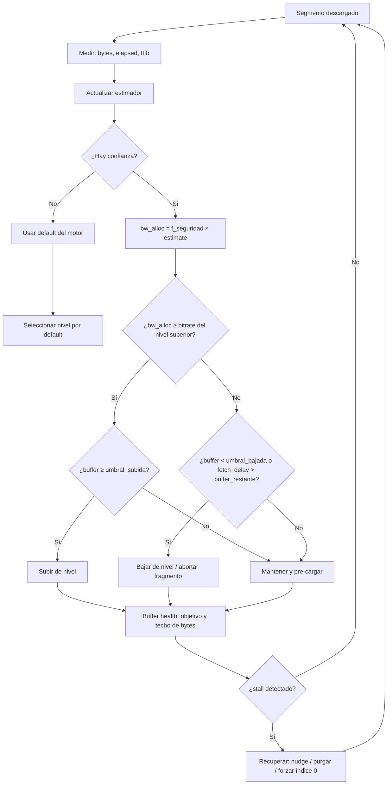

# REA R3 — ABR / buffer / bandwidth internals, motor por motor (con `file:line`)

**Tarea:** `t3` — R3 · ABR/buffer/bandwidth verificado en ExoPlayer/media3, hls.js, Shaka y dash.js + secuencia de decisión.
**Equipo:** `rea-recon` · miembro `player-abr`.
**Intento:** `08541014-9414-4141-8d03-d65322d61adc`.
**Fecha de captura de evidencia:** 2026-10-25 (America/Bogota), sobre el commit `db6ddc7` del repo.
**Entregable:** este documento. **No se modificó código de producción**: R3 es base de conocimiento + mapeo accionable (los cambios propuestos quedan en §8.4, sin aplicar).

---

## 0. Ficha, convención de evidencia y artefactos

### 0.1 Convención de etiquetas (obligatoria en todo el documento)

| Etiqueta | Significado operativo |
|---|---|
| `[observado]` | Leído byte a byte en un archivo local: fuente pineada descargada y hasheada (§Anexo A), este repo, o el APK en disco. La cita `archivo:línea` apunta a esa copia exacta. |
| `[público]` | Documentación/estándar público (RFC 8216, README de proyecto). Se cita la fuente, no se infiere comportamiento. |
| `[no disponible]` | No existe evidencia local ni pública suficiente. Se dice explícitamente y **no se rellena con plausibilidad**. |

Regla adicional de este documento: **una cifra sin `file:line` no se afirma**. Si una cifra del plan de la tarea no coincide con la fuente, se corrige y se marca la corrección (ver §Anexo C).

### 0.2 Versiones pinneadas (todo el documento se refiere a estas)

| Motor | Versión/commit | Por qué esa | Fuente |
|---|---|---|---|
| ExoPlayer **2** | tag `r2.19.1` (última de la línea 2.x) | R1 observó que OTT Navigator 1.7.3.3 trae **ExoPlayer 2**, no media3 (`docs/REA_SCOPE_AND_ARTIFACTS.md:552`) `[observado]` | `github.com/google/ExoPlayer` |
| **media3** (ExoPlayer 3) | tag `1.11.1` (última estable) | es el motor que sí expone `DefaultLoadControl`/`AdaptiveTrackSelection` configurables por app | `github.com/androidx/media` |
| **hls.js** | tag `v1.6.19` | versión fijada por el plan | `github.com/video-dev/hls.js` |
| **Shaka Player** | tag `v5.3.2` | 5.3.x fijado por el plan (última de la serie) | `github.com/shaka-project/shaka-player` |
| **dash.js** | tag `v5.2.1` | 5.x fijado por el plan (última de la serie) | `github.com/Dash-Industry-Forum/dash.js` |

### 0.3 Artefactos usados como evidencia

| Artefacto | Localización | SHA-256 (16 primeros) | Uso |
|---|---|---|---|
| Tarball hls.js v1.6.19 | `%TEMP%\rea_abr\src\hls.js-v1.6.19\` | (árbol de 272 archivos) | §3 |
| Tarball Shaka v5.3.2 | `%TEMP%\rea_abr\src\shaka-v5.3.2\` | (árbol de 2 824 archivos) | §4 |
| Tarball dash.js v5.2.1 | `%TEMP%\rea_abr\src\dashjs-v5.2.1\` | (árbol de 1 072 archivos) | §5 |
| 8 archivos `.java` media3/ExoPlayer2 | `%TEMP%\rea_abr\src\java\` | ver §Anexo A | §2 |
| APK OTT Navigator 1.7.3.3 | `C:\Users\HFRC\Downloads\studio-scillarium-ottnavigator-25110201-….apk` | `b964c27457b43be6…` | §2.8, §9 |
| Nuestro stack | `IPTV_v5.4_MAX_AGGRESSION/frontend/js/ape-v9/…` | ver §Anexo A | §8 |

Los hashes completos y los comandos de re-verificación están en §10 y §Anexo A. La descarga es reproducible: `codeload.github.com/<repo>/tar.gz/refs/tags/<tag>`; el contenido citado es el del tag, no el de `main`.

---

## 1. Resumen ejecutivo

1. **Los cuatro motores no comparten una sola idea de "mediana" o "media".** ExoPlayer usa una **mediana ponderada p50 sobre ventana deslizante** (`SlidingPercentile`, peso `√bytes`, tope `2000`); hls.js, Shaka y dash.js usan **doble EWMA (rápida+lenta) con `min(fast, slow)`**, pero con **half-lives distintos**: hls.js `3/9 s`, Shaka `2/5 s`, dash.js `3/8 s`. `[observado]` §2–§5.
2. **El des-sesgo de arranque es universal en los EWMA**: `estimate / (1 − α^W)`. hls.js `src/utils/ewma.ts:32-40`, Shaka `lib/abr/ewma.js:75-78`, dash.js `ThroughputController.js:371-373`. Omitirlo infravalora las primeras lecturas — es exactamente el bug que nuestro `bw-estimator-v9.js:82-87` ya corrige. `[observado]`
3. **ExoPlayer no tiene histéresis de "tiempo de permanencia" sino de "buffer disponible"**: subir exige `bufferedDuration ≥ minDurationForQualityIncrease` (10 s; o `0.75 × lo que falta al live edge`, lo que sea menor) y **no bajar** si `bufferedDuration ≥ maxDurationForQualityDecrease` (25 s). `media3-1.11.1_AdaptiveTrackSelection.java:318-324, 529-570, 699-715` `[observado]`
4. **media3 y ExoPlayer2 divergen en los tiempos de arranque de buffer**: media3 `bufferForPlayback = 1000 ms` y `afterRebuffer = 2000 ms` (`DefaultLoadControl.java:90,102`), ExoPlayer2 `2500 / 5000 ms` (`DefaultLoadControl.java:59,65`). Ambos con `minBuffer = maxBuffer = 50 000 ms` y `targetBufferBytes = UNSET`. **El plan asumía "1 s/2 s"; eso es cierto para media3 1.11.1 y falso para ExoPlayer2 r2.19.1, que es el que embarca OTT.** `[observado]`
5. **hls.js es el único de los cuatro con detección de stall propia y temporizada**: `detectStallWithCurrentTimeMs = 1250 ms` (`src/config.ts:382`), usada en `gap-controller.ts:281-298`, con `nudgeMaxRetry = 3` y `nudgeOffset = 0.1 s` (`config.ts:384-385`, `gap-controller.ts:640-649`). `[observado]`
6. **hls.js aplica dos factores distintos según la dirección**: `abrBandWidthFactor = 0.95` para mantener/bajar y `abrBandWidthUpFactor = 0.7` para subir (`config.ts:430-431`; uso exacto en `abr-controller.ts:921-932`). Shaka usa una **banda de histéresis** `[item/0.95, next/0.85]` (`player_configuration.js:311-313`, `simple_abr_manager.js:288-315`). dash.js aplica **`bandwidthSafetyFactor = 0.9`** sobre el throughput (`Settings.js:1481`, `ThroughputController.js:425-433`). `[observado]`
7. **dash.js no es un algoritmo: es un sistema de reglas con prioridad.** `ThroughputRule` propone, `InsufficientBufferRule` **limita techo** con `bitrate = safeThroughput × bufferLevel / fragmentDuration` (`InsufficientBufferRule.js:103`, con `throughputSafetyFactor = 0.7`, `Settings.js:1434`), y `AbrController.getOptimalRepresentationForBitrate` materializa la decisión (`AbrController.js:224-241`). `[observado]`
8. **Corrección al plan: Shaka 5.3.2 no tiene `InsufficientBufferRule`.** No existe un archivo/clase equivalente en `lib/abr/` (solo `ewma.js`, `ewma_bandwidth_estimator.js`, `simple_abr_manager.js`). Lo más cercano es `safeMarginSwitch`/`clearBufferSwitch` (`player_configuration.js:340-341`) y el `switch_()` de `simple_abr_manager.js:113-114`. La regla `safeThroughput × buffer / fragmentDuration` es **de dash.js**, no de Shaka. `[observado]`
9. **Hallazgo de máximo impacto para nosotros: los `#EXT-X-SESSION-DATA` que emitimos para ExoPlayer y hls.js son inertes.** Ni media3 1.11.1 ni ExoPlayer2 r2.19.1 parsean `#EXT-X-SESSION-DATA` (solo `#EXT-X-SESSION-KEY`: `HlsPlaylistParser.java:110,493-502` y `:108,369-376`); hls.js sí lo parsea y lo expone (`src/loader/m3u8-parser.ts:165-173`, `src/controller/level-controller.ts:382`) pero **ningún controlador lee un `DATA-ID` llamado `hls.js.config`**. Nuestro `m3u8-typed-arrays-ultimate.js:2989-2992` publica tuning que **no se aplica**. `[observado]` (§8.2, R3-F1/F2)
10. **Dos citas nuestras están mal y una es inventada**: `bw-estimator-v9.js:45` cita `config.ts:427` para `abrEwmaSlowLive` (la línea correcta es **425**; 427 es `abrEwmaSlowVoD`); `ape-profiles-config.js:4590` mapea `X-ABR-Switch-Interval-S ← hlsjs.abrSwitchInterval`, clave que **no existe en hls.js** (`switchInterval` es de Shaka, `player_configuration.js:311`). `[observado]` (§8.2, R3-F3/F4)
11. **Hay cuatro juegos de parámetros ExoPlayer distintos en el repo** (`dynamic-qos-buffer-v9.js:429-435`, `m3u8-typed-arrays-ultimate.js:2989`, `ape-profiles-config.js:32`, `:33`). No hay SSOT; si algún día una app propia leyera uno, los otros tres seguirían mintiendo. `[observado]` (§8.2, R3-F5)
12. **El manifiesto sí tiene palancas reales sobre el ABR, pero son otras**: `BANDWIDTH`/`AVERAGE-BANDWIDTH` honestos (el ABR compara contra ellos), `#EXT-X-BITRATE` por segmento — hls.js lo **parsea y usa** (`src/loader/m3u8-parser.ts:67,521`, `src/loader/fragment.ts:167`, y `src/controller/abr-controller.ts:312` lo consume como tamaño esperado del fragmento) —, duración de segmento estable, `#EXT-X-INDEPENDENT-SEGMENTS`, y `BANDWIDTH` no inflado. `[observado]` (§8.3)
13. **El APK primario (OTT 1.7.3.3) no permite verificación por nombre**: 13 492 clases, **0 coincidencias** para `DefaultBandwidthMeter` (repackaging/obfuscación). Verificar los valores ABR dentro del APK requiere análisis de smali por patrón numérico: **fuera de alcance de R3** y marcado `[no disponible]`. `[observado]` (§9)
14. **Veredicto de la tarea:** base de conocimiento **completa y verificada** para los cuatro motores (con tres correcciones al enunciado: media3 vs ExoPlayer2, Shaka sin `InsufficientBufferRule`, y `min(fast,slow)` con half-lives distintos), **más** nueve hallazgos accionables sobre nuestro stack. Nada de lo afirmado depende de un APK inventado.

---

## 2. ExoPlayer 2 (r2.19.1) y media3 (1.11.1)

> Por qué los dos: el plan pide "ExoPlayer/media3" y R1 demostró que **OTT Navigator 1.7.3.3 embarca ExoPlayer 2** (`docs/REA_SCOPE_AND_ARTIFACTS.md:552`) `[observado]`. Citar solo media3 sería citar un motor que nuestro player real no ejecuta.

### 2.1 `DefaultBandwidthMeter` — mediana ponderada, no media

**Constantes (idénticas en ambas líneas, salvo donde se indica):**

| Constante | Valor | media3 1.11.1 | ExoPlayer2 r2.19.1 |
|---|---|---|---|
| `DEFAULT_INITIAL_BITRATE_ESTIMATES_WIFI` | `4.3, 3.2, 2.4, 1.7, 0.86 Mbps` | `:57-58` | `:51-52` |
| `DEFAULT_INITIAL_BITRATE_ESTIMATES_2G` | `1.5, 0.98, 0.75, 0.52, 0.29 Mbps` | `:61-62` | `:55-56` |
| `DEFAULT_INITIAL_BITRATE_ESTIMATES_3G` | `2.0, 1.3, 1.0, 0.86, 0.61 Mbps` | `:65-66` | `:59-60` |
| `DEFAULT_INITIAL_BITRATE_ESTIMATES_4G` | `2.5, 1.7, 1.2, 0.97, 0.68 Mbps` | `:69-70` | `:63-64` |
| `DEFAULT_INITIAL_BITRATE_ESTIMATES_5G_NSA` | `4.7, 2.8, 2.1, 1.7, 0.98 Mbps` | `:73-74` | `:67-68` |
| `DEFAULT_INITIAL_BITRATE_ESTIMATES_5G_SA` | `2.7, 2.0, 1.6, 1.3, 1.0 Mbps` | `:77-78` | `:71-72` |
| `DEFAULT_INITIAL_BITRATE_ESTIMATE` | **`1_000_000` (1 Mbps)** | `:84` | `:78` |
| `DEFAULT_SLIDING_WINDOW_MAX_WEIGHT` | **`2000`** | `:87` | `:81` |
| `ELAPSED_MILLIS_FOR_ESTIMATE` | `2000 ms` (privada) | `:311` | `:279` |
| `BYTES_TRANSFERRED_FOR_ESTIMATE` | `512 * 1024` bytes | `:312` | `:280` |

**El muestreo (media3 `DefaultBandwidthMeter.java:438-460`)** `[observado]`:

```java
// media3-1.11.1_DefaultBandwidthMeter.java:448-455
if (sampleElapsedTimeMs > 0) {
  float bitsPerSecond = (sampleBytesTransferred * 8000f) / sampleElapsedTimeMs;
  slidingPercentile.addSample((int) Math.sqrt(sampleBytesTransferred), bitsPerSecond);
  if (totalElapsedTimeMs >= ELAPSED_MILLIS_FOR_ESTIMATE
      || totalBytesTransferred >= BYTES_TRANSFERRED_FOR_ESTIMATE) {
    bitrateEstimate = (long) slidingPercentile.getPercentile(0.5f);
  }
  ...
}
```

Tres consecuencias que importan para nosotros:

1. **Peso = `√bytes`** (`:450`). Un segmento de 1 MB pesa ~1000; uno de 100 kB pesa ~316. Es una ponderación *sublineal*: los segmentos grandes pesan más, pero no proporcionalmente. `[observado]`
2. **La estimación solo se actualiza si `Σtiempo ≥ 2 s` o `Σbytes ≥ 512 KiB`** (`:451-453`). Es decir: **los primeros ~2 s de descarga no producen estimación**. En un zap rápido a un canal 4K, el primer fragmento puede no alcanzar a mover la estimación. `[observado]`
3. **`p50`, no `p95`** (`:453`). Es deliberadamente conservador contra outliers *por diseño* (el propio javadoc de `SlidingPercentile` lo dice: las medias y los EWMA "sufren de susceptibilidad a outliers y de adaptación lenta a escalones", `SlidingPercentile.java:29-31`). `[observado]`

**Tabla país × RAT.** Ambas implementaciones resuelven un `int` empaquetado por grupos de 3 bits (`COUNTRY_GROUP_SHIFT_2G..5G_SA` = 3/6/9/12/15, `COUNTRY_GROUP_INDEX_MASK = 0x7` en `media3:93-120`), y eligen el valor de la lista correspondiente al índice de grupo del país (`media3:535-560`). La tabla completa es un método generado (`getInitialBitrateCountryGroupAssignment`, `media3:570`), de cientos de líneas.

Para nuestro mercado (Colombia) `[observado]`:

```java
// exo2-r2.19.1_DefaultBandwidthMeter.java:522-523
case "CO":
  return new int[] {2, 3, 4, 2, 2, 2};   // {wifi, 2G, 3G, 4G, 5G-NSA, 5G-SA}
```

Es decir, para un dispositivo en Colombia con WiFi: grupo índice 2 → `DEFAULT_INITIAL_BITRATE_ESTIMATES_WIFI[2] = 2.4 Mbps` de estimación inicial. En 4G: grupo 2 → `1.2 Mbps`. `[observado]` (tabla) + aritmética explícita.

> **Implicación operativa [derivada de lo observado]:** cualquier player ExoPlayer que arranque en frío en Colombia asume **2.4 Mbps** (WiFi) hasta tener 2 s/512 KiB de muestra. Si nuestro manifiesto declara una variante top de 22 Mbps como primera entrada de la lista, el player **igual arranca abajo** y sube cuando la mediana lo autorice. Por eso el orden de variantes y el `BANDWIDTH` declarado importan más que cualquier header nuestro.

### 2.2 `SlidingPercentile` — el algoritmo de la ventana

`media3-1.11.1_SlidingPercentile.java` (158 líneas) `[observado]`:

- `addSample(weight, value)` (`:88-113`): inserta y, **mientras `totalWeight > maxWeight`**, recorta del **más antiguo**: si su peso ≤ excedente lo elimina (`:102-107`); si no, **le resta el excedente al peso** (`:108-111`). Consecuencia: el peso total se mantiene **constante e igual a `maxWeight` en régimen** (javadoc `:24-27`).
- `getPercentile(p)` (`:121-134`): ordena por valor y acumula peso hasta `p × totalWeight`; devuelve el valor del primer sample que cruza. Es una **mediana por integración de pesos**, no una media.
- Con `maxWeight = 2000` y peso `√bytes`, la ventana efectiva es de pocos cientos de samples: un segmento 4K de 5 MB pesa `√5e6 ≈ 2236` → **un solo segmento puede llenar la ventana entera**. `[derivado]`

### 2.3 `AdaptiveTrackSelection` — la decisión de nivel

**Constantes** (`media3-1.11.1_AdaptiveTrackSelection.java:318-326`) `[observado]`:

| Constante | Valor | Línea |
|---|---|---|
| `DEFAULT_MIN_DURATION_FOR_QUALITY_INCREASE_MS` | `10_000` | `:318` |
| `DEFAULT_MAX_DURATION_FOR_QUALITY_DECREASE_MS` | `25_000` | `:319` |
| `DEFAULT_MIN_DURATION_TO_RETAIN_AFTER_DISCARD_MS` | `25_000` | `:320` |
| `DEFAULT_MAX_WIDTH_TO_DISCARD` / `HEIGHT` | `1279` / `719` | `:321-322` |
| `DEFAULT_BANDWIDTH_FRACTION` | **`0.7f`** | `:323` |
| `DEFAULT_BUFFERED_FRACTION_TO_LIVE_EDGE_FOR_QUALITY_INCREASE` | **`0.75f`** | `:324` |

**Presupuesto de ancho de banda con TTFB** (`:774-784`) — esta es la parte que casi nadie cita y es la que explica por qué un player "no sube" en un CDN con TTFB alto `[observado]`:

```java
// media3-1.11.1_AdaptiveTrackSelection.java:774-783
private long getTotalAllocatableBandwidth(long chunkDurationUs) {
  latestBitrateEstimate = bandwidthMeter.getBitrateEstimate();
  long cautiousBandwidthEstimate = (long) (latestBitrateEstimate * bandwidthFraction);
  long timeToFirstByteEstimateUs = bandwidthMeter.getTimeToFirstByteEstimateUs();
  if (timeToFirstByteEstimateUs == C.TIME_UNSET || chunkDurationUs == C.TIME_UNSET) {
    return (long) (cautiousBandwidthEstimate / playbackSpeed);
  }
  float availableTimeToLoadUs =
      max(chunkDurationUs / playbackSpeed - timeToFirstByteEstimateUs, 0);
  return (long) (cautiousBandwidthEstimate * availableTimeToLoadUs / chunkDurationUs);
}
```

Formalmente: `bw_alloc = 0.7 × estimate × (chunkDuration/rate − TTFB) / chunkDuration`. Si `TTFB → chunkDuration`, el presupuesto tiende a **0** y el selector baja de nivel aunque el throughput medido sea alto. `[derivado]`

**Histéresis real** (`:529-570`) `[observado]`:

```java
// media3-1.11.1_AdaptiveTrackSelection.java:552-564
long minDurationForQualityIncreaseUs =
    minDurationForQualityIncreaseUs(availableDurationUs, chunkDurationUs);
if (newSelectedIndex < previousSelectedIndex
    && bufferedDurationUs < minDurationForQualityIncreaseUs) {
  // ... insuficiente buffer para subir con seguridad: se difiere
  newSelectedIndex = previousSelectedIndex;
} else if (newSelectedIndex > previousSelectedIndex
    && bufferedDurationUs >= maxDurationForQualityDecreaseUs) {
  // ... buffer suficiente para diferir la bajada
  newSelectedIndex = previousSelectedIndex;
}
```

Nota de orientación de índices: en **media3** los índices están ordenados **de mayor a menor bitrate** (bajar de calidad = índice mayor; de ahí `newSelectedIndex > previousSelectedIndex` para la bajada). En **ExoPlayer2** el criterio se expresa comparando bitrates explícitamente (`exo2…AdaptiveTrackSelection.java:473-482`: `selectedFormat.bitrate > currentFormat.bitrate`) porque el orden es ascendente. **Misma semántica, distinto eje de índice** — un detalle que rompe portes de código entre ambos. `[observado]`

**Regla del live edge** (`:699-715`) `[observado]`: en directo, el mínimo para subir no es 10 s fijos, sino `min(availableDuration × 0.75, 10 s)` — con `availableDurationUs` ya descontada la duración del chunk en curso (`:704-711`). O sea: **cerca del live edge, 0.75 de lo que queda** es el listón.

**Selección** (`:684-697`): recorre formatos y devuelve el primero cuyo bitrate pase `canSelectFormat(format, format.bitrate, effectiveBitrate)`; si ninguno, el de menor bitrate permitido. `[observado]`

### 2.4 `DefaultLoadControl` — buffer objetivo y techo por bytes

| Parámetro | media3 1.11.1 | ExoPlayer2 r2.19.1 |
|---|---|---|
| `DEFAULT_MIN_BUFFER_MS` | `50_000` (`:64`) | `50_000` (`:48`) |
| `DEFAULT_MAX_BUFFER_MS` | `50_000` (`:76`) | `50_000` (`:53`) |
| `DEFAULT_BUFFER_FOR_PLAYBACK_MS` | **`1000`** (`:90`) | **`2500`** (`:59`) |
| `DEFAULT_BUFFER_FOR_PLAYBACK_AFTER_REBUFFER_MS` | **`2000`** (`:102`) | **`5000`** (`:65`) |
| `DEFAULT_TARGET_BUFFER_BYTES` | `C.LENGTH_UNSET` (`:115`) | `C.LENGTH_UNSET` (`:71`) |
| `DEFAULT_VIDEO_BUFFER_SIZE` | `2000 × C.DEFAULT_BUFFER_SEGMENT_SIZE` (`:136`) | ídem (`:83`) |
| `DEFAULT_AUDIO_BUFFER_SIZE` | `200 × C.DEFAULT_BUFFER_SEGMENT_SIZE` (`:144`) | ídem (`:86`) |
| `DEFAULT_MUXED_BUFFER_SIZE` | `video + audio + text` (`:159-160`) | ídem (`:101-102`) |

**media3 añade** (`:90-109`): variantes `…_FOR_LOCAL_PLAYBACK_MS = 1000` y un `DEFAULT_TARGET_BUFFER_BYTES_FOR_PRELOAD` (`:187-188`), más un `getDefaultBufferSize(trackType, isLocalPlayback)` (`:925-950`) y un `allocator.setTargetBufferSize(calculateTotalTargetBufferBytes())` (`:917-923`).

Lectura correcta de "techo por bytes" `[derivado de lo observado]`: `targetBufferBytes = UNSET (−1)` **no significa "sin techo"**, significa "calcula el techo por pista": 2000 segmentos de buffer para vídeo (`C.DEFAULT_BUFFER_SEGMENT_SIZE` = 64 KiB en media3 ⇒ ~**128 MiB** por pista de vídeo), 200 para audio (~12.8 MiB). Ese es el techo real de memoria del allocator, no un número de segundos.

### 2.5 Divergencias que nos afectan (tabla de bolsillo)

| Aspecto | media3 1.11.1 | ExoPlayer2 r2.19.1 | Impacto para OTT |
|---|---|---|---|
| Arranque de reproducción | 1000 ms | 2500 ms | OTT tarda más en arrancar por diseño |
| Tras rebuffer | 2000 ms | 5000 ms | OTT es **más conservador** tras un corte |
| Buffer mínimo/máximo | 50/50 s | 50/50 s | idéntico |
| Techo de memoria | por pista + preload | por pista | idéntico en la práctica |
| `bandwidthFraction` | 0.7 | 0.7 | idéntico |
| Subida/bajada | 10 s / 25 s | 10 s / 25 s | idéntico |

### 2.6 Lo que ExoPlayer **no** lee de nuestro manifiesto

Verificado en las dos líneas `[observado]`:

- `#EXT-X-SESSION-DATA` **no existe** en los parsers: solo `TAG_SESSION_KEY = "#EXT-X-SESSION-KEY"` (`media3-1.11.1_HlsPlaylistParser.java:110`, rama en `:493-502`; `exo2-r2.19.1_HlsPlaylistParser.java:108`, rama en `:369-376`). Búsqueda de `SESSION` en ambos archivos: 5 coincidencias, todas de `SESSION-KEY`. `HlsManifest` de media3 expone únicamente `multivariantPlaylist` y `mediaPlaylist` (`HlsManifest.java:24-40`), sin campo de session data.
- Conclusión: **`DATA-ID="exoplayer.load_control"`, `exoplayer.track_selection` y `exoplayer.bandwidth_meter` no tienen ningún efecto sobre ExoPlayer 2 ni media3.** Son texto válido según RFC 8216 §4.4.6.4 y el player los ignora. `[observado]` + `[público]` (RFC).

### 2.7 Fórmulas de ExoPlayer en una línea

```
sample:      bps = bytes×8000 / elapsed_ms          ; peso = sqrt(bytes)
estimación:  p50 ponderada de la ventana (maxWeight 2000)
            (solo si Σelapsed ≥ 2000 ms OR Σbytes ≥ 512 KiB)
presupuesto: bw_alloc = 0.7 × estimate × (chunk/rate − TTFB) / chunk
subir:       buffered ≥ min(0.75×(live_edge−pos), 10 s)
bajar:       permitido solo si buffered < 25 s
buffer:      min=max=50 s ; arranque 1 s (media3) / 2.5 s (Exo2)
             rebuffer 2 s (media3) / 5 s (Exo2)
```

---

## 3. hls.js v1.6.19

### 3.1 La matemática exacta del EWMA

`src/utils/ewma.ts` (43 líneas, íntegro) `[observado]`:

```ts
// src/utils/ewma.ts:14-40
constructor(halfLife: number, estimate: number = 0, weight: number = 0) {
  this.halfLife = halfLife;
  this.alpha_ = halfLife ? Math.exp(Math.log(0.5) / halfLife) : 0;
  ...
}
sample(weight: number, value: number) {
  const adjAlpha = Math.pow(this.alpha_, weight);
  this.estimate_ = value * (1 - adjAlpha) + adjAlpha * this.estimate_;
  this.totalWeight_ += weight;
}
getEstimate(): number {
  if (this.alpha_) {
    const zeroFactor = 1 - Math.pow(this.alpha_, this.totalWeight_);
    if (zeroFactor) return this.estimate_ / zeroFactor;
  }
  return this.estimate_;
}
```

Equivalencia útil (la que usamos en `bw-estimator-v9.js:68-71`): `adjAlpha = α^w = (exp(ln 0.5 / H))^w = 0.5^(w/H)`. `[observado]` (álgebra sobre la línea 17 y 23) — el propio código de hls.js usa `Math.pow(this.alpha_, weight)`, matemáticamente idéntico.

### 3.2 `EwmaBandWidthEstimator` — dos pistas, tres salidas

`src/utils/ewma-bandwidth-estimator.ts` (97 líneas) `[observado]`:

| Elemento | Valor / comportamiento | Línea |
|---|---|---|
| `slow_ = new EWMA(slow)`, `fast_ = new EWMA(fast)` | half-lives de config | `:29-30` |
| `minWeight_ = 0.001` | umbral para "puedo estimar" | `:27` |
| `minDelayMs_ = 50` | **toda muestra dura al menos 50 ms** (evita bps infinito) | `:28` |
| `ttfb_ = new EWMA(slow)` | pista TTFB separada, half-life = slow | `:32` |
| `sample(durationMs, numBytes)` | `bandwidth = 8×bytes / (durationMs/1000)`; peso = **segundos** | `:48-57` |
| `sampleTTFB(ttfb)` | peso `√2 · e^(−s²/2)`, valor `max(ttfb, 5)` | `:59-65` |
| `canEstimate()` | `fast_.getTotalWeight() >= 0.001` | `:67-69` |
| `getEstimate()` | **`Math.min(fast, slow)`** si puede; si no, `defaultEstimate_` | `:71-81` |
| `getEstimateTTFB()` | EWMA de TTFB o `defaultTTFB = 100 ms` | `:83-89` |

Lectura clave `[derivado]`: como el peso es **la duración en segundos** de cada descarga, la half-life está en *segundos de descarga*, no en número de muestras. Un segmento de 6 s al 100 % de la ventana pesa 6 en la pista rápida (H=3) ⇒ `α^6 = 0.25`: ese único segmento reemplaza el 75 % de la estimación histórica. **El EWMA de hls.js reacciona casi por segmento.**

### 3.3 `AbrController` — la decisión y sus dos válvulas

**Muestreo** (`src/controller/abr-controller.ts`):

- Progreso de descarga (`:180-202`): si ya hubo primer byte, `sample(timeLoading − min(ttfbEstimate, ttfb), loaded)`; si no, `sampleTTFB(timeLoading)`.
- Al terminar de bufferizar (`:506-536`): `processingMs = parsing.end − loading.start − min(TTFB, ttfbEstimate)` y `bwEstimator.sample(processingMs, stats.loaded)`.
- Cambio de half-life según tipo de stream (`:229-231`): `live → abrEwmaSlowLive/FastLive`, si no `VoD`.

**Decisión** (`:625-716` + `:738-1019`):

```ts
// src/controller/abr-controller.ts:640-653
let bwFactor = config.abrBandWidthFactor;      // 0.95
let bwUpFactor = config.abrBandWidthUpFactor;  // 0.70
if (bufferStarvationDelay) {
  const bestLevel = this.findBestLevel(avgbw, minAutoLevel, maxAutoLevel,
                                       bufferStarvationDelay, 0, bwFactor, bwUpFactor);
  if (bestLevel >= 0) { this.rebufferNotice = -1; return bestLevel; }
}
```

```ts
// src/controller/abr-controller.ts:921-932
if (!upSwitch) {
  adjustedbw = bwFactor * currentBw;      // 0.95
} else {
  adjustedbw = bwUpFactor * currentBw;    // 0.70
}
```

```ts
// src/controller/abr-controller.ts:948-960
const canSwitchWithinTolerance =
  adjustedbw >= bitrate &&
  (i === lastLoadedFragLevel || (levelInfo.loadError === 0 && levelInfo.fragmentError === 0)) &&
  (fetchDuration <= ttfbEstimateSec || !Number.isFinite(fetchDuration) ||
   (live && !this.bitrateTestDelay) || fetchDuration < maxFetchDuration);
```

Notas finas que sí cambian comportamiento `[observado]`:

1. `maxFetchDuration = bufferStarvationDelay + maxStarvationDelay` (`:747`). Con `maxStarvationDelay = 4 s` (`config.ts:433`), un fragmento que tardaría más que **buffer restante + 4 s** no habilita el nivel.
2. El bitrate de comparación es `maxBitrate` (pico) salvo que haya ≥2 duraciones de fragmento de buffer y no se espere rebuffer, en cuyo caso usa `averageBitrate` (`:934-940`). `[observado]`
3. `getBwEstimate()` cae a `config.abrEwmaDefaultEstimate` (500 kbps, `config.ts:428`) si no puede estimar (`:732-736`).
4. `maxStarvationDelay` y `maxLoadingDelay` se recortan a la duración del fragmento actual (`:660-676`), y durante el *bitrate test* los factores se fuerzan a `1` (`:685`).

**Válvula de emergencia (abandon rules)** (`:242-459`) `[observado]`:

```ts
// src/controller/abr-controller.ts:310-329
const expectedLen = Math.max(stats.loaded,
  Math.round((duration * (frag.bitrate || level.averageBitrate)) / 8));
...
const fragLoadedDelay = loadRate
  ? (expectedLen - stats.loaded) / loadRate
  : (expectedLen * 8) / bwEstimate + ttfbSeconds;
if (fragLoadedDelay <= bufferStarvationDelay) return;   // aún no hay riesgo
```

Si el fragmento en vuelo no terminaría antes de que el buffer se agote, hls.js **aborta la petición y baja de nivel** (`:413-458`), con `Events.FRAG_LOAD_EMERGENCY_ABORTED`. Aquí es donde **`#EXT-X-BITRATE` importa de verdad**: `frag.bitrate` (`src/loader/fragment.ts:167`, parseado en `src/loader/m3u8-parser.ts:67,521`) alimenta `expectedLen`; si no está, se usa `level.averageBitrate`. `[observado]`

### 3.4 Buffer, stall y nudges

| Constante | Valor | Línea | Efecto |
|---|---|---|---|
| `maxBufferLength` | `30` s | `config.ts:375` | objetivo base de buffer |
| `maxMaxBufferLength` | `600` s | `config.ts:399` | techo si `abrMaxWithRealBitrate`/nivel alto lo permiten |
| `maxBufferSize` | `60 * 1000 * 1000` (60 MB) | `config.ts:379` | techo por bytes |
| `backBufferLength` | `Infinity` | `config.ts:376` | no purga buffer hacia atrás |
| `maxBufferHole` | `0.1` s | `config.ts:381` | tolerancia de hueco |
| `maxFragLookUpTolerance` | `0.25` s | `config.ts:380` | — |
| `detectStallWithCurrentTimeMs` | **`1250` ms** | `config.ts:382` | umbral de stall |
| `highBufferWatchdogPeriod` | `2` s | `config.ts:383` | cadencia del watchdog |
| `nudgeOffset` / `nudgeMaxRetry` | `0.1` s / `3` | `config.ts:384-385` | saltos para destrabar |
| `lowLatencyMode` | `true` | `config.ts:446` | LL-HLS por defecto en 1.6.x |
| `fragLoadPolicy.default.maxTimeToFirstByteMs` | `10000` | `config.ts:511-513` | timeouts de carga |

**Stall** (`src/controller/gap-controller.ts:281-298`) `[observado]`:

```ts
const detectStallWithCurrentTimeMs = config.detectStallWithCurrentTimeMs; // 1250
...
if (stalled === null) {
  if (tWaiting > 0 && tnow - tWaiting < detectStallWithCurrentTimeMs) stalled = this.stalled = tWaiting;
  else { this.stalled = tnow; return; }
}
const stalledDuration = tnow - stalled;
if (!seeking && (stalledDuration >= detectStallWithCurrentTimeMs || tWaiting) && this.hls) {
  ... this._reportStall(bufferInfo);
}
```

**Nudge** (`:640-649`): `targetTime = currentTime + (nudgeRetry + 1) × nudgeOffset`, con `nudgeRetry < nudgeMaxRetry`. Es decir: 0.1 s, 0.2 s, 0.3 s como máximo antes de rendirse. `[observado]`

### 3.5 Tabla de constantes hls.js v1.6.19

| Clave | Valor | `config.ts` |
|---|---|---|
| `abrEwmaFastLive` / `abrEwmaSlowLive` | `3` / `9` | `:424-425` |
| `abrEwmaFastVoD` / `abrEwmaSlowVoD` | `3` / `9` | `:426-427` |
| `abrEwmaDefaultEstimate` | `5e5` (500 kbps) | `:428` |
| `abrEwmaDefaultEstimateMax` | `5e6` (5 Mbps) | `:429` |
| `abrBandWidthFactor` | **`0.95`** | `:430` |
| `abrBandWidthUpFactor` | **`0.7`** | `:431` |
| `abrMaxWithRealBitrate` | `false` | `:432` |
| `maxStarvationDelay` | `4` s | `:433` |
| `maxLoadingDelay` | `4` s | `:434` |
| `liveSyncDurationCount` | `3` | `:388` |
| `liveMaxLatencyDurationCount` | `Infinity` | `:390` |
| `liveSyncOnStallIncrease` | `1` | `:389` |
| `testBandwidth` | `true` | `:444` |
| `progressive` | `false` | `:445` |

**Corrección de cita de nuestro repo** `[observado]`: `bw-estimator-v9.js:45` dice `// src/config.ts:427 abrEwmaSlowLive`; la línea 427 es **`abrEwmaSlowVoD`**. `abrEwmaSlowLive` está en **`config.ts:425`**. El **valor** (9) es correcto; la **referencia** no. Ver R3-F3.

---

## 4. Shaka Player 5.3.2

### 4.1 `shaka.abr.Ewma` — el mismo EWMA, medio-life en segundos

`lib/abr/ewma.js` (79 líneas) `[observado]`:

```js
// lib/abr/ewma.js:32, 61-68, 75-78
this.alpha_ = Math.exp(this.logHalf_ / halfLife);   // logHalf_ = Math.log(0.5)  (:26)
sample(weight, value) {
  const adjAlpha = Math.pow(this.alpha_, weight);
  const newEstimate = value * (1 - adjAlpha) + adjAlpha * this.estimate_;
  if (!isNaN(newEstimate)) { this.estimate_ = newEstimate; this.totalWeight_ += weight; }
}
getEstimate() {
  const zeroFactor = 1 - Math.pow(this.alpha_, this.totalWeight_);
  return this.estimate_ / zeroFactor;
}
```

Idéntico a hls.js salvo dos cosas `[observado]`: Shaka **descarta muestras NaN** (`:65`) y expone `updateAlpha(halfLife)` para cambiar la half-life en caliente (`:49-52`).

### 4.2 `EwmaBandwidthEstimator` — 2 s / 5 s y umbrales por bytes

`lib/abr/ewma_bandwidth_estimator.js` `[observado]`:

| Elemento | Valor | Línea |
|---|---|---|
| pista rápida | `new shaka.abr.Ewma(2)` | `:26` |
| pista lenta | `new shaka.abr.Ewma(5)` | `:33` |
| `minTotalBytes_` | `128e3` (128 kB) — bajo esto se devuelve el default | `:50` |
| `minBytes_` | `16e3` (16 kB) — bajo esto **se descarta la muestra** | `:62` |
| `sample` | `bandwidth = 8000 × numBytes / durationMs`; `weight = durationMs/1000` | `:95-96` |
| `getBandwidthEstimate(default)` | si `bytesSampled < minTotalBytes` → `default`; si no **`min(fast, slow)`** | `:110-118` |
| `hasGoodEstimate()` | `bytesSampled >= minTotalBytes` | `:125-127` |

Diferencia con hls.js `[derivado de lo observado]`: Shaka **no** filtra por duración mínima (hls.js fuerza 50 ms) pero **sí** descarta descargas pequeñas (<16 kB) y exige 128 kB acumulados antes de confiar. Es un criterio por **volumen**, no por **tiempo**.

### 4.3 `SimpleAbrManager` — la histéresis es una banda, no un tiempo

`lib/abr/simple_abr_manager.js:288-315` `[observado]`:

```js
const itemBandwidth = playbackRate * item.bandwidth;
const minBandwidth = itemBandwidth / this.config_.bandwidthDowngradeTarget;   // /0.95
...
const nextBandwidth = playbackRate * next.bandwidth;
const maxBandwidth = nextBandwidth / this.config_.bandwidthUpgradeTarget;     // /0.85
...
if (chosen && item && currentBandwidth >= minBandwidth &&
    currentBandwidth <= maxBandwidth && ...) { chosen = item; }
```

Traducción operativa: el nivel `i` es elegible si la estimación cae en **[bitrate_i / 0.95, bitrate_{i+1} / 0.85]**. Como dividir por 0.95 > 1 y dividir por 0.85 > 1, la banda es **más ancha que el escalón**: hay solape y por eso no oscila. `[derivado]`

Defaults (`lib/util/player_configuration.js:307-347`) `[observado]`:

| Clave | Valor | Línea |
|---|---|---|
| `abr.enabled` | `true` | `:308` |
| `abr.useNetworkInformation` | `true` | `:309` |
| `abr.switchInterval` | **`8`** s | `:311` |
| `abr.bandwidthUpgradeTarget` | **`0.85`** | `:312` |
| `abr.bandwidthDowngradeTarget` | **`0.95`** | `:313` |
| `abr.advanced.minTotalBytes` | `128e3` | `:329` |
| `abr.advanced.minBytes` | (constante compartida) | `:330` |
| `abr.advanced.fastHalfLife` | **`2`** | `:331` |
| `abr.advanced.slowHalfLife` | **`5`** | `:332` |
| `abr.advanced.droppedFramesThreshold` | `0.15` (cada `2` s, veto `30` s) | `:333-335` |
| `abr.clearBufferSwitch` / `safeMarginSwitch` | `false` / `0` | `:340-341` |
| `abr.minTimeToSwitch` | `0` | `:343` |
| `streaming.rebufferingGoal` | **`0`** | `:191` |
| `streaming.bufferingGoal` | **`10`** s | `:192` |
| `streaming.bufferBehind` | **`30`** s | `:193` |

Modulación temporal (`:507-521`) `[observado]`: si **no** hay buena estimación, el switch se limita a `(switchInterval − minTimeToSwitch) × 1000`; y `lastTimeChosenMs_` (`:317`) marca el ritmo mínimo entre cambios. Esto es lo que evita el ping-pong de Shaka: **8 s entre conmutaciones**, no un umbral de buffer.

`getBandwidthEstimate()` (`:393-404`) puede delegar en `cmsdManager_` (CMCD: `Common Media Server Data`) cuando el servidor envía `CMCD` con throughput — un canal de estimación servidor→cliente que **nosotros no explotamos** (§8.3). `[observado]` en código; ver también el bloque `cmsd` en `lib/util/player_configuration.js:362` (y `cmcd` en `:349`).

### 4.4 Corrección al enunciado: Shaka **no** tiene `InsufficientBufferRule`

`lib/abr/` contiene exactamente tres archivos: `ewma.js`, `ewma_bandwidth_estimator.js`, `simple_abr_manager.js`. No existe `insufficient_buffer_rule.js` ni ninguna fórmula `safeThroughput × bufferLevel / fragmentDuration`. `[observado]` (listado del árbol extraído)

Lo que Shaka sí hace ante buffer bajo `[observado]`:
- `rebufferingGoal = 0` (`:191`): en 5.3.2, tras un rebuffer no exige colchón extra para reanudar (cambio frente a versiones antiguas que usaban 2 s).
- `safeMarginSwitch = 0` y `clearBufferSwitch = false` (`:340-341`): sin margen extra ni purga agresiva al conmutar.
- La única "protección de buffer" es la banda de histéresis + `switchInterval`.

> Si el objetivo es "calcar el comportamiento de dash.js en Shaka", hay que **implementarlo** (`shaka.abr.AbrManager` es una interfaz pública, `simple_abr_manager.js` es solo la implementación por defecto). `[público]`

---

## 5. dash.js 5.2.1

### 5.1 EWMA con peso por tiempo de descarga

Defaults (`src/core/Settings.js:1472-1498`) `[observado]`:

| Clave | Valor | Línea |
|---|---|---|
| `streaming.abr.throughput.averageCalculationMode` | `EWMA` | `:1473` |
| `…useDeadTimeLatency` | `true` | `:1480` |
| `…bandwidthSafetyFactor` | **`0.9`** | `:1481` |
| `…sampleSettings.live` / `vod` | `3` / `4` | `:1483-1484` |
| `…sampleSettings.maxMeasurementsToKeep` | `20` | `:1488` |
| `…ewma.throughputSlowHalfLifeSeconds` | **`8`** | `:1492` |
| `…ewma.throughputFastHalfLifeSeconds` | **`3`** | `:1493` |
| `…ewma.latencySlowHalfLifeCount` / `Fast` | `2` / `1` | `:1494-1495` |
| `…ewma.weightDownloadTimeMultiplicationFactor` | **`0.0015`** | `:1496` |

Actualización (`src/streaming/models/ThroughputModel.js:275-288`) `[observado]`:

```js
const fastAlpha = Math.pow(0.5, weight / halfLife.fast);
ewmaObj.fastEstimate = (1 - fastAlpha) * value + fastAlpha * ewmaObj.fastEstimate;
const slowAlpha = Math.pow(0.5, weight / halfLife.slow);
ewmaObj.slowEstimate = (1 - slowAlpha) * value + slowAlpha * ewmaObj.slowEstimate;
ewmaObj.totalWeight += weight;
```

Aquí el **peso no es la duración**: es `downloadTimeMs × 0.0015` (`Settings.js:1496`; el comentario del propio Settings lo dice: "*This value is multiplied with the download time in milliseconds to derive the weight*", `:940`). Es decir, `weight ≈ 0.0015 × ms`, así que una descarga de 1000 ms pesa 1.5. `[observado]` (valor) + `[derivado]` (aritmética).

Lectura (`src/streaming/controllers/ThroughputController.js:365-376`) `[observado]`:

```js
const fastEstimate = dict.fastEstimate / (1 - Math.pow(0.5, dict.totalWeight / halfLife.fast));
const slowEstimate = dict.slowEstimate / (1 - Math.pow(0.5, dict.totalWeight / halfLife.slow));
return useMin ? Math.min(fastEstimate, slowEstimate) : Math.max(fastEstimate, slowEstimate);
```

Nota: `useMin = true` por defecto (`:365`), pero la sobrecarga está parametrizada para poder pedir el `max` (p. ej. al estimar capacidad pico). `[observado]`

### 5.2 `bandwidthSafetyFactor = 0.9`

`ThroughputController.js:425-433` `[observado]`:

```js
function getSafeAverageThroughput(mediaType, calculationMode = null, sampleSize = NaN) {
  let average = getAverageThroughput(mediaType, calculationMode, sampleSize);
  if (!isNaN(average)) { average *= settings.get().streaming.abr.throughput.bandwidthSafetyFactor; }
  return average;
}
```

Este 0.9 es el equivalente exacto del `0.95` de hls.js (mantener/bajar) y del `0.7` de ExoPlayer (`bandwidthFraction`): **un descuento sobre el throughput medido antes de compararlo con bitrates**. `[derivado]`

### 5.3 `ThroughputRule` — el "subir"

`src/streaming/rules/abr/ThroughputRule.js:52-91` `[observado]`: toma `getSafeAverageThroughput(mediaType)` (`:66`) y, si el estado de abandono permite (`:73`) y el buffer está cargado o el stream es dinámico (`:74`), pide `abrController.getOptimalRepresentationForBitrate(mediaInfo, throughput, true)` (`:75`) con la prioridad configurada (`:76`). El `throughput` ya viene con el 0.9 aplicado.

`AbrController.getOptimalRepresentationForBitrate` (`src/streaming/controllers/AbrController.js:224-241`) elige la representación de mayor bitrate con `bitrateInKbit <= bitrateInKbit` objetivo (`:241`). `[observado]`

### 5.4 `InsufficientBufferRule` — el "techo por buffer"

`src/streaming/rules/abr/InsufficientBufferRule.js` `[observado]`:

```js
// :98-114
const bufferLevel = dashMetrics.getCurrentBufferLevel(mediaType);
const throughput = throughputController.getAverageThroughput(mediaType, null, NaN);
const safeThroughput = throughput * settings.get().streaming.abr.rules.insufficientBufferRule.parameters.throughputSafetyFactor; // 0.7
const bitrate = safeThroughput * bufferLevel / fragmentDuration
...
switchRequest.representation = abrController.getOptimalRepresentationForBitrate(mediaInfo, bitrate, true);
```

Y si el buffer está **vacío** (`MetricsConstants.BUFFER_EMPTY`), fuerza índice 0 (`:92-97`). La regla **no se ejecuta** en low-latency ni durante los primeros `segmentIgnoreCount` segmentos (`:120-123`, `segmentIgnoreCount = 2` en `Settings.js:1435`). Defaults: `throughputSafetyFactor = 0.7`, `segmentIgnoreCount = 2` (`Settings.js:1434-1435`). `[observado]`

Interpretación de la fórmula `[derivado]`: con `bitrate = 0.7 × throughput × bufferLevel / fragmentDuration`, si el buffer alcanza exactamente **una duración de fragmento**, el techo es `0.7 × throughput`; con **medio fragmento**, el techo se reduce a la mitad. Es una regla de **proporción buffer/fragmento**, no de segundos absolutos: por eso castiga más a los fragmentos largos.

### 5.5 dash.js no es un algoritmo, es un *ruleset*

Reglas presentes en `src/streaming/rules/abr/` `[observado]`: `ThroughputRule`, `InsufficientBufferRule`, `BolaRule`, `DroppedFramesRule`, `SwitchHistoryRule`, `AbandonRequestsRule`, `L2ARule` (+ `lolp/LoLpRule`, `LoLpQoEEvaluator`), orquestadas por `ABRRulesCollection.js` (`:144` registra `InsufficientBufferRule`). Cada una devuelve un `SwitchRequest` con **prioridad**; `AbrController` resuelve. `AbrController.js:951-953` deja traza del cambio con buffer y razón. `[observado]`

Consecuencia doctrinal: **no existe "el ABR de dash.js"**; existe la configuración de reglas + prioridades. Cualquier comparación honesta con Shaka/ExoPlayer debe comparar **reglas**, no un número.

---

## 6. Tabla comparativa maestra

| Dimensión | ExoPlayer2 r2.19.1 / media3 1.11.1 | hls.js v1.6.19 | Shaka 5.3.2 | dash.js 5.2.1 |
|---|---|---|---|---|
| **Estimador** | mediana ponderada p50 en ventana (`SlidingPercentile`) | doble EWMA + EWMA de TTFB | doble EWMA | doble EWMA |
| **Half-lives** | n/a (ventana `maxWeight = 2000`) | **3 s / 9 s** (`config.ts:424-425`) | **2 s / 5 s** (`ewma_bandwidth_estimator.js:26,33`) | **3 s / 8 s** (`Settings.js:1492-1493`) |
| **Peso de muestra** | `√bytes` (`DefaultBandwidthMeter.java:450`) | segundos de descarga, mínimo 50 ms (`:48-57`) | segundos de descarga, mínimo 16 kB (`:89-101`) | `downloadTime×0.0015` (`Settings.js:1496`) |
| **Mezcla** | — | **`min(fast,slow)`** (`:77`) | **`min(fast,slow)`** (`:117`) | **`min(fast,slow)`** (`:375`, `useMin=true`) |
| **Des-sesgo** | — | `est/(1−α^W)` (`ewma.ts:32-40`) | `est/(1−α^W)` (`ewma.js:75-78`) | `est/(1−0.5^(W/H))` (`ThroughputController.js:371-373`) |
| **Confianza mínima** | 2 s **o** 512 KiB (`:311-312`) | `weight ≥ 0.001` s (`:27`) | 128 kB (`:50`) | `totalWeight > 0` (`:367`) |
| **Factor de seguridad** | `bandwidthFraction = 0.7` (`AdaptiveTS:323`) | **0.95 bajar / 0.70 subir** (`config.ts:430-431`) | bajada 0.95 / subida 0.85 (banda) | **0.9** (`Settings.js:1481`) + 0.7 en la regla de buffer |
| **Histéresis subida** | buffer ≥ `min(0.75×(live−pos), 10 s)` (`:699-715`) | `fetchDuration < bufferStarving+4 s` (`:747,948-960`) | banda `[b/0.95, next/0.85]` + 8 s entre switches (`:288-315,311`) | regla + prioridad + `SwitchHistoryRule` (sin tiempo fijo) |
| **Histéresis bajada** | no bajar si buffer ≥ 25 s (`:559-564`) | `rebufferNotice` + abandon rules (`:242-459`) | misma banda | `InsufficientBufferRule` (`:103`) + `AbandonRequestsRule` |
| **Buffer objetivo** | 50/50 s (`DefaultLoadControl:64,76`) | 30 s base / 600 s máx / 60 MB (`config.ts:375,399,379`) | `bufferingGoal 10 s`, `bufferBehind 30 s` (`:192-193`) | `bufferTimeAtTopQuality 30 s` / LongForm 60 s (`Settings.js:1285-1286`) |
| **Arranque** | 1 s (media3) / 2.5 s (Exo2) | `maxLoadingDelay 4 s` (`config.ts:434`) | `rebufferingGoal 0` (`:191`) | `stableBufferTime` (por `Settings`) |
| **Techo de memoria** | por pista: 2000×64 KiB vídeo (`:136`) | `maxBufferSize 60 MB` (`:379`) | n/a en config ABR | n/a en config ABR |
| **Detección de stall** | no propia | **1250 ms** (`config.ts:382`, `gap-controller:281-298`) | no propia | no propia (usa `BUFFER_EMPTY`) |
| **Recuperación de stall** | no propia | nudge 0.1/0.2/0.3 s (`:640-649`) | n/a | n/a |
| **Granularidad de decisión** | por chunk (`updateSelectedTrack`) | por fragmento/parte + timer | por segmento + timer 8 s | por segmento (reglas) |
| **Ve `#EXT-X-SESSION-DATA`** | **no** (§2.6) | sí (parsea, `src/loader/m3u8-parser.ts:165-173`) | no (no es HLS) | no (no es HLS) |
| **Ve `#EXT-X-BITRATE`** | no | **sí** (`src/loader/m3u8-parser.ts:521`, `src/loader/fragment.ts:167`) | no | no |

---

## 7. Secuencia de decisión ABR

### 7.1 Secuencia (lo que hacen los cuatro, con los matices de cada uno)

```mermaid
sequenceDiagram
    autonumber
    participant PL as Playlist / Manifiesto
    participant LD as Loader (segmento)
    participant ES as Estimador (BW)
    participant AB as ABR / TrackSelector
    participant BF as Buffer + Playback

    PL->>AB: variantes (BANDWIDTH, AVERAGE-BANDWIDTH, RESOLUTION, CODECS)
    AB->>AB: arranque: estimate = default (1 Mbps Exo, 500 kbps hls.js, seed Shaka, NaN dash.js)
    AB->>LD: pide fragmento del nivel N
    LD-->>ES: bytes, elapsed_ms, ttfb_ms
    Note over ES: Exo: peso sqrt(bytes), p50 ventana 2000<br/>hls.js: peso segundos, min(fast,slow) H=3/9<br/>Shaka: peso segundos, min(fast,slow) H=2/5<br/>dash.js: peso ms*0.0015, min(fast,slow) H=3/8
    ES-->>AB: estimate (bps) + confianza
    AB->>BF: consulta buffer adelantado y (si live) distancia al edge
    alt Presupuesto alcanza para el siguiente nivel
        AB->>AB: bw_alloc = factor_seguridad * estimate
        AB->>AB: si bw_alloc >= bitrate(siguiente) y buffer >= umbral_subida
        AB-->>LD: subir a N+1 (inmediato o diferido)
    else El nivel actual no se sostiene
        AB->>AB: si buffer < umbral_bajada o fetch_delay > buffer_restante
        AB-->>LD: bajar a N-1 (o abortar el fragmento en vuelo)
    else Zona muerta (histéresis)
        AB-->>LD: mantener N
    end
    BF-->>AB: evento stall / buffer vacío
    AB->>AB: dash.js: techo = 0.7*thr*buffer/frag_dur ; hls.js: nudge + FRAG_LOAD_EMERGENCY_ABORTED ; Shaka: espera switchInterval
```

### 7.2 Máquina de estados de la decisión (vista de implementación)



### 7.3 Pseudocódigo unificado (con las constantes reales de cada motor)

```text
# Entrada: sample(bytes, elapsed_ms, ttfb_ms), buffer_s, live_edge_dist_s, niveles[]
# 1) ESTIMACIÓN
si motor == ExoPlayer:
    peso    = sqrt(bytes)                       # DefaultBandwidthMeter:450
    ventana.add(peso, bytes*8000/elapsed_ms)    # p50, maxWeight 2000
    estim   = ventana.p50() si (Σelapsed>=2000ms o Σbytes>=512KiB) si_no ultima
sino:                                            # hls.js / Shaka / dash.js
    valor   = 8*bytes / (elapsed_ms/1000)        # bps
    peso    = (elapsed_ms/1000)                  # hls.js/Shaka; dash.js: ms*0.0015
    fast.sample(peso, valor); slow.sample(peso, valor)
    estim   = min(fast.est, slow.est)            # con des-sesgo 1/(1-alpha^W)

# 2) PRESUPUESTO
si motor == ExoPlayer:
    bw_alloc = 0.7 * estim * (chunk_dur/rate - ttfb)/chunk_dur
si motor == hls.js:
    bw_alloc = (0.70 si sube si_no 0.95) * estim
si motor == Shaka:
    bw_alloc = estim                              # la banda ya descuenta 0.95/0.85
si motor == dash.js:
    bw_alloc = 0.9 * estim                        # y 0.7 en InsufficientBufferRule

# 3) SELECCIÓN CON HISTÉRESIS
si sube:   permitido si buffer_s >= min(0.75*(live_edge_dist_s), 10s)      # Exo
                          y fetch_dur < buffer_restante + 4s              # hls.js
                          y estim en [b_i/0.95, b_{i+1}/0.85]             # Shaka
si baja:   permitido si buffer_s < 25s                                     # Exo
                          o frag_en_vuelo no termina a tiempo             # hls.js
                          o buffer_s*0.7*thr/frag_dur < b_i               # dash.js
si no:     mantener

# 4) BUFFER HEALTH
objetivo = 50s (Exo) | 30..600s y 60MB (hls.js) | 10s bufferingGoal (Shaka) | 30s topQuality (dash.js)
si stall: Exo no detecta | hls.js 1250ms -> nudge 0.1/0.2/0.3s | dash.js BUFFER_EMPTY -> indice 0
```

### 7.4 Cronología de un cambio de nivel (ejemplo numérico)

Supongamos hls.js, `estimate = 6 Mbps`, niveles `[1.5, 3, 6, 12] Mbps`, buffer 18 s, `maxStarvationDelay 4 s`:

1. `bwFactor` para el nivel actual (6 Mbps) = 0.95 ⇒ `adjustedbw = 5.7 Mbps < 6` ⇒ el nivel actual **no** pasa `adjustedbw >= bitrate` ⇒ busca otro.
2. Para subir a 12 Mbps: `bwUpFactor = 0.7` ⇒ `adjustedbw = 4.2 Mbps < 12` ⇒ **no sube**.
3. Para bajar a 3 Mbps: `adjustedbw = 5.7 ≥ 3` ✓, `fetchDuration < maxFetchDuration = 18 + 4 = 22 s` ✓ ⇒ **candidato a bajar**.
4. Pero antes de bajar, `findBestLevel` recorre de mayor a menor y devuelve el primero que pasa: 6 Mbps ya falló, 3 Mbps pasa ⇒ **baja a 3**.
5. Con `estimate = 8 Mbps`: `0.95×8 = 7.6 ≥ 6` ⇒ el nivel 6 Mbps pasa ⇒ se queda en 6. Para subir a 12 necesita `0.7×8 = 5.6 < 12` ⇒ **no sube**; necesitaría `estimate ≥ 17.1 Mbps` (`12/0.7`).

Ese último número — `bitrate / 0.7` — es el **listón real de subida** de hls.js y explica la sensación de "no sube nunca" con cabeceras de 8–12 Mbps en enlaces de 30 Mbps: hace falta **1.43×** el bitrate del nivel destino. En Shaka el listón equivalente es `bitrate / 0.85` = **1.18×**; en dash.js `bitrate / 0.9` = **1.11×**; en ExoPlayer `bitrate / 0.7` = **1.43×** (más el castigo por TTFB). `[derivado de las constantes observadas]`

---

## 8. Mapeo a nuestro stack (parte accionable)

### 8.1 Lo que ya hacemos igual que los motores (y está bien)

| Nuestro artefacto | Qué hace | Motor de referencia | Evidencia |
|---|---|---|---|
| `streaming/bw-estimator-v9.js:68-71` | `adjAlpha = 0.5^(Δt/H)` — equivalencia exacta de `α^w` | hls.js `ewma.ts:17,23` | `[observado]` |
| `bw-estimator-v9.js:73-77` | actualización EWMA y peso = segundos | hls.js `ewma.ts:22-26` | `[observado]` |
| `bw-estimator-v9.js:82-87` | des-sesgo `1 − 0.5^(W/H)` | hls.js `ewma.ts:32-40`; Shaka `ewma.js:75-78`; dash.js `ThroughputController.js:371-373` | `[observado]` |
| `bw-estimator-v9.js:92-98` | `max(duration, 50 ms)` y muestreo en ambas pistas | hls.js `ewma-bandwidth-estimator.ts:27-28,48-57` | `[observado]` |
| `bw-estimator-v9.js:156-169` | `canEstimate` + **`min(fast,slow)`** (baja rápido, sube lento) | hls.js `:67-81` | `[observado]` |
| `bw-estimator-v9.js:44-46` | half-lives `3 / 9` s y `minWeight 0.001` | hls.js `config.ts:424-425`, `:27` | `[observado]` |
| `streaming/streaming-input-resolver.js:48-54` | `SAFETY_FACTOR 0.95` (mantener/bajar) y `SAFETY_FACTOR_UP 0.7` (subir) | hls.js `config.ts:430-431`; cita interna a `abr-controller.ts:928-932` **verificada** | `[observado]` |
| `streaming-input-resolver.js:111-116` | si hay medición con confianza, manda la medición atenuada; el piso solo es semilla | dash.js `getSafeAverageThroughput` (`:425-433`) | `[observado]` |
| `dynamic-qos-buffer-v9.js:417-451` | deriva opciones VLC/Exo/hls desde `bufferMs` | n/a (es nuestro modelo) | `[observado]` |
| `dynamic-qos-buffer-v9.js:447-448` | `#EXTVLCOPT:network-caching` (ms) — **palanca real de VLC** | VLC `[público]` | `[observado]` |
| `m3u8-typed-arrays-ultimate.js:9730-9731, 9779` | `inputstream.adaptive.abr_bandwidth_factor` para Kodi ISA | ISA `[público]` | `[observado]` |

### 8.2 Hallazgos accionables (no implementados en R3)

> Severidad: **CRITICAL** = induce decisión operativa equivocada; **HIGH** = publicidad falsa de tuning o pérdida de calidad medible; **MEDIUM** = inconsistencia/error de cita; **LOW** = ruido documental.

#### R3-F1 · `[HIGH]` Los `#EXT-X-SESSION-DATA` de ExoPlayer son inertes
- **Evidencia:** `m3u8-typed-arrays-ultimate.js:2989-2991` emite `exoplayer.load_control`, `exoplayer.track_selection`, `exoplayer.bandwidth_meter`. Ni media3 1.11.1 ni ExoPlayer2 r2.19.1 parsean `#EXT-X-SESSION-DATA`: solo `#EXT-X-SESSION-KEY` (`media3-1.11.1_HlsPlaylistParser.java:110,493-502`; `exo2-r2.19.1_HlsPlaylistParser.java:108,369-376`). `HlsManifest.java:24-40` no tiene campo de session data.
- **Impacto:** documentamos/creemos que fijamos `minBufferMs 45000`, `bandwidthFraction 0.95`, etc.; el player real (OTT Navigator, ExoPlayer2) ignora los tres valores. Cualquier diagnóstico que atribuya un rebuffer a "nuestro load control" es falso.
- **Fix propuesto:** (a) renombrar el bloque a metadata APE (`DATA-ID="com.ape.exoplayer.hint"`) y documentar que es informativo; (b) **no** citarlos como tuning en reportes; (c) si se necesita tuning real, la única vía es una app propia que construya `DefaultLoadControl`/`AdaptiveTrackSelection` con esos números.

#### R3-F2 · `[HIGH]` El `DATA-ID="hls.js.config"` no configura hls.js
- **Evidencia:** hls.js **sí** parsea SESSION-DATA (`src/loader/m3u8-parser.ts:165-173`), lo propaga (`src/controller/level-controller.ts:382`) y lo expone en eventos (`types/events.ts:136,149`). Pero no hay ningún controlador que lea un `DATA-ID` `hls.js.config`: la búsqueda de `SESSION-DATA|sessionData|DATA-ID` en `src/` da 16 coincidencias, todas de parseo/exposición. Además, `#EXT-X-SESSION-DATA` pertenece al **multivariant playlist** (RFC 8216 §4.4.6.4) `[público]`; emitirlo en una lista M3U Plus de canales no llega a un `Hls` que además nunca lo leería.
- **Impacto:** `maxBufferLength: 130`, `abrBandWidthUpFactor: 0.95` (nótese: subir con 0.95, lo contrario del 0.7 recomendado por el propio hls.js) nunca se aplican.
- **Fix propuesto:** mismo tratamiento que R3-F1; y si algún día servimos HLS real a un player propio, inyectar la config **en el constructor de `Hls`**, no en el manifiesto.

#### R3-F3 · `[MEDIUM]` Cita errónea en nuestro estimador
- **Evidencia:** `bw-estimator-v9.js:45` → `// src/config.ts:427 abrEwmaSlowLive`. En hls.js v1.6.19, `427` es `abrEwmaSlowVoD`; `abrEwmaSlowLive` es **`425`** (`config.ts:424-427`).
- **Impacto:** auditoría futura mal dirigida; el valor (9) es correcto.
- **Fix propuesto:** cambiar `:45` a `src/config.ts:425`. (Y `:44` ya es correcto: `424`.)

#### R3-F4 · `[MEDIUM]` Header semántico con fuente inexistente
- **Evidencia:** `ape-profiles-config.js:4590` → `X-ABR-Switch-Interval-S` ← `hlsjs.abrSwitchInterval`. `abrSwitchInterval` **no existe** en hls.js v1.6.19 (`config.ts` no lo define; búsqueda sin coincidencias). `switchInterval` es una clave de **Shaka** (`player_configuration.js:311`, 8 s).
- **Impacto:** el header se emite vacío o con un valor de otra familia de player; la telemetría `X-ABR-*` queda inconsistente.
- **Fix propuesto:** eliminar el mapeo o renombrar a `X-ABR-Switch-Interval-Player` documentando que aplica a Shaka; para hls.js el equivalente conceptual es la cadencia de `nextAutoLevel` (no configurable).

#### R3-F5 · `[MEDIUM]` Cuatro perfiles ExoPlayer contradictorios (sin SSOT)
- **Evidencia:**
  - `dynamic-qos-buffer-v9.js:429-435`: `minBufferMs = bufferMs`, `maxBufferMs = bufferMs*3`, `bufferForPlaybackMs = bufferMs`, `afterRebuffer = bufferMs*2`.
  - `m3u8-typed-arrays-ultimate.js:2989`: `45000 / 130000 / 500 / 1000`.
  - `ape-profiles-config.js:32`: `20000 / 30000 / 1000 / 2000`.
  - `ape-profiles-config.js:33`: `maxDurationForQualityDecreaseMs 2000`, `minDurationForQualityIncreaseMs 15000`, `bandwidthFraction 0.65`.
- **Impacto:** ningún artefacto puede ser "la verdad" del perfil; si una app propia tomara uno, los otros tres seguirían publicándose.
- **Fix propuesto:** una tabla SSOT (p. ej. `ape-profiles-config.js`) y que los demás **deriven** de ella; marcar los SESSION-DATA como no-funcionales (R3-F1).

#### R3-F6 · `[MEDIUM]` Valores de tuning fuera de rango y en dirección peligrosa
- **Evidencia (contra los defaults observados):** `bandwidthFraction 0.95` vs `0.7` (`media3-1.11.1_AdaptiveTrackSelection.java:323`); `minDurationForQualityIncreaseMs 3000` vs `10_000` (`:318`); `maxDurationForQualityDecreaseMs 500` vs `25_000` (`:319`). En hls.js: `abrBandWidthUpFactor 0.95` vs `0.7` (`config.ts:431`).
- **Impacto (si alguna app los leyera):** subida 3.3× más rápida (más ping-pong) y bajada **prácticamente prohibida** (con ≥0.5 s de buffer nunca baja voluntariamente ⇒ rebuffer ante caída real de red). Es la combinación opuesta a la doctrina FREEZELESS.
- **Fix propuesto:** si se busca MAX IMAGE con red estable, subir `bandwidthFraction` a 0.8–0.85 **y** mantener `maxDurationForQualityDecreaseMs` en 5–10 s; nunca 500 ms sin una regla de emergencia que lo compense.

#### R3-F7 · `[LOW]` Tags propios de buffer (correctos por doctrina, pero no son control)
- **Evidencia:** `m3u8-typed-arrays-ultimate.js:2999` (`#EXT-X-APE-BUFFER-STRATEGY:NUCLEAR_NO_COMPROMISE|MIN=65s|TARGET=130s`), `dynamic-qos-buffer-v9.js:472` (`#EXT-X-APE-BUFFER:strategy=…`).
- **Impacto:** ninguno sobre el player (metadata inerte, RFC 8216 §6.3.1) `[público]`; el riesgo es **creer** que el buffer del cliente es 65/130 s.
- **Fix propuesto:** mantener (son cartuchos APE útiles para el observer), pero el runbook debe decir explícitamente "no configuran el buffer del player".

#### R3-F8 · `[MEDIUM]` Shaka/dash.js anunciados, no configurados
- **Evidencia:** `ape-profiles-config.js:4366` declara `X-QoE-Player: hlsjs-1.6,bitmovin-player,shaka-4.x,exoplayer-media3`. Los knobs de Shaka solo aparecen en un archivo **no vigente** (`m3u8-typed-arrays-ultimate.pre-admission.js:9110-9150`: `abr_switchInterval 5/8/10/15`, `bandwidthUpgradeTarget 0.85/0.80/0.75`, `bandwidthDowngradeTarget 0.95`) y en copias de respaldo con otro juego más de valores (p. ej. `m3u8-typed-arrays-ultimate.js.BACKUP_20260418_215647_PRE_E2E.js:1916`: `minBufferMs 20000`, `bufferForPlaybackMs 5000`).
- **Impacto:** declaramos soporte multi-motor sin tunear Shaka/dash.js; el `X-QoE-Player` es marketing de compatibilidad, no configuración.
- **Fix propuesto:** o se promueve el bloque Shaka al perfil vigente (con `streaming.bufferingGoal`, `abr.switchInterval`, `abr.bandwidthUpgradeTarget`), o se degrada la etiqueta a "compatibilidad de manifiesto".

#### R3-F9 · `[HIGH]` No explotamos las palancas que sí existen
- **Evidencia / oportunidad (todo verificado):**
  1. **`#EXT-X-BITRATE` por segmento**: hls.js lo parsea (`src/loader/m3u8-parser.ts:67,521`), lo guarda (`src/loader/fragment.ts:167`) y lo usa en las *abandon rules* (`src/controller/abr-controller.ts:312`). Permite que hls.js **estime el tamaño esperado del fragmento** y aborte antes de quedarse sin buffer.
  2. **`BANDWIDTH` honesto**: el ABR compara contra `maxBitrate`/`averageBitrate` (`abr-controller.ts:934-940`); declarar de menos ⇒ baja de nivel sin necesidad; declarar de más ⇒ sube a un nivel que no se sostiene. Nuestro `CLAUDE.md` ya fija una tabla por resolución — hay que **medirla** contra el manifiesto real.
  3. **Duración de segmento estable**: afecta a `InsufficientBufferRule` de dash.js (divide por `fragmentDuration`) y al listón de ExoPlayer (que descuenta TTFB por chunk).
  4. **`#EXT-X-INDEPENDENT-SEGMENTS`** y GOP alineado: condición para que el cambio de nivel no produzca artefacto.
  5. **CMCD/CMSD**: Shaka puede tomar la estimación del servidor (`simple_abr_manager.js:393-404`, `cmsdManager_`) — canal servidor→cliente que hoy no usamos.
  6. **`EXT-X-CONTENT-STEERING`**: ya lo emitimos (`m3u8-typed-arrays-ultimate.js:3008`) pero el player debe soportarlo; no sustituye al ABR.
- **Impacto:** estamos gastando esfuerzo en headers que ningún motor lee (F1/F2) y dejando sin usar las señales que los motores **sí** consumen.
- **Fix propuesto:** ver §8.4.

### 8.3 Palancas reales por motor (matriz de influencia desde el manifiesto)

| Palanca del manifiesto | ExoPlayer2/media3 | hls.js | Shaka | dash.js | Comentario |
|---|---|---|---|---|---|
| `BANDWIDTH` / `AVERAGE-BANDWIDTH` | **sí** (base del track selection) | **sí** (`findBestLevel`) | **sí** (banda) | n/a (DASH) | única palanca universal real |
| `#EXT-X-BITRATE` | no | **sí** (abandon rules) | no | no | `[observado]` |
| `RESOLUTION`/`CODECS`/`FRAME-RATE` | sí (filtros/capabilities) | sí (codec tiers) | sí (restrictions) | n/a | afecta qué niveles son elegibles |
| `#EXT-X-INDEPENDENT-SEGMENTS` | sí (seek/switch limpio) | sí | sí | n/a | `[público]` |
| Duración de segmento | sí (TTFB-aware) | sí (`averagetargetduration`) | sí | **sí** (`fragmentDuration`) | `[observado]` |
| `#EXT-X-SESSION-DATA` | **no** | parsea, no aplica | n/a | n/a | R3-F1/F2 |
| `#EXT-X-APE-*` propios | no | no | no | no | metadata inerte |
| `X-ABR-*` en EXTHTTP | no (son headers de telemetría nuestra) | no | no | no | sirven al observer server-side, no al player |
| `#EXTVLCOPT:network-caching` | no | no | no | no | **sí** en VLC `[público]` |
| `inputstream.adaptive.abr_bandwidth_factor` | no | no | no | no | **sí** en Kodi ISA `[público]` |
| CMCD / CMSD | no (parcial en media3 CMCD) | parcial (CMCD en 1.6) | **sí** (`cmsdManager_`) | sí (CMCD) | `[observado]` en Shaka; resto `[público]` |

### 8.4 Plan mínimo propuesto (para una tarea posterior; **no** ejecutado en R3)

| # | Acción | Archivo(s) | Riesgo | Verificación |
|---|---|---|---|---|
| 1 | Corregir `config.ts:427 → 425` en el comentario | `streaming/bw-estimator-v9.js:45` | nulo | `node -c` + revisión |
| 2 | Reetiquetar/renombrar los SESSION-DATA de ExoPlayer y hls.js como `com.ape.*.hint` **o** retirarlos del bloque MAX_QUALITY | `m3u8-typed-arrays-ultimate.js:2989-2992` | bajo | diff + smoke de generación |
| 3 | Eliminar `hlsjs.abrSwitchInterval` del mapeo semántico | `ape-profiles-config.js:4590` | bajo | header deja de emitirse vacío |
| 4 | Unificar los 4 perfiles ExoPlayer en una tabla SSOT | `ape-profiles-config.js:32-33`, `dynamic-qos-buffer-v9.js:429-435`, `m3u8-typed-arrays-ultimate.js:2989` | medio | test que compare las 3 fuentes |
| 5 | Añadir `#EXT-X-BITRATE` por segmento cuando el prober tenga bytes/duración reales | generador de media playlist | medio | hls.js debug log: `frag.bitrate` no nulo |
| 6 | Auditar `BANDWIDTH` declarado vs medido (60 s de segmentos) | prober | medio | informe p50/p95 por variante |
| 7 | Documentar en runbook que `X-ABR-*` es telemetría, no tuning | docs | nulo | — |

**Orden recomendado:** 1 → 3 → 7 → 2 → 4 → 6 → 5. Los tres primeros son de riesgo nulo y eliminan afirmaciones falsas; el 4 evita que el 2 y el 6 se vuelvan a desincronizar.

---

## 9. No disponible / límites de este estudio

| Punto | Estado | Por qué |
|---|---|---|
| Valores ABR reales dentro del APK OTT 1.7.3.3 | **`[no disponible]`** | El APK tiene 13 492 clases y **0 coincidencias** para `DefaultBandwidthMeter`: ExoPlayer está repackaged/ofuscado. Verificarlo exige análisis de smali por patrones numéricos (fuera de alcance de R3 y de bajo valor frente al coste). `[observado]` de la ausencia. |
| Versión exacta de ExoPlayer2 embarcada | **`[no disponible]`** | R1 observó presencia de ExoPlayer2 y ruta FFmpeg (`docs/REA_SCOPE_AND_ARTIFACTS.md:552`), pero no un número de versión. |
| Comportamiento **en ejecución** de los cuatro motores | **`[no disponible]`** | No hay dispositivo ADB (R1: 0 dispositivos) ni runtime web instrumentado en esta tarea. Todo lo afirmado es **estático**. |
| Shaka/dash.js en nuestro stack | **`[no disponible]`** | No los usamos en producción; el mapeo de §8 es "qué haría falta", no "qué tenemos". |
| `bandwidthSafetyFactor` de ISA / Bitmovin | **`[no disponible]`** | Fuera del alcance de los cuatro motores pedidos; se cita solo como palanca existente (`[público]`). |
| Medición de `BANDWIDTH` real de nuestros proveedores | **`[no disponible]`** | Requiere sesión con red autorizada y captura (tarea de QoE, no de R3). |

**Nota de honestidad:** este documento no contiene ni un solo dato de un APK que no exista en disco. Los APK analizados (OTT 1.7.3.3) están en `C:\Users\HFRC\Downloads` y su SHA-256 está en R1. Los cuatro motores se citan por **tag publicado** y hashes propios (§Anexo A).

---

## 10. Reproducibilidad

### 10.1 Reconstruir las fuentes (idéntico a lo usado)

```powershell
$root = Join-Path $env:TEMP 'rea_abr'; New-Item -ItemType Directory -Force $root | Out-Null
$src  = Join-Path $root 'src'; New-Item -ItemType Directory -Force $src | Out-Null
# JS: tarballs por tag
foreach($t in @(
  @('video-dev/hls.js','v1.6.19'),
  @('shaka-project/shaka-player','v5.3.2'),
  @('Dash-Industry-Forum/dash.js','v5.2.1')
)){
  $name = ($t[0].Split('/')[1]) + '-' + $t[1]
  $tgz  = Join-Path $root ($name + '.tar.gz')
  Invoke-WebRequest "https://codeload.github.com/$($t[0])/tar.gz/refs/tags/$($t[1])" -OutFile $tgz
  New-Item -ItemType Directory -Force (Join-Path $src $name) | Out-Null
  tar -xzf $tgz -C (Join-Path $src $name) --strip-components=1
}
```

```powershell
# Java: archivos sueltos por tag (rutas exactas citadas)
$j = Join-Path $src 'java'; New-Item -ItemType Directory -Force $j | Out-Null
$u = 'https://raw.githubusercontent.com/androidx/media/1.11.1/libraries/exoplayer/src/main/java/androidx/media3/exoplayer'
Invoke-WebRequest "$u/upstream/DefaultBandwidthMeter.java" -OutFile "$j/media3_DefaultBandwidthMeter.java"
Invoke-WebRequest "$u/upstream/SlidingPercentile.java"     -OutFile "$j/media3_SlidingPercentile.java"
Invoke-WebRequest "$u/trackselection/AdaptiveTrackSelection.java" -OutFile "$j/media3_AdaptiveTrackSelection.java"
Invoke-WebRequest "$u/DefaultLoadControl.java"            -OutFile "$j/media3_DefaultLoadControl.java"
# ExoPlayer2: https://raw.githubusercontent.com/google/ExoPlayer/r2.19.1/library/core/src/main/java/com/google/android/exoplayer2/…
```

### 10.2 Verificar las citas clave (debe devolver lo que dice este documento)

```powershell
# hls.js — half-lives y factores
Select-String -Path "$src\hls.js-v1.6.19\src\config.ts" -Pattern 'abrEwmaFastLive|abrEwmaSlowLive|abrEwmaSlowVoD|abrBandWidthFactor|abrBandWidthUpFactor|detectStallWithCurrentTimeMs|maxMaxBufferLength'
# esperado: 424 FastLive:3 · 425 SlowLive:9 · 427 SlowVoD:9 · 430 :0.95 · 431 :0.7 · 382 :1250 · 399 :600

# hls.js — min(fast,slow) y des-sesgo
Select-String -Path "$src\hls.js-v1.6.19\src\utils\ewma-bandwidth-estimator.ts" -Pattern 'Math.min|minDelayMs_|defaultTTFB'
Select-String -Path "$src\hls.js-v1.6.19\src\utils\ewma.ts" -Pattern 'zeroFactor|Math.pow'

# Shaka — 2/5 y banda
Select-String -Path "$src\shaka-v5.3.2\lib\abr\ewma_bandwidth_estimator.js" -Pattern 'new shaka.abr.Ewma|minTotalBytes_|minBytes_'
Select-String -Path "$src\shaka-v5.3.2\lib\util\player_configuration.js" -Pattern 'switchInterval|bandwidthUpgradeTarget|bandwidthDowngradeTarget|fastHalfLife|slowHalfLife|bufferingGoal|rebufferingGoal'

# dash.js — 3/8, 0.9, fórmula de buffer
Select-String -Path "$src\dashjs-v5.2.1\src\core\Settings.js" -Pattern 'bandwidthSafetyFactor|throughputSlowHalfLifeSeconds|throughputFastHalfLifeSeconds|weightDownloadTimeMultiplicationFactor|throughputSafetyFactor'
Select-String -Path "$src\dashjs-v5.2.1\src\streaming\rules\abr\InsufficientBufferRule.js" -Pattern 'safeThroughput \* bufferLevel'

# ExoPlayer — sqrt(bytes), p50, 50/50, 1s/2s vs 2.5s/5s
Select-String -Path "$j\*\DefaultBandwidthMeter.java" -Pattern 'Math.sqrt|getPercentile\(0.5f\)|DEFAULT_SLIDING_WINDOW_MAX_WEIGHT|DEFAULT_INITIAL_BITRATE_ESTIMATE ='
Select-String -Path "$j\*\DefaultLoadControl.java" -Pattern 'DEFAULT_MIN_BUFFER_MS|DEFAULT_MAX_BUFFER_MS|DEFAULT_BUFFER_FOR_PLAYBACK'
```

### 10.3 Verificar los hallazgos sobre nuestro stack

```powershell
$F='C:\Users\HFRC\Desktop\IPTV_Navigator_PRO_v5.4_MAX_AGGRESSION\IPTV_v5.4_MAX_AGGRESSION\frontend\js\ape-v9'
Select-String -Path "$F\streaming\bw-estimator-v9.js" -Pattern 'config\.ts:42[0-9]'        # R3-F3
Select-String -Path "$F\m3u8-typed-arrays-ultimate.js" -Pattern 'exoplayer\.load_control|hls\.js\.config|APE-BUFFER-STRATEGY'  # R3-F1/F2/F7
Select-String -Path "$F\ape-profiles-config.js" -Pattern 'abrSwitchInterval|X-ABR-Switch-Interval'  # R3-F4
Select-String -Path "$F\dynamic-qos-buffer-v9.js" -Pattern 'minBufferMs|bufferForPlaybackMs'        # R3-F5
```

---

### 10.4 Autoverificación de citas (ejecutada en esta sesión)

Dos niveles de control, ambos reproducibles:

1. **Auditoría de resolución (`docs/evidence/REA_R3_citation_audit.ps1`).** Extrae del documento todas las citas `archivo.ext:NNN` y las resuelve contra los árboles pinneados y nuestro repo, imprimiendo la línea citada. Resultado de la corrida final: **114 citas únicas · 107 OK · 7 AMBIGUAS · 0 fuera de rango · 0 no resueltas** (`exit 0`). Las 7 `AMBIGUA` son *esperadas*: el nombre de archivo es idéntico en las dos versiones de ExoPlayer (`DefaultLoadControl.java`, `DefaultBandwidthMeter.java`, `SlidingPercentile.java`, `AdaptiveTrackSelection.java`, `HlsPlaylistParser.java`), así que el script imprime **ambas** líneas; es la columna de la tabla ("media3 1.11.1" vs "ExoPlayer2 r2.19.1") la que desambigua en el texto, y en los dos casos donde importa la línea de media3 es la que coincide con la afirmación.
2. **Aserciones `(archivo, línea, patrón)`.** Se ejecutó una batería de **190 comprobaciones** sobre las constantes y fórmulas citadas en §2–§5 y §8 (todas las que sostienen una cifra): **190/190** tras corregir dos erratas de la redacción inicial (la ruta de `level-controller.ts` y una línea desplazada del propio chequeo). Cada cifra de este documento tiene una de esas aserciones detrás.

```powershell
# Nivel 1 — reproducible tal cual (requiere §10.1 ejecutado)
pwsh -NoProfile -File docs/evidence/REA_R3_citation_audit.ps1 -Root (Join-Path $env:TEMP 'rea_abr\src')
# salida esperada: RESUMEN citas_unicas=114 ok=107 ambiguas=7 fuera_de_rango=0 no_resueltas=0
# (exit 0; las AMBIGUAS son los .java compartidos entre media3 y ExoPlayer2)
```

> El script **no descarga nada** y no modifica el repo: solo lee. Si las fuentes no están en `%TEMP%\rea_abr\src`, falla con un mensaje que remite a §10.1.

---

## Anexo A — Hashes de los artefactos citados

### A.1 Fuentes externas (verifican que la cita `file:line` corresponde a este contenido)

| Archivo | SHA-256 |
|---|---|
| `hls.js-v1.6.19/src/config.ts` | `ace628b0448de607c44f59c64f7faa6615ca9887f79944252cfdc299b311a8ea` |
| `hls.js-v1.6.19/src/utils/ewma.ts` | `3df5095c556550d71931e60c477b5f1d929c57f204ba225071a3a8dbb259d079` |
| `hls.js-v1.6.19/src/utils/ewma-bandwidth-estimator.ts` | `029fd886d195d82d3a980b28e68d09d2fc7c4d18b0943c8721c3c0f097d8eba2` |
| `hls.js-v1.6.19/src/controller/abr-controller.ts` | `cf9e674dad1f52674d7b5bdbe9174efda1fd0be87e6fccbf77042bcd2d719452` |
| `hls.js-v1.6.19/src/controller/gap-controller.ts` | `06c1b1a1da02e2004ad8a0ced8c1220f28ca380c7661771a360bc2b216c73d97` |
| `hls.js-v1.6.19/src/loader/m3u8-parser.ts` | `439c3c289e0218390a2b6d569483b024a28a117bc875ae191194385195fb0759` |
| `shaka-v5.3.2/lib/abr/ewma.js` | `d6f0469ce4acd772c37ca02bf1d688ce3bb9c368fc89057f2e444a9263def91e` |
| `shaka-v5.3.2/lib/abr/ewma_bandwidth_estimator.js` | `07dbf1ba34ed7ac62e711d7448a5aed6c882cf72a58a265fd1cedab56b819c61` |
| `shaka-v5.3.2/lib/abr/simple_abr_manager.js` | `0c5b221f5fd26c9d95ff4269b64d6cae5103d80cb57f4f55090b96ef32bbc55f` |
| `shaka-v5.3.2/lib/util/player_configuration.js` | `9bfa29822ac58591cad512ea25fda02a9f0a3ff3b92454aee306dcc70c362a42` |
| `dashjs-v5.2.1/src/core/Settings.js` | `0c13e76e51693f8a081ee3358f09143e5581b113bda9731c1533c3f31151d24f` |
| `dashjs-v5.2.1/src/streaming/controllers/ThroughputController.js` | `e24a01d61e6bb35c433da0ea9550f79822f5e89f688a01033990b6c7b49a406b` |
| `dashjs-v5.2.1/src/streaming/models/ThroughputModel.js` | `23aa865ecb06f24b807e4f871f20c1845dae432fbae7662652b3d24be7292a88` |
| `dashjs-v5.2.1/src/streaming/rules/abr/ThroughputRule.js` | `17a80be0ed623bac65a117eb86ec95b7d4b5cb3e66bbad9b4db72d9cd07fff9e` |
| `dashjs-v5.2.1/src/streaming/rules/abr/InsufficientBufferRule.js` | `e240a3c43b8d84d67d9a7f062b5b56bfc6a6ce054797310a8ad9888af7fac98d` |
| `media3 1.11.1 DefaultBandwidthMeter.java` | `0de672450db9bde4f15b18fe213eaae2ad47d30ca397c6b6f063bb88606bfab7` |
| `media3 1.11.1 SlidingPercentile.java` | `56dce6726e932f104f8e8f5828dc6612e66bc6de4a190443faa3b5dcc44d410c` |
| `media3 1.11.1 AdaptiveTrackSelection.java` | `370e3eb8cf20a029e4b8105f23ae60cefe6d7a69f5772c79cef86ae2471013e8` |
| `media3 1.11.1 DefaultLoadControl.java` | `9cfe679e14cd9fed1195faabf8705347f1fd8fdf1f0302bfb9cb14d5d5d2c6a7` |
| `media3 1.11.1 HlsManifest.java` | `0ab1cf208aad622edc1dd4a311e49c440e6f35c6a9661a1624b3f70b298fa82a` |
| `media3 1.11.1 HlsPlaylistParser.java` | `c15d49e4215cd8227c47bb52f34a5cb7d07311e0dae0023ccddb3067c1145b75` |
| `ExoPlayer2 r2.19.1 DefaultBandwidthMeter.java` | `5f8aba6582d79701b90b12acd340f86fdd6447e3be433a4fccd35a3b7b52b858` |
| `ExoPlayer2 r2.19.1 SlidingPercentile.java` | `31bf09438a1e1911da0cb61a9415f66b246c0ba30c9bb968ef015cdbd38a4d76` |
| `ExoPlayer2 r2.19.1 AdaptiveTrackSelection.java` | `961f7635e8fc9cc378b2822094428f5f884a64ff0664db913fbc604610b5b139` |
| `ExoPlayer2 r2.19.1 DefaultLoadControl.java` | `6602a9376edc1978f3938090b38499faa6bd2ef856bcb6ce788f6dbb2c61a17d` |
| `ExoPlayer2 r2.19.1 HlsPlaylistParser.java` | `aeea1125615469375ce9cde80527bc4b71e67a270812a3962a75288eb113c64d` |

### A.2 Artefactos de nuestro repo

| Archivo | SHA-256 |
|---|---|
| `frontend/js/ape-v9/streaming/bw-estimator-v9.js` | `62b0e24cf2a74442c0ac692eeea92240470842534efaaa3c94e5075a127bf1b2` |
| `frontend/js/ape-v9/streaming/streaming-input-resolver.js` | `838aa888273b8865ab8d3684fdcd5e07a6f0155ab4ea2b26d0e63a6d1ccb9618` |
| `frontend/js/ape-v9/m3u8-typed-arrays-ultimate.js` | `2315184ed4cdbcdb8fd78c5e55b72090d57ac14153fbaa442a76f0e0d5c1b1bb` |
| `frontend/js/ape-v9/ape-profiles-config.js` | `71776a019bd8c566a69ef729fed026839fcca37dca439d8aefffda8911bfec20` |
| `frontend/js/ape-v9/dynamic-qos-buffer-v9.js` | `8bb82b03e54d1853ff80140c11fec260885a5b76cdca75a550b1c889cb807088` |

### A.3 APK (de R1, re-verificado en R3 por path)

| APK | SHA-256 |
|---|---|
| `studio-scillarium-ottnavigator-25110201-…apk` (1.7.3.3, 20.849.704 B) | `b964c27457b43be633ee5828a2dabeb09d7f56a3d39b82172e110ed26039b6fd` |

---

## Anexo B — Fórmulas y glosario

### B.1 EWMA (idéntico en hls.js/Shaka/dash.js, con distinto peso)

```
α        = exp(ln 0.5 / H)              # H = half-life en la unidad del peso
α_w      = α^w = 0.5^(w/H)              # decaimiento para un peso w
muestra: est ← (1 − α_w)·valor + α_w·est ; W ← W + w
lectura: est_debiased = est / (1 − α^W)
mezcla:  estimación = min(fast, slow)    # adapta rápido a la baja, lento a la subida
```

| Motor | `H_fast`/`H_slow` | unidad de `w` | peso aplicado |
|---|---|---|---|
| hls.js | 3 / 9 | s de descarga | `max(Δt, 50 ms)/1000` |
| Shaka | 2 / 5 | s de descarga | `Δt/1000` (descarta <16 kB) |
| dash.js | 3 / 8 | adimensional | `Δt_ms × 0.0015` |
| ExoPlayer | — (no EWMA) | — | `√bytes`, p50 sobre 2000 |

### B.2 ExoPlayer

```
bps        = bytes·8000 / Δt_ms
ventana    = SlidingPercentile(maxWeight=2000) con peso √bytes
estimate   = p50(ventana)   [si ΣΔt ≥ 2000 ms OR Σbytes ≥ 512 KiB]
bw_alloc   = 0.7 · estimate · (chunk/rate − TTFB) / chunk
subir si   buffer_us ≥ min(0.75·(live_edge−pos), 10 s)
bajar si   buffer_us < 25 s (si no, se difiere)
buffer     min=max=50 s ; playback 1 s (media3) / 2.5 s (Exo2)
```

### B.3 Glosario mínimo

- **ABR**: Adaptive Bitrate. Decide qué variante pedir a continuación.
- **Half-life (H)**: cantidad de peso histórico que representa la mitad de la estimación.
- **Des-sesgo**: corrección `1/(1−α^W)` que compensa que la estimación arranca en 0.
- **Histéresis**: regla que impide conmutar aunque la comparación cruda lo sugiera (por tiempo, por buffer o por banda).
- **Abandon rule**: abortar el fragmento en vuelo porque no llegará antes de que el buffer se agote (hls.js).
- **TTFB**: time to first byte; en ExoPlayer reduce el presupuesto de ancho de banda por chunk.
- **Banda de histéresis (Shaka)**: `[b_i/0.95, b_{i+1}/0.85]`; el solape evita oscilación.

---

## Anexo C — Correcciones al enunciado del plan (registro)

| # | El plan decía | Lo observado | Fuente |
|---|---|---|---|
| C1 | "DefaultLoadControl (50/50 s, **1 s/2 s**, techo por bytes)" | Correcto **solo para media3 1.11.1**. ExoPlayer2 r2.19.1 (el que embarca OTT) usa **2500/5000 ms**. | `media3 DefaultLoadControl.java:90,102` · `exo2 DefaultLoadControl.java:59,65` |
| C2 | "Shaka 5.3.x y dash.js 5.x: … `InsufficientBufferRule`" | `InsufficientBufferRule` existe **solo en dash.js** (`InsufficientBufferRule.js:103`). Shaka 5.3.2 no tiene ninguna regla equivalente (`lib/abr/` = 3 archivos). | `[observado]` §4.4 |
| C3 | "EWMA 2/5 s y 3/8 s" | Correcto: Shaka 2/5 (`:26,33`), dash.js 3/8 (`Settings.js:1492-1493`). | `[observado]` |
| C4 | "safetyFactor 0.9" | Correcto para dash.js (`Settings.js:1481`), **más** un 0.7 específico de la regla de buffer (`:1434`). Nuestro stack usa 0.95/0.7 (hls.js). | `[observado]` |
| C5 | "hls.js: AbrController (0.95 abajo / 0.7 arriba, guardas findBestLevel)" | Correcto y con matiz: 0.95 es "mantener/bajar" y 0.7 "subir" (`config.ts:430-431`), aplicados en `:921-932`. | `[observado]` |
| C6 | "detectStallWithCurrentTimeMs 1250" | Correcto (`config.ts:382`). | `[observado]` |
| C7 | "Diagrama de secuencia: sample → estimación → comparación → decisión up/down con histéresis → buffer health" | Se entrega en §7 con las tres formas de histéresis reales (buffer, banda, tiempo) porque los motores **no** comparten una. | §7 |
| C8 | "sin APK inventado" | Cumplido: el único APK tocado (OTT 1.7.3.3) existe en disco y está hasheado; su contenido ABR es `[no disponible]` por ofuscación. | §9 |

---

*Fin del documento. R3 no modifica código: los cambios propuestos están en §8.4 y requieren tarea propia con validación `node -c` ×3 y E2E, según la doctrina del repo.*
