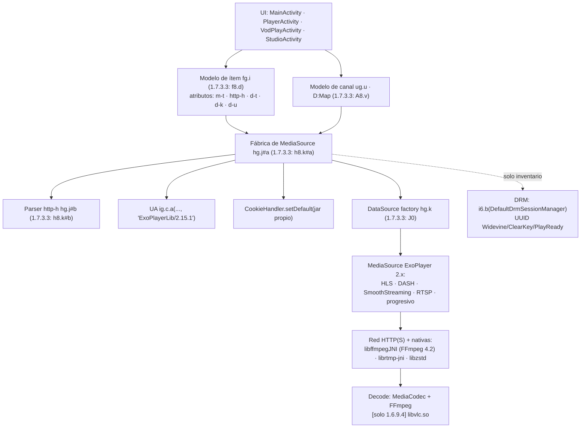
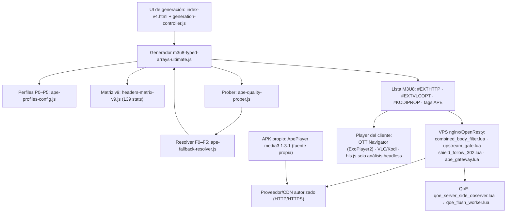
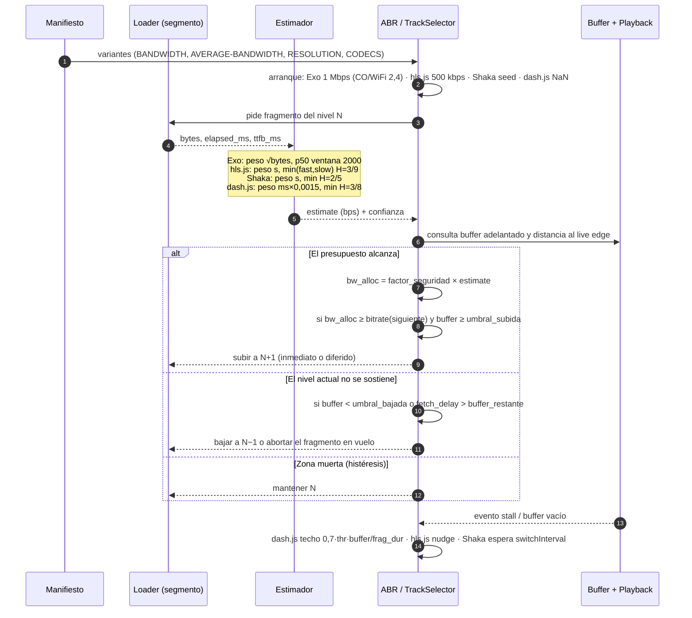
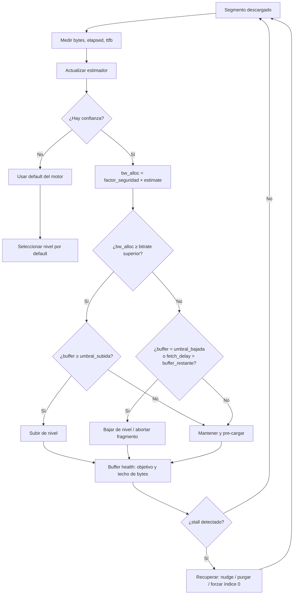

# REA · R6 — Entregable final: análisis de streaming

> **Tarea:** `t6` (R6) · **Intento:** `517c8483-ce83-4c5b-be4c-e9507e763bd9` · **Miembro:** `doc-writer`
> **Fecha:** 2026-10-25 (America/Bogota) · **Entregable:** `docs/REA_STREAMING_ANALYSIS.md`
> **Naturaleza:** documento de integración de R1–R5. **No** ejecuta APK, **no** usa dispositivos, **no**
> toca el VPS ni ningún servicio remoto. No repite la REA: la cita, la cruza y verifica líneas y hashes.
> **Regla de evidencia:** cada afirmación lleva `[observado: …]`, `[público: …]` o `[no disponible]`.
> Donde no hay artefacto o medición, se dice; no se rellena con plausibilidad.

---

## Ficha, fuentes y convención de evidencia

### 0.1 Fuentes citadas (alias usados en todo el documento)

| Alias | Documento | Líneas | SHA-256 medido al ensamblar (2026-10-25) |
|---|---|---:|---|
| **R1** | `docs/REA_SCOPE_AND_ARTIFACTS.md` | 741 | `bb3d19617a49a0a30c9b621930eb73c3a007ea337fd9dd41d559aeb7d3aa41d8` |
| **R2** | `docs/REA_APK_ANALYSIS.md` | 1.140 | `844b7ded1d182f4896903099fca608ee671005163c9230bac9c1d35e0b4fc1ed` |
| **R3** | `docs/REA_ABR_INTERNALS.md` | 1.033 | `e7047509956ab3af2262c5f4ef9aeb7417a49be20cb690d147a19e93b2946baa` |
| **R4** | `docs/REA_HEADERS_MATRIX.md` | 792 | `fa866e39fd91a270c808d04905c7694ae49c1a6e031f08f84999d78f050d0b8d` |
| **R5** | `docs/REA_DIAGNOSIS_AND_FIXES.md` | 836 | `dc63165e036ac8ece076dd9e382e9f202ad483248af7808ffa3a577fd0a38eb5` |

`[observado]` (medido con `Get-FileHash -Algorithm SHA256`; comando en §5.E.1). La cita `R2:417-443`
significa "líneas 417 a 443 del documento R2"; el documento fuente contiene a su vez la cita primaria
(código, APK o comando). R6 **no** reabre los APK: verifica hashes de artefacto, líneas del código propio
y la coherencia entre entregables (§0.3).

> **Deriva registrada:** R5 se entregó con SHA `3b8b9eed…` (así consta en el resultado de `t5`); el fichero
> presente hoy tiene `dc63165e…` y 836 líneas. R1 se entregó con 740 líneas y hoy tiene 741. R4 coincide
> exactamente. Se registra la diferencia y se cita **el fichero presente**; no se asume cuál revisión es la
> canónica (§5.G).

### 0.2 Convención de etiquetas

| Etiqueta | Significado operativo |
|---|---|
| `[observado: …]` | Leído en esta sesión sobre un fichero local (código, documento o artefacto) o medido con el comando indicado. En citas a R1–R5, el documento fuente contiene la evidencia primaria y su `Evidence ID` de REA (§5.C.3). |
| `[público: …]` | Norma, RFC o documentación pública verificable; no se midió aquí. |
| `[derivado]` | Inferencia directa de una o más observaciones; se declara el razonamiento. |
| `[no disponible]` | No existe artefacto, no se midió o no se puede establecer con la evidencia actual. Nunca se sustituye por una suposición. |

### 0.3 Qué re-verificó R6 directamente (no delegado)

| # | Comprobación | Resultado | Evidencia |
|---:|---|---|---|
| 1 | SHA-256 de los 5 entregables R1–R5 | Coinciden los 5 ficheros con lo citado; R5/R1 con la deriva de líneas indicada | `[observado: docs/REA_*.md · §5.B.2]` |
| 2 | SHA-256 de los dos APK de OTT Navigator | `b964c274…` (A1) y `bd509c0c…` (A2), **idénticos** a R1 | `[observado: C:\Users\HFRC\Downloads\…apk · §5.B.1]` |
| 3 | Líneas del generador citadas por R3/R4 | `2989-2991`, `5429-5431`, `5608`, `5628`, `7968-7970`, `8454`, `8677` existen y contienen lo citado (fotografía 23:11:04; ver Erratum D1, §5.H) | `[observado: IPTV_v5.4_MAX_AGGRESSION/frontend/js/ape-v9/m3u8-typed-arrays-ultimate.js]` |
| 4 | Líneas del estimador y del resolver | `bw-estimator-v9.js:44-45,68-87`; `streaming-input-resolver.js:53-54` | `[observado: …/streaming/bw-estimator-v9.js]` |
| 5 | Mapeo semántico `X-ABR-Switch-Interval-S` | `ape-profiles-config.js:4590` sigue mapeando `hlsjs.abrSwitchInterval` | `[observado: …/ape-profiles-config.js:4590]` |
| 6 | Breaker del gateway | `_vps_stage/lua/ape_gateway.lua:168-179` conserva `down:<host>` y TTL 15 | `[observado: _vps_stage/lua/ape_gateway.lua:168-179]` |
| 7 | Carga de scripts del UI y uso de hls.js | Orden 3612/3930/3971-3972/3978; hls.js v1.5.17 **solo** para análisis headless (3925-3927) | `[observado: IPTV_v5.4_MAX_AGGRESSION/frontend/index-v4.html]` |
| 8 | APK propio: fuente Kotlin, manifiesto y Gradle | `AgentService.kt`, `ApePlayer.kt`, `TfliteInferenceEngine.kt`, `UltraEnhancePipeline.kt`, `SettingsApplier.kt`, `Config.kt`, `build.gradle.kts` leídos; assets `.tflite` de 1.4–1.7 KB | `[observado: IPTV_v5.4_MAX_AGGRESSION/android/ape-crystal-agent/]` |
| 9 | Offsets de entradas ZIP de los APK citados | Calculados con `zipfile` de CPython 3.12.10 (§5.C.1) | `[observado: §5.C.1]` |
| 10 | SHA-256 de los ficheros de código citados | 8 de 8 calculados; coinciden con R3 Anexo A.2 donde R3 los publicó | `[observado: §5.B.3]` |

---

## 1. Resumen ejecutivo

### 1.1 Qué se entregó

| Tarea | Artefacto | Resultado en una línea | Evidencia |
|---|---|---|---|
| **R1** | `docs/REA_SCOPE_AND_ARTIFACTS.md` | Gate de inventario: 9 APK en disco = 8 únicos; OTT ×2, SFA ×3, v2rayNG, agente propio; TiviMate/Disney+/Prime **no** están; ADB = 0 dispositivos; frontera legal fijada | `[observado: R1:22-44,79-99,337-341,422-435]` |
| **R2** | `docs/REA_APK_ANALYSIS.md` | REA estática real de OTT: ExoPlayer 2.x, parser `http-h`, DataSource propio, delta 1.6.9.4→1.7.3.3, SFA/v2rayNG; 0 APK ejecutados | `[observado: R2:23-68,412-470,759-773]` |
| **R3** | `docs/REA_ABR_INTERNALS.md` | ABR/buffer/bandwidth verificado en ExoPlayer2/media3, hls.js, Shaka y dash.js con `file:line`; 9 hallazgos sobre nuestro stack; secuencia de decisión | `[observado: R3:48-63,578-711,736-789]` |
| **R4** | `docs/REA_HEADERS_MATRIX.md` | Matriz de 22 familias de headers con evidencia; conteos v9 (139/135/109); 9 tóxicos + 2 familias; 10 hallazgos H1–H10; gate TiviMate/Disney+/Prime = N/D | `[observado: R4:19-76,302-325,562-578]` |
| **R5** | `docs/REA_DIAGNOSIS_AND_FIXES.md` | Causa raíz del bounce nginx (cron `cache-health-monitor`), breaker del gateway (TTL 15), 4K NO-GO numérico y prerrequisitos de fan-out; **sin cambios en producción** | `[observado: R5:19-34,90-134,344-408,493-535]` |
| **R6** | este documento | Integración en 5 secciones con etiqueta por afirmación, snippets, SHAs, offsets/clases y secuencia ABR; sin REA nueva | `[observado]` |

### 1.2 Qué quedó establecido

- **Inventario real:** 9 archivos APK = 8 artefactos únicos (un duplicado byte a byte); conjunto analizable
  230.885.047 B (220,2 MiB); 7 APK únicos abribles (OTT ×2, SFA ×3 variantes de ABI de 2 builds, v2rayNG,
  agente propio) y X-plore fuera de alcance. `[observado: R1:79-99,105-116]`
- **Los dos OTT no son el mismo binario:** `1.6.9.4` = v1+v2+v3, certificado `2e12755b…`, **Source Stamp**
  de Play, 10.315 clases, `libvlc.so`; `1.7.3.3` = **solo v2**, certificado `6cf278ec…`, sin stamp ni
  linaje, 13.492 clases, **sin** `libvlc.so`. `[observado: R1:226-253; R2:614-626]`
- **Framework de OTT:** ExoPlayer **2.x**, no media3; UA por defecto literal `"ExoPlayerLib/2.15.1"` en ambos
  builds; 0 clases `androidx.media3`; 0 `HttpDataSource`/`DefaultHttpDataSource`; **OkHttp empaquetado con
  visibilidad distinta por build:** en **A2 (1.6.9.4)** solo conserva el nombre
  `okhttp3.internal.publicsuffix.PublicSuffixDatabase`; en **A1 (1.7.3.3)** se observaron **325 descriptores
  `Lokhttp3`** y **682 coincidencias** (R4:381-385); Cronet 0.
  `[observado: R2:252-274; R1:147-159; R4:381-385]`
- **Canal de headers de OTT:** atributo `http-h`, gramática idéntica en ambos builds: `K=V&K2=V2` **o**
  objeto JSON; precedencia ítem > canal; un solo valor por nombre (`put`); `null` omite; si empieza por `{`
  y no es objeto, se descarta. `[observado: R2:412-470,643-677]`
- **Delta funcional 1.7.3.3:** añade `Authorization: Basic` desde `uri.getUserInfo()` **después** de aplicar
  `http-h` (puede sobrescribir el nuestro); añade atributo DRM `d-d`; constructor de `HlsMediaSource` pasa
  de 10 a 9 argumentos. `[observado: R2:686-773]`
- **Motor real de 1.7.3.3:** ExoPlayer 2 + FFmpeg (`libffmpegJNI.so`, FFmpeg 4.2 `Lavc58.54.100`); la ruta
  VLC conserva clases pero **no librería nativa** → no cargable. `[observado: R1:138,161-165; R2:775-787]`
- **ABR de los cuatro motores:** ExoPlayer = mediana ponderada p50 (`√bytes`, ventana 2000); hls.js = EWMA
  3/9 s; Shaka = 2/5 s; dash.js = 3/8 s; `min(fast,slow)` en los tres EWMA; des-sesgo `1/(1−α^W)`;
  factores de seguridad 0.7 (Exo), 0.95/0.70 (hls.js), 0.95/0.85 (Shaka), 0.9 + 0.7 (dash.js).
  `[observado: R3:580-599]`
- **Tres correcciones al enunciado del plan:** (a) "1 s/2 s" es media3 1.11.1, **no** ExoPlayer2 r2.19.1, que
  usa **2500/5000 ms**; (b) Shaka 5.3.2 **no** tiene `InsufficientBufferRule` (es de dash.js); (c) los
  SESSION-DATA de ExoPlayer y `hls.js.config` son **inertes** en el player real. `[observado: R3:214-219,479-491,736-744]`
- **Headers de nuestro stack:** matriz v9 = 139 stats / 135 union / 109 emitidas en L5; EXTHTTP con tope 200
  nombres y 8.192 B; 9 tóxicos (6 C8 + 3 hop-by-hop) y 11 patrones por 2 familias; `build_exthttp()`
  devuelve string y el spread `.headers` produce `{}` (H1). `[observado: R4:19-49,123-148,186-214]`
- **Diagnóstico de lo pendiente:** bounce nginx = cron `cache-health-monitor` con `proxy_cache off`
  (52/24 h, 11.096 reinicios desde 2026-04-25); breaker = `down:<host>` TTL 15 con 502 sin `reason`;
  4K por CPU = **NO-GO** (0,356×, 7,61 core·s/s, 3 vCPU, sin GPU); fan-out bloqueado por prerrequisitos.
  `[observado: R5:21-34,90-134,374-396,500-535,576-610]`
- **APK propio:** `com.ape.crystalagent` debug 1.0.0, TFLite 2.14 + GPU delegate, WireGuard embebido,
  `WRITE_SECURE_SETTINGS`, **media3 1.3.1** para su player, track-selection HEVC-first y
  `ApeUltraEnhanceGlEffect`; sus modelos `.tflite` son **baseline de pesos fijos** (1,4–1,7 KB), no redes
  entrenadas. `[observado: R1:304-317; …/ApePlayer.kt:29-53; …/UltraEnhancePipeline.kt:11-21]`

### 1.3 Qué NO quedó establecido (y por qué)

| # | Hueco | Motivo | Etiqueta |
|---:|---|---|---|
| 1 | TiviMate: identidad, motor, headers, ABR, single-value | **No hay APK ni dispositivo ADB**; solo doctrina interna | `[no disponible: R1:337-338,471-505]` |
| 2 | Disney+ y Prime Video: cualquier comportamiento de app | **No hay APK**; además el eje DRM está **fuera de alcance** por doctrina y ley | `[no disponible: R1:339-340,426-435]` |
| 3 | SDK de Conviva embebido | **0 hits** de `conviva` en los dex de OTT; Conviva no se distribuye como APK | `[observado: R1:157,167-168; R1:358-384]` |
| 4 | Comportamiento **en ejecución** de cualquier APK | 0 dispositivos; todo el análisis fue estático y offline | `[no disponible: R1:350-356; R2:1046]` |
| 5 | Versión exacta de ExoPlayer 2 dentro de OTT | `ExoPlayerLibraryInfo` renombrada; `2.15.1` es un literal de UA que la app escribe | `[no disponible: R2:266-269,1039]` |
| 6 | Clase del parser M3U/M3U8 y XSPF de OTT | Ofuscación R8 y re-siembra; el modelo destino lo usan cientos de clases | `[no disponible: R2:587-592,1037-1038]` |
| 7 | Valores ABR reales dentro de OTT 1.7.3.3 | 0 coincidencias de `DefaultBandwidthMeter`; exigiría smali por patrón numérico | `[no disponible: R3:827]` |
| 8 | Aceptación de cada header por el proveedor upstream | Es medición de probe, no REA | `[no disponible: R2:1028-1029; R4:612]` |
| 9 | Conteo runtime del EXTHTTP actual (¿76–79?) | No se generó una lista post-fix; H1 hace que el total configurado no sea el emitido | `[no disponible: R4:28-40,610]` |
| 10 | 4K por CPU en el VPS actual | Física: 7,61 core·s/s vs 3 vCPU, sin GPU; medido 0,356× | `[observado: R5:500-535]` |
| 11 | Handshake de licencias, claves, CDM, Widevine/PlayReady/HDCP | **Prohibido** por la frontera legal del proyecto | `[observado: R1:422-435; AGENTS.md §Regla legal]` |
| 12 | Códecs/HDR realmente decodificados por el device | Sin dispositivo y sin runtime; el manifiesto declarado no prueba decode | `[no disponible: R3:829; R1:391]` |
| 13 | Procedencia oficial de OTT 1.7.3.3 | Firma distinta, solo v2, sin Source Stamp ni linaje | `[observado: R1:230-236]` `[derivado: R1:244-248]` |

### 1.4 Correcciones al plan (registro)

| # | El plan decía / asumía | Lo observado | Corrección aplicada |
|---:|---|---|---|
| C1 | R6 debía marcar **OTT** como "no disponible — pendiente de artefacto" | OTT está en disco en dos builds y fue analizado con JADX 0.7.1 (R1/R2) | OTT se documenta como **disponible con REA real**; la etiqueta de pendiente queda para TiviMate/Disney+/Prime (§3.0) |
| C2 | Los dos OTT eran "el mismo binario" o builds equivalentes | Distinto dex, distinta firma, distinto motor nativo, distinta procedencia | Se tratan como **dos artefactos**; 1.6.9.4 = base Play/VLC; 1.7.3.3 = build vigente re-firmado (§3.1) |
| C3 | Load control "1 s / 2 s" | Cierto solo para media3 1.11.1; ExoPlayer2 r2.19.1 (el de OTT) usa 2500/5000 ms | Corregido en §4.1 y §5.D; el APK propio (media3 1.3.1) es el único caso media3 |
| C4 | Shaka 5.3.2 y dash.js tienen `InsufficientBufferRule` | Solo dash.js (`InsufficientBufferRule.js:103`); `lib/abr/` de Shaka = 3 archivos | Corregido en §5.D y R3 Anexo C |
| C5 | Los `#EXT-X-SESSION-DATA` de ExoPlayer y `hls.js.config` configuran el player | Ni media3 ni ExoPlayer2 parsean SESSION-DATA; hls.js lo expone pero ningún controlador lo lee | Marcados **inertes**; no se citan como tuning (§4.1 fila 12; R3-F1/F2) |
| C6 | El bounce de nginx era el watchdog propio o SSH | Cron `cache-health-monitor` con `proxy_cache off`; 52/52 coincidencias; 11.096 reinicios | Fix P0 alert-only propuesto, no aplicado (R5 §1.5, H1 de R5) |
| C7 | El breaker del gateway era "suave" | Devuelve **502 instantáneo sin `reason`** si todos los hosts están castigados | Se propone eliminar gate y castigo conservando telemetría (R5 §2.4, H2 de R5) |
| C8 | 4K era una meta de configuración | Es imposible en este host por CPU (0,356×, 3 vCPU, sin GPU) | 4K por CPU = **NO-GO**; solo nodo GPU para canales seleccionados (R5 §3, H3 de R5) |

### 1.5 Veredicto y frontera legal

**Veredicto:** el objetivo útil del encargo **se cumplió donde había artefacto**: OTT Navigator (2 builds),
SFA/sing-box (2 builds), v2rayNG y el agente propio están inventariados y analizados estáticamente; los
cuatro motores de ABR están documentados con `file:line`; la matriz de headers está construida **solo** con
evidencia y la infraestructura propia tiene causa raíz y fix para sus tres pendientes.
`[observado: R1:22-44; R2:65-68; R3:63; R4:592-594; R5:28-34]`

**Frontera legal (cardinal, no negociable):** se trabaja solo con artefactos, streams, credenciales y
tráfico **del propietario y autorizados**. El handshake de licencias no se analiza en este proyecto. No se
implementa ni se documenta evasión de DRM: ni extracción de claves, ni Widevine/PlayReady para evadir, ni HDCP
para saltarse una ruta protegida, ni descifrado, ni redistribución.
`[observado: R1:409-435; AGENTS.md §Regla legal]`
`[público: 17 U.S.C. §1201; Directiva 2001/29/CE art. 6; Ley 1915 de 2018 — categorías citadas en R1:416-420,
sin pretensión de asesoría jurídica]`

---

## 2. Arquitectura general

### 2.1 Las cuatro capas que se comparan

La comparación usa una cadena única para todas las apps: **UI → player → datasource → red**. En OTT y en el
APK propio esa cadena está dentro del APK; en nuestro stack el "player" es un cliente externo y lo que
controlamos es **generador + entrega**. `[observado: R2:143-187,983-997; R4:344-352]`

### 2.2 OTT Navigator — arquitectura observada (no inferida)



`[observado]` para cada caja: `R2:276-410` (fábrica y cookies), `R2:412-470` (parser), `R2:472-491`
(DataSource), `R2:493-542` (pistas), `R2:556-576` (DRM como inventario), `R2:939-999` (UML y secuencia).
Los nombres `hg.j`, `hg.k`, `fg.i`, `ug.u`, `h8.k`, `J0` son los que reporta JADX; el **rol** se deduce del
uso (firma y cuerpo), no del nombre. `[observado: R2:98-115,236-251]`

**Secuencia de un zap (1.6.9.4), paso a paso:**

1. `PlayerActivity` crea la fuente a través de una clase de reproducción ofuscada (no aislada →
   `[no disponible]`). `[observado: R2:983-997]`
2. `hg.j#a(Context, url, AUTO, item, …, referer, canal, cfg, mask)`:
   instala `CookieHandler` global, detecta tipo (`m-t` → `Util.inferContentType` → esquema → ruta
   `/ace/getstream` → extensión → default HLS/`ts`). `[observado: R2:282-335]`
3. Arma headers: mapa `http` del perfil + `Referer` + `http-h`; compone UA con el literal
   `ExoPlayerLib/2.15.1`. `[observado: R2:347-358]`
4. Crea `hg.k(Context, UA, headers)` y su `k(): f8.q` = `DataSource.Factory`. `[observado: R2:472-487]`
5. Si hay `d-t`/`d-k`/`d-u`, construye `i6.b` (DRM); en 1.7.3.3 añade `d-d`. `[observado: R2:564-569,729-736]`
6. Elige `HlsMediaSource.Factory` / `DashMediaSource` / `SsMediaSource` / `RtspMediaSource` /
   progresivo. `[observado: R2:362-394]`
7. ExoPlayer usa su `TrackSelector` (renombrado): **OTT no implementa ABR propio**; construye una lista de
   variantes para la UI con ancho×alto×fps. `[observado: R2:493-537]`

### 2.3 Nuestro stack — arquitectura observada



`[observado]` UI y orden de carga: `index-v4.html:3612` (`gateway-manager.js`), `:3930`
(`ape-quality-prober.js`), `:3971-3972` (`ape-fallback-resolver.js` y `m3u8-typed-arrays-ultimate.js`),
`:3978` (`generation-controller.js`); hls.js v1.5.17 se carga **solo** para análisis LL-HLS headless
(`index-v4.html:3925-3927`). `[observado]` Entrega: `IPTV_v5.4_MAX_AGGRESSION/vps/nginx/lua/` (28 módulos,
entre ellos `combined_body_filter.lua`, `upstream_gate.lua`, `shield_follow_302.lua`,
`qoe_server_side_observer.lua`) y `IPTV_v5.4_MAX_AGGRESSION/vps/resolve.php`. El gateway con breaker está
en `_vps_stage/lua/ape_gateway.lua:168-179` (R5 lo midió desplegado). `[observado: R5:346-372]`

**Lo que este stack NO tiene:** no incluye un motor de reproducción propio en el generador; el player es el
cliente nativo (OTT/VLC/Kodi) o el APK propio (media3). hls.js no reproduce: analiza manifiestos en modo
headless. `[observado: index-v4.html:3925-3927; R3:830]`

### 2.4 Equivalencias entre arquitecturas

| Capa | OTT Navigator | APK propio | Nuestro stack (generador + VPS) | Evidencia |
|---|---|---|---|---|
| **UI** | `PlayerActivity` / `VodPlayActivity` / `StudioActivity` | `MainActivity` + `PlayerActivity` | `index-v4.html` + `generation-controller.js` | `[observado: R2:206-214; R1:312; index-v4.html:3978]` |
| **Player** | ExoPlayer 2.x (renombrado) | media3 **1.3.1** (`ExoPlayer`, `HlsMediaSource`) | Cliente externo; sin motor propio en el generador | `[observado: R2:252-274; build.gradle.kts:76-81; index-v4.html:3925-3927]` |
| **Selección de pistas** | `hg.a#b` construye lista UI; delega en `TrackSelector` | `DefaultTrackSelector` HEVC-first (H.265/AV1/H.264) | No aplica en servidor; el manifiesto declara `RESOLUTION`/`CODECS` | `[observado: R2:493-537; ApePlayer.kt:29-36]` |
| **Datasource** | `hg.k` (1.7.3.3: `J0`) sobre stack HTTP; cookie jar | `DefaultHttpDataSource` con cross-protocol redirects | Cabeceras inyectadas por `#EXTHTTP` / `http-h`; entrega nginx | `[observado: R2:472-491,715-723; ApePlayer.kt:45-52; R4:344-352]` |
| **Headers por canal** | `http-h` JSON o `K=V&…`, last-wins | No observado (DataSource estándar) | `#EXTHTTP` + `#EXTVLCOPT` + `#KODIPROP`; matriz v9 no cableada (H2) | `[observado: R2:417-470; R4:120-148,569-570]` |
| **Red** | HTTP(S) directo del device; `usesCleartextTraffic=true` | HTTP(S) + WireGuard full-tunnel | nginx/OpenResty + PHP; proxy y reescritura de manifiesto | `[observado: R1:190,206,316; R5:344-372]` |
| **Telemetría/QoE** | Sin SDK Conviva (0 hits) | `QoEReporter` + heartbeat SSE | `qoe_server_side_observer.lua` + `qoe_flush_worker.lua` | `[observado: R1:167-168; AgentService.kt:68; vps/nginx/lua/]` |
| **DRM** | Inventario de clases (Widevine/ClearKey/PlayReady); **sin análisis** | No analizado | Fuera de alcance | `[observado: R2:556-576; R1:426-435]` |

### 2.5 Dónde termina la evidencia de arquitectura

Todo el diagrama de OTT y del APK propio es **estático**. No hay ningún paquete capturado en ejecución, ni
dispositivo, ni log de sesión. El punto exacto entre `PlayerActivity` y `hg.j` no se aisló
(`[no disponible: R2:187,984]`), el `TrackSelector` está renombrado (`[no disponible: R2:531-532]`) y el
cliente HTTP efectivo del DataSource de OTT no se puede afirmar (`[no disponible: R2:1041]`). En nuestro
stack, el runtime del EXTHTTP emitido tampoco se midió (`[no disponible: R4:28-40,610]`).

---

## 3. Deep dive por app

### 3.0 Estado del gate y corrección del encargo

| App | ¿Artefacto? | Estado en este documento | Etiqueta |
|---|---|---|---|
| **OTT Navigator** | **SÍ** — 2 builds (A1 `1.7.3.3`, A2 `1.6.9.4`) | **Deep dive con REA real** (§3.1) | `[observado: R1:29,81-82]` |
| **SFA / sing-box** | **SÍ** — 3 archivos = 2 builds (A3/A4 mismo build, A5 anterior) | **Deep dive** (§3.2) | `[observado: R1:84-86,219-224]` |
| **APK propio** | **SÍ** — A7 debug + proyecto Gradle completo | **Deep dive fuente-primero** (§3.3) | `[observado: R1:88,304-317]` |
| **TiviMate** | **NO** | **No disponible — pendiente de artefacto** (§3.4) | `[no disponible: R1:338]` |
| **Disney+** | **NO** | **No disponible — pendiente de artefacto** + eje DRM fuera (§3.5) | `[no disponible: R1:339]` |
| **Prime Video** | **NO** | **No disponible — pendiente de artefacto** + eje DRM fuera (§3.6) | `[no disponible: R1:340]` |
| **Conviva** | **NO como APK** | No aplica como app; 0 hits del SDK en OTT (§3.7) | `[observado: R1:157,167-168]` |

> **Corrección del encargo (no del resultado).** El enunciado de R6 pide marcar OTT como «no disponible —
> pendiente de artefacto». El gate R1 y el deep dive R2 demuestran que OTT Navigator **sí está en disco** y
> fue analizado con JADX 0.7.1: dos builds, SHA-256 completos y cuerpos de método citados.
> `[observado: R1:22-44,79-99; R2:23-68]` Marcar OTT como no disponible sería una afirmación falsa; por eso
> R6 conserva OTT como **disponible con REA real** y aplica la etiqueta «no disponible — pendiente de
> artefacto» solo a TiviMate, Disney+ y Prime Video. Los tres usan el mismo formato de aportación (§3.8).

### 3.1 OTT Navigator — disponible, REA real

#### 3.1.1 Identidad y procedencia

| Campo | A2 · `1.6.9.4` | A1 · `1.7.3.3` | Evidencia |
|---|---|---|---|
| Archivo | `ott-navigator-1-6-9-4.apk` | `studio-scillarium-ottnavigator-25110201-…apk` | `[observado: R1:81-82]` |
| SHA-256 | `bd509c0cb24b32deaae19c311b5537f60d5eb4c853163829f625a13d997d6854` | `b964c27457b43be633ee5828a2dabeb09d7f56a3d39b82172e110ed26039b6fd` | `[observado: §5.B.1]` |
| Bytes / MiB | 74.121.056 / 70,69 | 21.849.704 / 20,84 | `[observado: R1:81-82]` |
| `package` | `studio.scillarium.ottnavigator` | ídem | `[observado: R1:107-108]` |
| `versionName` / `versionCode` | `1.6.9.4` / `23072804` | `1.7.3.3` / `25110201` | `[observado: R1:107-108]` |
| SDK | min 23 · target 33 · compile 33 | min 26 · target 30 · compile 36 | `[observado: R1:107-108]` |
| Clases / recursos | 10.315 / 2.394 | 13.492 / 3.124 | `[observado: R1:182,197]` |
| Firma declarada | v1+v2+v3 · cert `2e12755b…` · **Source Stamp** `3257d599…` | **solo v2** · cert `6cf278ec…` · sin stamp ni linaje | `[observado: R1:230-231]` |
| Procedencia | Build distribuido por Play (derivado) | **No establecida**; patrón de re-firma de espejo | `[derivado: R1:242-248]` |
| Nativas VLC | `libvlc.so` + `libvlcjni.so` | **ausentes** | `[observado: R1:138-139; R2:775-781]` |
| `usesCleartextTraffic` | `true`, sin `networkSecurityConfig` | `true`, sin `networkSecurityConfig` | `[observado: R1:190,206,257-258]` |

**Lectura operativa:** A1 y A2 **no se pueden instalar uno encima del otro** (firma distinta); instalar A1
implica desinstalar la versión de Play y perder sus actualizaciones. `[derivado: R1:249-253]` Ninguna de las
dos afirmaciones de firma es una verificación criptográfica: REA reporta lo **declarado**.
`[observado: R1:237-238; R2:125-137]`

#### 3.1.2 Framework y motor

- **ExoPlayer 2.x**, no media3: `com.google.android.exoplayer2.source.hls.HlsMediaSource` presente y usado;
  **0** clases `androidx.media3`; **0** `HttpDataSource`/`DefaultHttpDataSource`/paquete
  `com.google.android.exoplayer2.upstream`. `[observado: R2:252-266; R1:154-155]`
- **UA por defecto:** literal `"ExoPlayerLib/2.15.1"` en **ambos** builds, pasado a `ig.c.a(...)` /
  `i8.d.a(...)`. Es una cadena que la app escribe, no un campo de versión: la versión empaquetada es
  `[no disponible]`. `[observado: R2:264-269,768; R2:1039]`
- **OkHttp:** empaquetado en ambos builds, con visibilidad distinta por build: en **A2 (1.6.9.4)** solo
  conserva el nombre `okhttp3.internal.publicsuffix.PublicSuffixDatabase`; en **A1 (1.7.3.3)** se observaron
  **325 descriptores `Lokhttp3`** y **682 coincidencias** (R4:381-385). Cronet 0. El cliente efectivo del
  player es `[no disponible]` (renombrado). `[observado: R2:270-274,1041; R4:381-385]`
- **VLC:** en 1.6.9.4 hay 38 clases de bindings **y** librería nativa → ruta funcionalmente posible; en
  1.7.3.3 hay clases pero **no** `libvlc.so` → `UnsatisfiedLinkError` al cargar; único motor ejecutable:
  ExoPlayer 2 + FFmpeg de software. `[observado: R2:594-604,775-787; R1:138,161-165]`

#### 3.1.3 Parser de headers `http-h` (hallazgo central)

Gramática efectiva, idéntica en `hg.j#b` (1.6.9.4) y `h8.k#b` (1.7.3.3) — código verbatim en §5.A.1:

```
http-h := "K1=V1&K2=V2&…"                    (split '&' → split '=' → solo pares con '=')
        | "{ \"K1\":\"V1\", \"K2\":\"V2\", … }"  (JsonReader; nextName→nextString; null omitido)
precedencia: atributo del ítem (fg.i / f8.d)  >  atributo del canal (ug.u.D / A8.v)
destino: HashMap<String,String> que consume el DataSource de ExoPlayer
```

`[observado: R2:417-443,646-673]`

| Consecuencia para nuestras listas | Etiqueta |
|---|---|
| JSON con nombres arbitrarios: **soportado nativamente** (`nextName()` → clave literal). Es el camino recomendado | `[observado: R2:459-460,1011]` |
| Modo `K=V&K2=V2`: soportado, pero un valor con `=` se corta en el **segundo** `=` (usa índice 0 y 1) | `[derivado: R2:461,1012]` |
| Valor con `&` en modo querystring: **se rompe** (separador de pares) | `[derivado: R2:462,1012]` |
| Valor que empieza por `{` y no es objeto JSON: se descarta **todo** el bloque (no cae a `&`) | `[observado: R2:463,1013]` |
| `null` explícito: **omite** el header (útil para borrar heredado del perfil) | `[observado: R2:464,1014]` |
| Header repetido: gana el **último** (`map.put`) → un solo valor por nombre | `[derivado: R2:465,1015]` |
| `Referer` y UA: se inyectan como headers literales; `http-h` gana sobre el perfil | `[observado: R2:466-468,1016-1018]` |
| 1.7.3.3 añade `Authorization: Basic` desde `user:pass@`, **después** de `http-h` → puede sobrescribir el nuestro | `[observado: R2:715-723,1019]` |

#### 3.1.4 Delta 1.6.9.4 → 1.7.3.3

| Aspecto | 1.6.9.4 | 1.7.3.3 | Evidencia |
|---|---|---|---|
| Fábrica | `hg.j#a` (enum `hg.a$c` + cascada inline) | `h8.k#a` (tipo como objeto `i8.b`; inferencia delegada a `m8.c.a`) | `[observado: R2:679-705,759-764]` |
| Parser headers | `hg.j#b` | `h8.k#b` **idéntico** + `catch (EOFException)` | `[observado: R2:643-677]` |
| Modelo ítem / canal | `fg.i` / `ug.u` | `f8.d` / `A8.v` (re-siembra) | `[observado: R2:628-641]` |
| DataSource | `hg.k(Context,UA,map)` | `J0(context, UA, map, 4)` | `[observado: R2:723]` |
| Auth | solo lo que venga por `http-h`/perfil | **+ `Authorization: Basic`** desde `userInfo` | `[observado: R2:715-721,765]` |
| DRM | `d-t`, `d-k`, `d-u` | **+ `d-d`** con fallback a `d-k` | `[observado: R2:729-736,766]` |
| Constructor `HlsMediaSource` | 10 args (incluye `boolean`) | **9 args** (sin `boolean`) | `[observado: R2:769,772-773]` |
| VLC nativo | sí | **no** | `[observado: R1:138-139; R2:775-787]` |

#### 3.1.5 Límites de este deep dive

`[no disponible]`: nombre del parser M3U/M3U8 y XSPF, versión exacta de ExoPlayer, semántica de campos
renombrados de `HlsMediaSource.Factory` (`f4993h=false`, `f19171b`, `f19177h`, `f19178j`), cliente HTTP
efectivo, selector de motor, contenido del mapa `http` del perfil (dato de usuario) y todo comportamiento en
runtime. Rutas de cierre: `R2:1033-1046` (U1–U10). `[observado: R2:1033-1046; R3:827-834]`

### 3.2 SFA / sing-box — disponible, REA real

| Campo | SFA `1.13.11` (A3/A4) | SFA `1.11.11` (A5) | Evidencia |
|---|---|---|---|
| `package` | `io.nekohasekai.sfa` | ídem | `[observado: R1:109-111]` |
| `versionCode` | 662 | 520 | `[observado: R1:109-111]` |
| SHA-256 | `9adfa37e…` (arm64), `1b5e0d84…` (armv7) | `83e2d08f…` | `[observado: R1:84-86; §5.B.1]` |
| Clases | 8.745 | 4.054 | `[observado: R2:806,882]` |
| UI | Jetpack Compose (`io.nekohasekai.sfa.compose.MainActivity`) | 12 activities View/XML | `[observado: R2:806-887]` |
| Núcleo | **nativo** `libbox.so` (sing-box, Go) | `libbox.so` | `[observado: R1:140-141]` |
| Servicios | `bg.VPNService` (FGS `systemExempted`), `bg.ProxyService` (`specialUse`), `bg.RootServer`, `TileService`, `BootReceiver` | idem | `[observado: R2:828-843,888]` |
| Privilegios | Shizuku (`rikka.shizuku.ShizukuProvider`), libxposed (`XposedProvider`), `REQUEST_INSTALL_PACKAGES`, `QUERY_ALL_PACKAGES` | sin Shizuku/instalación de paquetes | `[observado: R2:844-846,889-890]` |
| Deep link | `sing-box://import-remote-profile` | no observado | `[observado: R2:820-823,892]` |
| Cliente HTTP | `io.nekohasekai.sfa.utils.HTTPClient` → **`io.nekohasekai.libbox.HTTPClient`** (Go) | idem (núcleo nativo) | `[observado: R2:864-875]` |
| Firma | v1+v2 `32250a4b…` | **misma clave** `32250a4b…` | `[observado: R1:232-233; R2:278-282]` |

**Qué significa:** SFA no es una app de streaming; es el cliente de túnel del stack. `[derivado: R1:345-347; R2:915-917]` Sus headers, TLS y
proxy viven en Go dentro de `libbox`, así que **no son analizables estáticamente en el dex**; lo observable
es el wrapper Kotlin, el modelo `Profile` en Room y los servicios de túnel.
`[observado: R2:862-880]` A3 y A4 son el **mismo build** (manifest/dex/arsc idénticos byte a byte): para
código basta uno; el otro solo aporta la variante de ABI. `[observado: R1:219-224]`
La misma clave entre `1.11.11` y `1.13.11` es señal esperable de cadena de release, **no** una verificación
criptográfica. `[derivado: R2:280-282]`

### 3.3 APK propio `ape-crystal-agent` — disponible, fuente primero

**Identidad:** `com.ape.crystalagent`, vName `1.0.0`, vc 1, **debug y `debuggable=true`**, targetSdk 28,
SHA-256 `11101de8979ad68e895af1a29df6496b1f648284a8c5f38e6cf463d70e86b1c1`, 34.192.621 B.
`[observado: R1:88,304-317; §5.B.1]` Existe el **proyecto Gradle completo** al lado del APK
(`IPTV_v5.4_MAX_AGGRESSION/android/ape-crystal-agent/`), así que para este artefacto **la fuente manda sobre
el binario**. `[observado: R1:319-322; R2:932-935]`

**Rol real (leído en la fuente):**

| Componente | Qué hace | Evidencia |
|---|---|---|
| `AgentService` | Servicio foreground **aplicador puro**: se suscribe al bus SSE del VPS y aplica `device_settings`; **no** observa, no cambia canales, no abre apps | `[observado: AgentService.kt:12-20,58-67]` |
| `SettingsApplier` | Allowlist estricta `(ns,key)` + regex de valor; lo que no está en la lista se **rechaza** y se loguea; escribe solo donde la key ya existe | `[observado: SettingsApplier.kt:8-17,23-46]` |
| `WireGuardManager` / `EnrollClient` | Auto-enrolamiento y túnel WG full-tunnel; si falla, **la reproducción no se afecta** | `[observado: AgentService.kt:44-50; R1:314]` |
| `QoEReporter` | Heartbeat/liveness y reporte de `quality_change` (codec/res) | `[observado: AgentService.kt:58-68]` |
| `SelfUpdateManager` | Auto-update desde `/ara/version` + `/ara/agent.apk` | `[observado: AgentService.kt:69]` |
| `ApePlayer` | Player propio: **media3 1.3.1**, `DefaultTrackSelector` HEVC-first (H.265 → AV1 → H.264), `DefaultHttpDataSource`, cross-protocol redirects, `setVideoEffects(ApeUltraEnhanceGlEffect)` | `[observado: ApePlayer.kt:29-53; build.gradle.kts:76-81]` |
| `UltraEnhancePipeline` | Orquestador de motores: Media Enhancement API, CAR/denoise, unsharp/SR, RIFE/blend, LCEVC sintético, GLSL | `[observado: UltraEnhancePipeline.kt:23-70]` |
| Modelos TFLite | `car_denoise_f32.tflite` 1.676 B · `rife_blend_f32.tflite` 1.484 B · `sr_unsharp_f32.tflite` 1.580 B (cabecera `TFL3`) | `[observado: app/src/main/assets/]` |

**Declaración de honestidad del propio código (importante):** los `.tflite` son **baseline de pesos fijos**
—operaciones reales (gaussiana low-pass, unsharp, blend lineal), **no redes entrenadas**; el procesado de
frames en tiempo real requiere que **nuestro** APK reproduzca el vídeo (Android no permite capturar el
MediaCodec de un tercero) y `processFramePair(Bitmap)` es API conceptual/test, no el camino real.
`[observado: UltraEnhancePipeline.kt:11-21; TfliteInferenceEngine.kt:14-19]` El player **no transcodifica**:
solo elige la mejor variante **real** que el proveedor sirva; si solo hay AVC, reproduce AVC.
`[observado: ApePlayer.kt:20-22]`

**Seguridad observada:** el token se provisiona por **archivo** (data dir privado 0600 o `/sdcard/ape/token`),
nunca por `am … --es token` (argv/dumpsys/logs); el VPS por defecto es `https://iptv-ape.duckdns.org`;
`enhance_enabled` por defecto **ON** y apagable sin reinstalar. `[observado: Config.kt:7-13,19-20,46-53]`
La app es **debug**: no es un release, y su comportamiento en runtime no se ejecutó en esta sesión.
`[observado: R1:313; §3.3 límites]`

**Límites:** no se ejecutó el APK; no se midió calidad de los modelos ni latencia del pipeline; no hay
dispositivo. La afirmación "mejora la imagen" **no** se hace: el código dice "mejora modesta" y los modelos
son baseline. `[observado: UltraEnhancePipeline.kt:16-18]` `[no disponible: runtime]`

### 3.4 TiviMate — no disponible — pendiente de artefacto

| Aspecto | Estado | Etiqueta |
|---|---|---|
| APK en disco | **0** coincidencias (workspace y `Downloads`; sin XAPK/APKS) | `[observado: R1:338,96-99]` |
| Dispositivo ADB | **0 dispositivos** (`adb 36.0.2`) | `[observado: R1:33,350-356]` |
| Identidad, motor, versión | Sin artefacto | `[no disponible]` |
| Parser de headers, single-value, `#EXTHTTP`/`#EXTVLCOPT`/`#KODIPROP` | Sin artefacto; solo doctrina interna del repo (no es observación de la app) | `[no disponible: R4:238-241,419-430]` |
| ABR/buffer/bandwidth reales | Sin artefacto | `[no disponible]` |
| Desbloqueo "Premium" | **Fuera de alcance** (circunvención de licencia de software) | `[observado: R1:431]` |

**Qué se mediría al recibirlo (mismo protocolo que OTT):** identidad con `aapt`/REA; firma declarada;
motor (ExoPlayer/media3/VLC/otro) por búsqueda de clases y nativas; parser de headers y semántica
multi-valor; selección de pistas/ABR; timeouts y buffer; códecs/HDR declarados. Sin ejecutar la app y sin
tocar su licencia. `[derivado: R1:504-505; R2:1033-1046]`

### 3.5 Disney+ — no disponible — pendiente de artefacto (eje DRM fuera de alcance)

**Estado:** 0 APK, 0 ADB. `[observado: R1:339]` `[no disponible]` cualquier celda de comportamiento.

**Frontera:** El handshake de licencias no se analiza en este proyecto. Aunque llegara el APK de Disney+, no
se replican claves, CDM, Widevine/PlayReady ni HDCP; tampoco se re-sirve su manifest.
`[observado: R1:426-435; R4:432-442]`
**Lo lícito que sí se podría hacer con el artefacto del propietario:** medir **capacidades** del dispositivo
(códecs, HDR, nivel de DRM **declarado** por `MediaDrm`) y comportamiento de reproducción observable en **su**
equipo con **su** suscripción; nunca parchear el binario ni capturar su tráfico para reutilizarlo.
`[público: alcance lícito citado en R1:435 y R4:438-441]`

### 3.6 Prime Video — no disponible — pendiente de artefacto (eje DRM fuera de alcance)

**Estado:** 0 APK, 0 ADB. `[observado: R1:340]` `[no disponible]` comportamiento.
Aplica exactamente la misma frontera y el mismo alcance lícito que Disney+ (§3.5).
`[observado: R1:426-435; R4:432-442]`

### 3.7 Conviva — no es un APK

Conviva es un SDK de QoE que se embebe en apps; no se distribuye como app. En los dex de OTT hay **0**
coincidencias de `conviva`, así que **no está embebido** en el player analizado. `[observado: R1:157,167-168]`
En este repo sí existe implementación propia (16 archivos: 14 fuentes JS/PHP/Lua/Python + 2 `.pyc`);
es código del proyecto, no un artefacto de terceros. `[observado: R1:358-384]`

### 3.8 Cómo aportar un artefacto (TiviMate / Disney+ / Prime / otros)

**Convención de destino:** `C:\Users\HFRC\Downloads\<app>-<version>.apk` (o `<app>-base.apk` + `split_*.apk`).
`[observado: R1:473-474]`

**Opción A — copia local (más simple):** desde el equipo donde esté instalada, usar un gestor de archivos
(X-plore ya está en `Downloads`) o "compartir app" y dejar el APK en esa ruta. Si hay **splits**, copiar
todos los `.apk` del paquete. `[observado: R1:477-480]`

**Opción B — ADB (trae base + splits exactos), solo con el equipo conectado y autorizado por RSA:**

```powershell
# 1) ¿conectado y autorizado?  debe decir "<serial>    device"
adb devices
# 2) encontrar el paquete por nombre (no fijar un id a ciegas)
adb shell pm list packages | Select-String -Pattern 'tivimate|disney|prime'
# 3) ver TODOS los APK del paquete (base + splits)
adb shell pm path <package.id>
# 4) traerlos (repetir por cada ruta del paso 3)
adb pull /data/app/.../base.apk C:\Users\HFRC\Downloads\<app>-base.apk
```

`[observado: R1:485-499]` `[público: R1:501-502 — el id de TiviMate suele citarse como `ar.tvplayer.tv`,
pero no se fija sin verificación en el dispositivo]`

**Prohibido:** habilitar ADB en remoto o automatizar el "accept" RSA sin intervención del propietario; es un
truth-guard del manifiesto y un riesgo de seguridad. La extracción es local, con consentimiento.
`[observado: R1:402-403,527]`

**Al recibirlo, una tarea de REA debe:** calcular SHA-256 completo, registrar tamaño y ruta, verificar que es
`base.apk` (+ splits) y ejecutar el protocolo de §3.4. Sin APK no se rellena ninguna celda: `N/D` con
motivo. `[derivado: R4:419-430,588-594]`

### 3.9 v2rayNG y X-plore (secundarios)

- **v2rayNG 1.9.31:** `com.v2ray.ang`, vc `4000627`, SHA-256 `52a79ed8…`, 6.514 clases, minSdk 21; servicios
  `V2RayVpnService` (`SUPPORTS_ALWAYS_ON`), `V2RayProxyOnlyService`, `V2RayTestService`; entrada por
  `UrlSchemeActivity` (`vmess://`/`vless://`/`ss://`…), suscripciones, routing, Tasker y per-app proxy.
  Nativas **solo `armeabi-v7a`** (`libgojni.so` Xray, `libhysteria2.so`, `libtun2socks.so`): en un Android TV
  solo-64-bit no tendría `libgojni.so` que cargar. `[observado: R1:112,126-127,142]` `[derivado: R1:126-127]`
- **X-plore 4.46.00:** `com.lonelycatgames.Xplore`, min 26/target 36; gestor de archivos, **fuera de
  alcance**: no es player, ni transporte, ni parte del stack. `[observado: R1:114,324-327]`

---

## 4. Matriz de compatibilidad (solo evidencia)

### 4.1 Features por app/stack

**Leyenda:** `SÍ`/`NO`/`PARCIAL` ⇒ `[observado]`; `N/D` ⇒ `[no disponible]` con motivo; `—` = no aplica a esa
capa. "Nuestro stack" = generador + VPS; el APK propio va en columna separada porque **sí** tiene player.

| # | Capacidad | Nuestro stack | OTT 1.6.9.4 | OTT 1.7.3.3 | APK propio | TiviMate | Disney+ | Prime | Evidencia |
|---:|---|---|---|---|---|---|---|---|---|
| 1 | Motor de reproducción | — (cliente externo) | ExoPlayer 2.x | ExoPlayer 2.x | **media3 1.3.1** | N/D — sin APK | N/D — sin APK | N/D — sin APK | `[observado: R2:252-274; R2:594-604; build.gradle.kts:76-81]` |
| 2 | HLS (`m3u8`) | Emite M3U/M3U8 | `HlsMediaSource` | `HlsMediaSource` | `HlsMediaSource` | N/D | N/D | N/D | `[observado: R2:371-378,741-749; ApePlayer.kt:45-52]` |
| 3 | DASH / SmoothStreaming / RTSP | No emite | SÍ (3 ramas) | SÍ (3 ramas) | NO observado (solo HLS en `ApePlayer`) | N/D | N/D | N/D | `[observado: R2:379-391,750-755; ApePlayer.kt:45-52]` |
| 4 | VLC nativo | — (solo tags `EXTVLCOPT`) | SÍ (`libvlc.so`) | **NO** (ausente) | NO observado (sin `libvlc` en `lib/**`) | N/D | N/D | N/D | `[observado: R1:138-139,143; R2:775-787]` |
| 5 | Decode software FFmpeg | No activado (4K por CPU = NO-GO) | `libffmpegJNI` FFmpeg 4.2 | ídem | NO observado (nativas: TFLite + WireGuard) | N/D | N/D | N/D | `[observado: R1:143,161-165; R5:530-535]` |
| 6 | HTTP en claro | SÍ (proxy a upstream `http`) | SÍ | SÍ | SÍ (`usesCleartextTraffic=true`) | N/D | N/D | N/D | `[observado: R1:190,206,316,257-258; R5:349-360]` |
| 7 | UA configurable | SÍ (banco de UA) | SÍ (perfil; default `ExoPlayerLib/2.15.1`) | ídem | SÍ (UA Web0S por defecto) | N/D | N/D | N/D | `[observado: R4:307; R2:552,1018; ApePlayer.kt:72]` |
| 8 | Headers por canal | `#EXTHTTP` (JSON/&) | `http-h` JSON/& | `http-h` JSON/& | NO observado (DataSource estándar) | N/D | N/D | N/D | `[observado: R2:417-443; R4:344-352]` |
| 9 | Cookie de sesión | PARCIAL (solo matriz v9 L5) | SÍ (jar propio) | SÍ (jar propio) | `[no disponible]` | N/D | N/D | N/D | `[observado: R2:1023; R4:313]` |
| 10 | DRM (capacidad, no bypass) | **Fuera de alcance** | Inventario de clases | Inventario de clases | No analizado | N/D | N/D — fuera | N/D — fuera | `[observado: R2:556-576; R1:426-435]` |
| 11 | ABR propio | NO (base de conocimiento R3) | NO: delega en ExoPlayer | NO: delega | `DefaultTrackSelector` HEVC-first | N/D | N/D | N/D | `[observado: R2:493-537; ApePlayer.kt:29-36]` |
| 12 | `#EXT-X-SESSION-DATA` como tuning | **Emite y es inerte** | NO lo lee | NO lo lee | No aplica | N/D | N/D | N/D | `[observado: MAIN:2989-2991; R3:214-219,736-744]` |
| 13 | `#EXT-X-BITRATE` | **No lo emite** | No lo lee | No lo lee | No aplica | N/D | N/D | N/D | `[observado: R3:598,780-789]` |
| 14 | `BANDWIDTH`/`AVERAGE-BANDWIDTH` como palanca | Emite; honestidad del valor **no medida** | SÍ (base del selector) | SÍ | SÍ (selector) | N/D | N/D | N/D | `[observado: R3:791-805; R2:534-537; R4:344-352]` `[no disponible: R3:832]` |
| 15 | Buffer/load control | Tags APE **inertes** | 50/50 s; arranque 2.500 ms; rebuffer 5.000 ms | ídem | media3: 50/50 s; 1.000/2.000 ms (defaults de la línea; **1.3.1 no verificado**) | N/D | N/D | N/D | `[observado: R3:186-212,770-773]` `[no disponible: media3 1.3.1 runtime]` |
| 16 | Códecs/HDR decodificados en runtime | Declara `hvc1`/`hev1` según doctrina | `[no disponible]` | `[no disponible]` | `[no disponible]` (prefiere HEVC, no prueba decode) | N/D | N/D | N/D | `[observado: ApePlayer.kt:32; R3:829]` |
| 17 | `minSdk` del artefacto | — | 23 | 26 | 22 | N/D | N/D | N/D | `[observado: R1:107-113]` |

**Nota de lectura:** la columna "Nuestro stack" describe **emisión/entrega**, no reproducción. Que un tag se
emita no implica que el player lo consuma: eso se resuelve por motor en R3 y por app en R2/R4.
`[observado: R3:791-805; R4:582-594]` `[derivado]`

### 4.2 Matriz de headers (22 familias, condensada de R4)

**Leyenda:** `SÍ`/`NO`/`PARCIAL` ⇒ `[observado]`; `N/D` ⇒ `[no disponible]`; `N/A` = no aplica a esa capa.
La columna "Fuente" da la fila de R4 y la cita primaria cuando existe.

| # | Header / familia | Nuestro stack | OTT 1.7.3.3 | TiviMate | Disney+ | Prime | Fuente |
|---:|---|---|---|---|---|---|---|
| 1 | `#EXTHTTP:{...}` | **PARCIAL** (payload de `build_exthttp` perdido por H1) | **PARCIAL** (`http-h` sí; mapeo tag→`http-h` no observado) | N/D | N/D | N/D | `R4:304`; `MAIN:5608,8454`; `R2:459-470` |
| 2 | `#EXTVLCOPT` | SÍ | N/D (VLC nativo ausente en 1.7.3.3) | N/D | N/D | N/D | `R4:305`; `MAIN:7985-8033` |
| 3 | `#KODIPROP` | **PARCIAL** (`Connection` dentro; ruta JSON legacy) | N/D | N/D | N/D | N/D | `R4:306`; `MAIN:8662-8839,3807` |
| 4 | `User-Agent` | SÍ (determinista por canal) | SÍ (perfil; default `ExoPlayerLib/2.15.1`) | N/D | N/D | N/D | `R4:307`; `R2:552,1018` |
| 5 | `Accept` / `Accept-Language` / `Accept-Encoding` | SÍ | N/D | N/D | N/D | N/D | `R4:308`; `MAIN:4917-4919` |
| 6 | `Referer` / `Origin` | SÍ (pool de 20 dominios) | **PARCIAL**: `Referer` sí; `Origin` no observado | N/D | N/D | N/D | `R4:309`; `R2:550-552` |
| 7 | `Cache-Control` / `Pragma` | SÍ (`no-cache`) | N/D | N/D | N/D | N/D | `R4:310` |
| 8 | `Authorization` | **PARCIAL** (solo `Bearer` JWT propio) | **PARCIAL** (arbitrario por `http-h`; `Basic` automático en 1.7.3.3) | N/D | N/D — plataforma | N/D — plataforma | `R4:311`; `R2:715-723` |
| 9 | `X-Playback-Session-Id` | SÍ (UUID propio de correlación) | N/D | N/D | N/D — plataforma | N/D — plataforma | `R4:312`; `MAIN:8425` |
| 10 | `Cookie` | **PARCIAL** (solo matriz v9 L5) | SÍ (jar propio) | N/D | N/D | N/D | `R4:313`; `R2:1023` |
| 11 | `Connection` / `Keep-Alive` | **PARCIAL** (fuera de EXTHTTP; dentro de KODIPROP/PHP) | N/D | N/D | N/D | N/D | `R4:314`; `MAIN:8823,8832` |
| 12 | `Range` / `If-None-Match` / `If-Modified-Since` | **NO** (CA7 + denylist + scrub) | N/D | N/D | N/D | N/D | `R4:315`; `MAIN:2356-2360` |
| 13 | `TE` / `Priority` / `Upgrade-Insecure-Requests` | **NO** (mismo gate) | N/D | N/D | N/D | N/D | `R4:316` |
| 14 | `Sec-Fetch-*` / `Sec-CH-UA-*` | **NO (neto)**: se añaden y el denylist las quita | N/D | N/D | N/D | N/D | `R4:317`; H3 |
| 15 | `X-Forwarded-For` / `X-Real-IP` / `Via` / `Forwarded` | **NO** en EXTHTTP; sobreviven como tags APE | N/D | N/D | N/D | N/D | `R4:318` |
| 16 | `X-APE-*` (metadata interna) | **PARCIAL**: 27 activas; doctrina pide no filtrarlas | SÍ (JSON acepta nombres arbitrarios) | N/D | N/D | N/D | `R4:319`; H5 |
| 17 | `X-WidevineKeySystem` / `X-PlayReady-Support` / `X-DRM-Support` | **PARCIAL**: metadata inerte; **no** es DRM real | N/D | N/D | N/D — fuera | N/D — fuera | `R4:320` |
| 18 | Multi-value / 4-layer | **PARCIAL**: sanitizer en `test_exporter.js`; sin enforcement global | **PARCIAL**: `map.put` ⇒ last-wins (un valor) | N/D — doctrina | N/D | N/D | `R4:321`; `R2:465,1015` |
| 19 | CORS de respuesta | **PARCIAL**: origen específico y `*` mezclados | N/A | N/A | N/A | N/A | `R4:322` |
| 20 | URL firmada HMAC | **PARCIAL**: implementada, desactivada (`TOKEN_MODE='none'`) | N/A | N/A | N/A | N/A | `R4:323` |
| 21 | Referer allowlist (`valid_referers`) | **NO**: no hay en el repo | N/A | N/A | N/A | N/A | `R4:324` |
| 22 | Handshake de licencia DRM | **NO — fuera de alcance** | N/D — DRM fuera | N/D | **FUERA** | **FUERA** | `R4:325`; `R1:426-435` |

**Conteos de referencia del stack:** matriz v9 `139` stats, `135` union, `109` emitidas en L5; rótulos
`154`/`148` **stale**; EXTHTTP tope `200` nombres / `8.192` B; 9 tóxicos + 2 familias (`Sec-Fetch-*`,
`Sec-CH-UA-*`) = 11 patrones. `[observado: R4:186-214,250-282; MAIN:5429-5431]`

### 4.3 Veredicto por player

| Player | Artefacto | Nivel de evidencia | Se puede afirmar | **No** se puede afirmar |
|---|---|---|---|---|
| **OTT Navigator 1.7.3.3** | APK `b964c274…` | **Medio**: gramática `http-h` y fábrica observadas; mapeo del tag no | `http-h` JSON/`&`, last-wins, UA/Referer/cookie, `Basic` automático, ExoPlayer2, sin VLC nativo, cleartext | Que `#EXTHTTP` se mapee a `http-h`; cliente HTTP de media; aceptación upstream; que sea Play-signed |
| **OTT Navigator 1.6.9.4** | APK `bd509c0c…` | **Medio-alto** para el motor; es la línea base | ExoPlayer2 **y** VLC nativo posible; mismo parser `http-h`; build de Play | Igual que A1, salvo el delta ya medido |
| **APK propio media3 1.3.1** | APK `11101de8…` + fuente | **Alto** para fuente; **nulo** para runtime | Player media3, HEVC-first, `DefaultHttpDataSource`, efectos GPU, agent service, allowlist, WG, TFLite baseline | Que el pipeline real de frames o los modelos funcionen en device; latencia/calidad |
| **TiviMate** | **No hay APK** | **Nulo** | Nada de comportamiento; solo doctrina interna del repo | Single-value, `#EXTHTTP`, `#EXTVLCOPT`, `#KODIPROP`, UA, ABR |
| **Disney+ / Prime** | **No hay APK** | **Nulo** | Nada de headers de app; sí el estándar `Authorization` y la naturaleza de plataforma | Nombres/valores, handshake, tokens, sesión; replicarlos está fuera de alcance |

`[observado: R4:582-594; R2:1033-1046; §3.3]`

### 4.4 Hallazgos del stack que condicionan la matriz (H1–H10)

| ID | Sev. | Hallazgo (una línea) | Evidencia |
|---|---|---|---|
| **H1** | **H** | `build_exthttp()` devuelve **string**; el caller hace `.headers` → spread `{}`: el payload de 385 claves + inyección PM **no llega** al EXTHTTP final. *(Corregido en producción por t52; verificación de comportamiento pendiente — §5.H)* | `[observado: R4:33-40,136-148; MAIN:5608,7968-7970,8454]` |
| H2 | M | La matriz v9 no tiene cableado hacia `MAIN`; el wrapper la deja en `recommended_headers` sin consumidor | `[observado: R4:210-214,570]` |
| H3 | M | `Sec-Fetch-*`/`Sec-CH-UA-*` se añaden y el denylist incondicional las quita: neto cero | `[observado: R4:273-277,571]` |
| H4 | H | La política de 9 tóxicos no cubre KODIPROP ni el motor PHP: `Connection=keep-alive` y `X-Forwarded-For` siguen saliendo ahí | `[observado: R4:279-282,572]` |
| H5 | H | 27 claves `X-APE-*` activas en `_httpPayload`; solo 4 baneadas: riesgo de fingerprint | `[observado: R4:573]` |
| H6 | H | Artefactos legacy con tóxicos (18/canal el listado masivo; 6/canal el audit); son pre-fix, no prueban el filtro actual | `[observado: R4:574]` |
| H7 | M | Drift de conteos: 154/148/139; 139 líneas/canal vs 95 `EXTVLCOPT` + 54 `KODIPROP`; log "99" vs 261 slots | `[observado: R4:575]` |
| H8 | M | La matriz v9 L5 incluye headers de evasión/pseudo-bypass (`X-Captcha-Token`, cookie CF simulada, `X-Origin-Shield: bypass`) | `[observado: R4:576]` |
| H9 | M | HMAC implementado pero desactivado; CORS mezcla allowlist y `*`; no hay `valid_referers` | `[observado: R4:577]` |
| H10 | L | Riesgo de inferir ✓ de TiviMate/Disney+/Prime desde doctrina | `[observado: R4:578]` |

### 4.5 Lo que la matriz no prueba

- No prueba que el proveedor **acepte** cada header: eso es probe upstream, no REA.
  `[no disponible: R2:1028-1029; R4:612]`
- No prueba que los 139 de la matriz v9 lleguen a la lista: H2 dice que no hay consumidor observado.
  `[observado: R4:210-214]`
- No prueba el conteo runtime del EXTHTTP: falta una lista post-fix. `[no disponible: R4:28-40,610]`
- No prueba decode de códecs/HDR: sin dispositivo ni runtime. `[no disponible: R3:829]`
- **No incluye DRM como capacidad de evasión**: handshake, claves, CDM y HDCP están fuera de alcance por
  doctrina y ley. `[observado: R1:422-435; R4:615]`

### 4.6 Acciones por familia de headers (cierre R8-F2)

> **Origen:** R4:567-578 (H1–H10) y las mediciones de §4.2. Cada fila dice **qué se edita**, **dónde** y **cómo
> se verifica**; no repite el diagnóstico de §4.4. **Ninguna acción se ejecutó en R6**: son propuestas para una
> tarea de implementación. Rutas (índice completo en R4:724-745): `MAIN` =
> `IPTV_v5.4_MAX_AGGRESSION/frontend/js/ape-v9/m3u8-typed-arrays-ultimate.js`; `MATRIX` =
> `.../headers-matrix-v9.js`; `PROFILES` = `.../ape-profiles-config.js`; `WRAP` =
> `.../m3u8-api-wrapper-integrated.js`; `TESTEXP` = `test_exporter.js`; `PHPUH` =
> `IPTV_v5.4_MAX_AGGRESSION/frontend/vps/cmaf_engine/modules/universal_headers_engine.php`; `RESOLVE` =
> `IPTV_v5.4_MAX_AGGRESSION/frontend/vps/resolve.php`; `CORS` =
> `IPTV_v5.4_MAX_AGGRESSION/vps/nginx/snippets/prisma-public-api-locations.conf`.

| # | Familia(s) de header | R4 | Impacto | Corrección (qué se edita y dónde) | Verificación |
|---|---|---|---|---|---|
| A1 | `#EXTHTTP` completo (1) | H1 | El tag efectivo es el literal de 66 claves (61 tras denylist): las 385+PM **no llegan** | Cambiar el contrato de `build_exthttp()` a objeto (`{headers, overflow}`) o `JSON.parse` en el caller; ajustar `MAIN:5608,5628,7968-7970,8454`; conservar `_sanitizePayloadSize` | Lista generada: nº de claves del `#EXTHTTP` ≥ literal + 385 (o el que fije el test); `#EXT-X-APE-OVERFLOW-HEADERS` si hay overflow |
| A2 | Matriz v9 / `recommended_headers` (todas) | H2 | 139 stats / 109 en L5 no se fusionan: la matriz es asesora/UI | Merge explícito de `recommended_headers` en `_httpPayload` (`WRAP:648-657,833-836` → `MAIN`) **o** retirar la promesa de la UI | Clave exclusiva de L5 (p.ej. `X-Segment-Duration`) presente en el tag emitido; test `getHeaders(5)` vs EXTHTTP |
| A3 | `Sec-Fetch-*` / `Sec-CH-UA-*` (14) | H3 | Se añaden y el denylist las quita: neto cero, código muerto | Elegir política: excluirlas del denylist (`MAIN:8636-8639`) si se emite UA de navegador, **o** borrar el bloque de adición (`MAIN:8484-8507`) | UA Chrome → presentes; UA VLC/ExoPlayer → ausentes |
| A4 | `Connection` / `Keep-Alive` / `Proxy-Connection` (11) | H4 | Hop-by-hop tóxico fuera del EXTHTTP: sigue en KODIPROP y en el motor PHP | Aplicar CA7/denylist a `manifest_headers`/`stream_headers` (`MAIN:8823,8832`) y a `PHPUH:167-185`; o justificar por player y documentarlo | Conteo de los 3 nombres en la lista emitida (EXTHTTP + KODIPROP) y en la salida PHP = 0 |
| A5 | `X-APE-*` (16) | H5 | 27 activas, solo 4 baneadas: fingerprint del engine si el player va directo al proveedor | Ban completo de las 27 en CA7/denylist (`MAIN:8316-8338,8400-8410,8605-8607`) o prefijo documentado como no enviable | Conteo `X-APE-` en el EXTHTTP emitido = 0 (o el subconjunto declarado) |
| A6 | `Range` / `If-None-Match` / `If-Modified-Since` / `TE` / `Priority` / `UIR` (12,13) + artefactos legacy | H6 | El listado masivo de 2026-03-30 tiene 18 tóxicos/canal y 200 headers; no prueba el filtro actual | Regenerar con el build post-fix (no reutilizar `downloaded_list.m3u8`); smoke que parsee el EXTHTTP de cada canal | El smoke falla si aparece cualquiera de los 9 tóxicos; 0 hits en la lista nueva |
| A7 | Conteos/rótulos (todas) | H7 | 154/148/139; 95 `EXTVLCOPT` + 54 `KODIPROP` vs 139; 99 vs 261 slots | Generar `HEADERS-COUNT.json` desde el artefacto real y consumirlo en docs/UI; corregir `MATRIX:7`, `WRAP:1140`, `index-v4.html:2168`, `profile-manager-v9.js:6` | JSON = conteo del EXTHTTP emitido = valor de la UI |
| A8 | `Cookie` CF simulada / `X-Captcha-Token` / `X-Origin-Shield` (10 + extras de L5) | H8 | Pseudo-bypass: no es compatibilidad y puede violar ToS | Cuarentena por defecto en `MATRIX:279,303-307` y `PROFILES:259-265`; emitir solo con flag explícito documentado | Lista por defecto sin esas claves; el flag las activa y queda registrado |
| A9 | `Authorization` + CORS + `Referer` allowlist (8,19,20,21) | H9 | HMAC desactivado; CORS mezcla `*` y allowlist; no hay `valid_referers` | Activar HMAC solo en endpoints propios (`RESOLVE:44-54`); allowlist + `Vary: Origin` en endpoints con credenciales (`CORS:30,92`); `valid_referers` en nginx del catálogo | Token válido 200 / inválido 403; `Origin` no allowlisted sin ACAO; `Referer` inválido 403 |
| A10 | `X-WidevineKeySystem` / `X-PlayReady-Support` / `X-DRM-Support` (17) y `X-Playback-Session-Id` (9) | §5.3 | Los 3 primeros aparentan soporte DRM sin serlo; el último es correlación, no autenticación | Renombrar/retirar los pseudo-DRM o documentarlos como metadata inerte; conservar `X-Playback-Session-Id` como UUID propio | Lista sin pseudo-DRM; sesión = UUID v4 por canal; no se copia ninguna sesión ajena |
| A11 | `User-Agent`, `Accept*`, `Referer`/`Origin`, `Cache-Control`/`Pragma`, `X-Forwarded-For`/`Via` (4,5,6,7,15) | §2.5 | Familias ya tratadas; el riesgo es regresión al tocar A1–A5 | Sin cambio de código; conservar CA7/denylist y añadir la regresión de A6 | Smoke de A6 verde; diff sin claves nuevas fuera de la allowlist |
| A12 | `#EXTVLCOPT` y multi-value/4-layer (2,18) | §2.5 | `EXTVLCOPT` no pasa por el filtro del EXTHTTP; el 4-layer no tiene enforcement global en `MAIN` | Aplicar el sanitizer single-value de `TESTEXP:7622-7647` a las cabeceras estructuradas (`MAIN:4956-4962`) o documentar por player; revisar `#EXTVLCOPT` por tóxico | Headers estructurados (`Connection`, `Range`, `Referer`, `Origin`, `Authorization`) con 1 token; `#EXTVLCOPT` sin hop-by-hop |
| A13 | Handshake de licencia DRM (22) | R1 §8 | Fuera de alcance por doctrina y ley | Ninguna; no implementar ni documentar handshake | Auditoría: 0 referencias nuevas a handshake/claves/CDM |

**Cobertura:** las 22 familias de §4.2 quedan asignadas (1→A1; 2→A12; 3/11→A4; 4/5/6/7/10→A11; 8→A9;
9→A10; 12/13→A6; 14→A3; 15→A11; 16→A5; extras de L5→A8; 17→A10; 18→A12; 19/20/21→A9; 22→A13).
`[observado: R4:302-325,567-578]`

**Actualización t17:** la acción A1 (H1) ya está implementada en producción por t52; su verificación de
comportamiento sigue pendiente del dueño de esa línea (§5.H). Las acciones A2–A13 no han cambiado.

---

## 5. Anexos

### 5.A Snippets reales

#### A.1 OTT — parser de `http-h` en `hg.j#b` (1.6.9.4), verbatim

Fuente: `R2:417-443`, cuerpo Java descompilado (`representation=java`, `fell_back=false`);
`Evidence ID ev_474fc0c2…`. Artefacto: A2 `bd509c0c…`.

```java
public static void b(fg.i iVar, ug.u uVar, HashMap map) throws IOException {
    String strB;
    Map<String, String> map2;
    if (iVar == null || (strB = iVar.b("http-h")) == null) {
        strB = (uVar == null || (map2 = uVar.D) == null) ? null : map2.get("http-h");
    }
    if (strB != null) {
        if (!ee.n.q0(strB, '{')) {                       // NO empieza por '{'
            for (String str : ee.n.n0(strB, new char[]{'&'}, 0, 6)) {
                if (ee.n.W(str, '=')) {
                    List listN0 = ee.n.n0(str, new char[]{'='}, 0, 6);
                    map.put((String) listN0.get(0), (String) listN0.get(1));
                }
            }
            return;
        }
        JsonReader jsonReaderF = vf.d.f(strB);           // SÍ empieza por '{' → JSON
        if (jsonReaderF.peek() != JsonToken.BEGIN_OBJECT) { jsonReaderF.skipValue(); return; }
        jsonReaderF.beginObject();
        while (jsonReaderF.hasNext()) {
            String strNextName = jsonReaderF.nextName();
            if (jsonReaderF.peek() == JsonToken.NULL) { jsonReaderF.nextNull(); }
            else { map.put(strNextName, jsonReaderF.nextString()); }
        }
        jsonReaderF.endObject();
    }
}
```

#### A.2 OTT — `Authorization: Basic` añadido en 1.7.3.3 (delta)

Fuente: `R2:715-723`, cuerpo de `h8.k#a`; artefacto A1 `b964c274…`.

```java
/* ===== NUEVO EN 1.7.3.3: Basic auth desde el userInfo de la URL ===== */
String userInfo = uri.getUserInfo();
if (userInfo != null && (strA4 = s4.a.A(userInfo)) != null) {
    String strDecode = URLDecoder.decode(strA4, "UTF-8");
    Charset charset = s6.a.f49925b;
    map.put("Authorization", "Basic ".concat(new String(Base64.encode(strDecode.getBytes(charset), 0), charset)));
}
W5.h hVar5 = new W5.h(new J0(context, strA6, map, 4));   // DataSource factory
```

#### A.3 OTT — headers, `Referer` y UA en la fábrica (1.6.9.4)

Fuente: `R2:349-358`; `Evidence ID ev_c8ae5e7a…`.

```java
HashMap map5 = new HashMap();
map5.putAll(vf.d.j((qVarA == null || (aVarF = qVarA.f()) == null
                    || (qVar = aVarF.f18704m) == null) ? null : qVar.b("http")));
String strJ = str9 == null ? (qVarA != null ? qVarA.j(iVar2) : null) : str9;
if (strJ != null) map5.put("Referer", strJ);
b(iVar2, uVar2, map5);                                   // ← parser de http-h
String strA = ig.c.a(qVarA, str8, map5, iVar2, "ExoPlayerLib/2.15.1");   // ← UA
md.e eVar6 = new md.e(new k(context, strA, map5));       // ← DataSource factory
```

#### A.4 Nuestro stack — EWMA y des-sesgo del estimador

Fuente directa: `IPTV_v5.4_MAX_AGGRESSION/frontend/js/ape-v9/streaming/bw-estimator-v9.js:43-47,68-87`
(SHA-256 `62b0e24c…`, §5.B.3). Equivale a hls.js `ewma.ts:17-40` y Shaka `ewma.js:75-78`
`[observado: R3:718-726]`.

```javascript
var CONFIG = {
    HALF_LIFE_FAST_S: 3,              // src/config.ts:424 abrEwmaFastLive
    HALF_LIFE_SLOW_S: 9,              // src/config.ts:427 abrEwmaSlowLive
    MIN_WEIGHT: 0.001,                // ewma-bandwidth-estimator.ts:27 minWeight_
    ...
};

function adjAlpha(durationS, halfLifeS) {          // α_w = 0.5^(w/H)
    if (!(durationS > 0)) return 0;
    return Math.pow(0.5, durationS / halfLifeS);
}
function updateTrack(track, bitsPerSec, durationS, halfLifeS) {
    var a = adjAlpha(durationS, halfLifeS);
    track.estimate = track.estimate * a + bitsPerSec * (1 - a);
    track.weight += durationS;                     // peso = SEGUNDOS de descarga
}
function trackEstimate(track, halfLifeS) {         // des-sesgo 1/(1−α^W)
    if (!(track.weight > 0)) return 0;
    var debias = 1 - Math.pow(0.5, track.weight / halfLifeS);
    if (!(debias > 0)) return 0;
    return track.estimate / debias;
}
```

> **Nota de exactitud:** el comentario de `:45` cita `config.ts:427 abrEwmaSlowLive`; en hls.js v1.6.19
> `427` es `abrEwmaSlowVoD` y `abrEwmaSlowLive` es `425`. El **valor** (9) es correcto; la cita no.
> `[observado: R3:746-749]`

#### A.5 Nuestro stack — bug de contrato de `build_exthttp` (H1)

Fuente directa (estado en R6.2): `IPTV_v5.4_MAX_AGGRESSION/frontend/js/ape-v9/m3u8-typed-arrays-ultimate.js:5608,5628,7968-7970,8454`
(SHA-256 `2315184e…`, §5.B.3). **Nota t17:** el generador cambió después; este snippet y sus comentarios de
línea son históricos. Ver Erratum D1 (§5.H) para la fotografía vigente y las referencias derivadas.

```javascript
// 5608: build_exthttp() devuelve un STRING, no un objeto
const exthttp = `#EXTHTTP:${primaryJson}`;
// 5615: en caso overflow, devuelve OTRO string concatenado
return `${exthttp}\n#EXT-X-APE-OVERFLOW-HEADERS:${overflowB64}`;

// 7945-7947: el llamador guarda ese string tal cual
const _exthttp_base = (typeof build_exthttp === 'function')
    ? build_exthttp(cfg, profile, index, sessionId, reqId)
    : null;

// 8431: y aquí hace spread de `.headers` sobre un string → siempre {}
...(_exthttp_base ? _exthttp_base.headers || {} : {}),
```

Consecuencia: los 385 headers estáticos de `build_exthttp` (y su split primary/overflow) **no** se fusionan
en `_httpPayload`; el tag final sale del literal `_httpPayload` (66 claves, 61 tras denylist) más
JWT/max-quality condicionales. `[observado: R4:136-148; MAIN:8454,8677]` El total runtime es
`[no disponible]` (no se generó lista post-fix). `[observado: R4:610]` *(H1 corregido después por t52;
verificación pendiente — §5.H)*

#### A.6 Nuestro stack — SESSION-DATA que el player no lee

Fuente directa: `…/m3u8-typed-arrays-ultimate.js:2989-2991`.

```text
#EXT-X-SESSION-DATA:DATA-ID="exoplayer.load_control",VALUE="{\"minBufferMs\":45000,\"bufferForPlaybackMs\":500,\"bufferForPlaybackAfterRebufferMs\":1000,\"maxBufferMs\":130000}"
#EXT-X-SESSION-DATA:DATA-ID="exoplayer.track_selection",VALUE="{\"maxDurationForQualityDecreaseMs\":500,\"minDurationForQualityIncreaseMs\":3000,\"bandwidthFraction\":0.95}"
#EXT-X-SESSION-DATA:DATA-ID="exoplayer.bandwidth_meter",VALUE="{\"resetOnNetworkTypeChange\":false,\"slidingWindowMaxWeight\":2000,\"initialBitrateEstimate\":120000000}"
```

Ni media3 1.11.1 ni ExoPlayer2 r2.19.1 parsean `#EXT-X-SESSION-DATA` (solo `#EXT-X-SESSION-KEY`:
`HlsPlaylistParser.java:110,493-502` y `:108,369-376`). `[observado: R3:214-219,736-744]`

#### A.7 R5 — breaker del gateway (código medido, no modificado)

Fuente: `R5:346-364` sobre `_vps_stage/lua/ape_gateway.lua:167-181`; R6 re-verificó las líneas
168-179. `[observado: _vps_stage/lua/ape_gateway.lua:168-179]`

```lua
for _, h in ipairs(candidates) do
    local dk = "down:" .. h
    if not (HOSTS and HOSTS:get(dk)) then              -- :169  ← GATE (breaker)
        local res, fh, why = fetch_follow(h, path, args)
        if res and res.status and res.status >= 200 and res.status < 300 then
            winner, res_ok = h, res
            final_origin = "http://" .. fh
            break
        end
        last_status = (res and res.status) or 502
        last_reason = why or (res and res.status and ("http_" .. res.status)) or "capture_failed"
        if HOSTS then HOSTS:set(dk, 1, 15) end          -- :178  ← TTL 15 s
        qinc("host_down:" .. h)                         -- :179
    end
end
```

#### A.8 APK propio — player media3 HEVC-first (fuente)

Fuente directa: `…/android/ape-crystal-agent/app/src/main/java/com/ape/crystalagent/ApePlayer.kt:29-53`.

```kotlin
fun build(): ExoPlayer {
    val sel = DefaultTrackSelector(ctx)
    sel.parameters = sel.buildUponParameters()
        .setPreferredVideoMimeTypes(MimeTypes.VIDEO_H265, MimeTypes.VIDEO_AV1, MimeTypes.VIDEO_H264)
        .clearVideoSizeConstraints()
        .setForceHighestSupportedBitrate(false)          // el VPS controla el floor
        .setAllowVideoMixedMimeTypeAdaptiveness(false)   // no mezclar HEVC+AVC en ABR
        .build()
    return ExoPlayer.Builder(ctx).setTrackSelector(sel).build().also { p ->
        exo = p
        runCatching { p.setVideoEffects(listOf(ApeUltraEnhanceGlEffect(0.6f, 0.2f))) }
            .onFailure { Log.w(TAG, "setVideoEffects: ${it.message}") }
    }
}
fun playChannel(player: ExoPlayer, url: String, ua: String = DEFAULT_UA) {
    val http = DefaultHttpDataSource.Factory()
        .setUserAgent(ua)
        .setAllowCrossProtocolRedirects(true)            // sigue el 302 line→CDN
    val src = HlsMediaSource.Factory(http).createMediaSource(MediaItem.fromUri(url))
    ...
}
```

#### A.9 APK propio — declaración de honestidad de los modelos

Fuente directa: `…/UltraEnhancePipeline.kt:11-21`.

```kotlin
/**
 * ARQUITECTURA HONESTA (correcciones de ingeniería sobre el doc 2.0):
 *  - Procesar frames requiere que NUESTRO APK reproduzca el video (F3 ExoPlayer): Android NO permite
 *    capturar el MediaCodec de un player de terceros. ...
 *  - Los modelos .tflite (car_denoise/sr_unsharp/rife_blend) son BASELINE de pesos fijos = operaciones
 *    reales (gaussiana low-pass, unsharp, blend lineal), NO redes entrenadas (honesto: mejora modesta,
 *    nunca basura; swap por entrenados sin tocar firmas). Si faltan en assets/ → motor OFF (autopista).
 *  - Media Enhancement API se detecta por reflexión (sin dep fantasma). LCEVC = residual sintético propio.
 */
```

### 5.B SHAs e identidades

#### B.1 APK (8 artefactos únicos; 9 archivos por 1 duplicado)

| ID | Archivo | Bytes | SHA-256 | Fuente |
|---|---|---:|---|---|
| A1 | `studio-scillarium-ottnavigator-25110201-…apk` | 21.849.704 | `b964c27457b43be633ee5828a2dabeb09d7f56a3d39b82172e110ed26039b6fd` | medido en R6; R1:81 |
| A2 | `ott-navigator-1-6-9-4.apk` | 74.121.056 | `bd509c0cb24b32deaae19c311b5537f60d5eb4c853163829f625a13d997d6854` | medido en R6; R1:82 |
| A2′ | `ott-navigator-1-6-9-4 (1).apk` | 74.121.056 | idéntico a A2 (duplicado byte a byte) | `[observado: R1:83,94-95]` |
| A3 | `SFA-1.13.11-arm64-v8a.apk` | 28.190.211 | `9adfa37e09e8b58c4476cb5ac233e56fd09cdb4e9a30e8ac2cc3f3315999e3b4` | R1:84 |
| A4 | `SFA-1.13.11-armeabi-v7a.apk` | 27.919.469 | `1b5e0d84c76ca31f7e979257659c931980ddfc7e63ddf7526d5f0b8ac4fb3e7a` | R1:85 |
| A5 | `SFA-1.11.11-armeabi-v7a.apk` | 13.706.426 | `83e2d08f070427c6e047510d4ea4c99b5ad792ef0a659d169d5e0281c48229b0` | R1:86 |
| A6 | `v2rayNG.apk` | 30.905.560 | `52a79ed8c0e3ac669a74ad9a988d746e70497044db7de84bfd8c47e419dac56e` | R1:87 |
| A7 | `app-debug.apk` (ape-crystal-agent) | 34.192.621 | `11101de8979ad68e895af1a29df6496b1f648284a8c5f38e6cf463d70e86b1c1` | medido en R6; R1:88 |
| A8 | `x-plore-file-manager-4-46-00.apk` | 11.251.127 | `1f019bde72fd4b6fefb273e57222d26e27449f36d0ecff370448db205c793a3d` | R1:89 (fuera de alcance) |

Totales: 9 archivos = 316.257.230 B; 8 únicos; conjunto analizable = 230.885.047 B.
`[observado: R1:91-92]`

#### B.2 Entregables

| Documento | Líneas | Bytes | SHA-256 |
|---|---:|---:|---|
| R1 `REA_SCOPE_AND_ARTIFACTS.md` | 741 | 55.254 | `bb3d19617a49a0a30c9b621930eb73c3a007ea337fd9dd41d559aeb7d3aa41d8` |
| R2 `REA_APK_ANALYSIS.md` | 1.140 | 80.586 | `844b7ded1d182f4896903099fca608ee671005163c9230bac9c1d35e0b4fc1ed` |
| R3 `REA_ABR_INTERNALS.md` | 1.033 | 77.074 | `e7047509956ab3af2262c5f4ef9aeb7417a49be20cb690d147a19e93b2946baa` |
| R4 `REA_HEADERS_MATRIX.md` | 792 | 58.035 | `fa866e39fd91a270c808d04905c7694ae49c1a6e031f08f84999d78f050d0b8d` |
| R5 `REA_DIAGNOSIS_AND_FIXES.md` | 836 | 50.561 | `dc63165e036ac8ece076dd9e382e9f202ad483248af7808ffa3a577fd0a38eb5` |
| R6 `REA_STREAMING_ANALYSIS.md` | este fichero | — | se calcula con §5.E.1 (no se puede auto-incluir) |

#### B.3 Código citado (medido en R6)

> `…/` = `IPTV_v5.4_MAX_AGGRESSION/` (raíz interna del repo).

| Archivo | Bytes | SHA-256 |
|---|---:|---|
| `…/frontend/js/ape-v9/m3u8-typed-arrays-ultimate.js` | 746.967 | `2315184ed4cdbcdb8fd78c5e55b72090d57ac14153fbaa442a76f0e0d5c1b1bb` |
| `…/frontend/js/ape-v9/headers-matrix-v9.js` | 30.601 | `ff01118d199b5fc936e485598870f9605ecc48cb3da2a88108f7dc638d88c760` |
| `…/frontend/js/ape-v9/ape-profiles-config.js` | 367.765 | `71776a019bd8c566a69ef729fed026839fcca37dca439d8aefffda8911bfec20` |
| `…/frontend/js/ape-v9/streaming/bw-estimator-v9.js` | 10.243 | `62b0e24cf2a74442c0ac692eeea92240470842534efaaa3c94e5075a127bf1b2` |
| `…/frontend/js/ape-v9/streaming/streaming-input-resolver.js` | 17.454 | `838aa888273b8865ab8d3684fdcd5e07a6f0155ab4ea2b26d0e63a6d1ccb9618` |
| `_vps_stage/lua/ape_gateway.lua` | 19.087 | `b9eb14061d5e2c81fdb71c69c81637abc161d081c6276aba1e71691379322710` |
| `…/vps/resolve.php` | 43.754 | `9815c663b35164907081550f218a3b5d87a7c73c2371c3ee774ab493d1219040` |
| `…/frontend/index-v4.html` | 266.355 | `103093be445d5ac5f91d8c2c32f7515c32ef4484c59d3e497c229b9b393f4e3f` |

Los cuatro primeros coinciden con R3 Anexo A.2 (mismos hashes): no hubo cambio de contenido entre R3 y R6.
`[observado: R3:957-965; §5.B.3]`

#### B.4 Fuentes externas de R3 (hashes que anclan cada `file:line`)

| Archivo | SHA-256 |
|---|---|
| `hls.js-v1.6.19/src/config.ts` | `ace628b0448de607c44f59c64f7faa6615ca9887f79944252cfdc299b311a8ea` |
| `hls.js-v1.6.19/src/utils/ewma.ts` | `3df5095c556550d71931e60c477b5f1d929c57f204ba225071a3a8dbb259d079` |
| `hls.js-v1.6.19/src/utils/ewma-bandwidth-estimator.ts` | `029fd886d195d82d3a980b28e68d09d2fc7c4d18b0943c8721c3c0f097d8eba2` |
| `hls.js-v1.6.19/src/controller/abr-controller.ts` | `cf9e674dad1f52674d7b5bdbe9174efda1fd0be87e6fccbf77042bcd2d719452` |
| `hls.js-v1.6.19/src/loader/m3u8-parser.ts` | `439c3c289e0218390a2b6d569483b024a28a117bc875ae191194385195fb0759` |
| `shaka-v5.3.2/lib/abr/ewma.js` | `d6f0469ce4acd772c37ca02bf1d688ce3bb9c368fc89057f2e444a9263def91e` |
| `shaka-v5.3.2/lib/abr/ewma_bandwidth_estimator.js` | `07dbf1ba34ed7ac62e711d7448a5aed6c882cf72a58a265fd1cedab56b819c61` |
| `shaka-v5.3.2/lib/abr/simple_abr_manager.js` | `0c5b221f5fd26c9d95ff4269b64d6cae5103d80cb57f4f55090b96ef32bbc55f` |
| `shaka-v5.3.2/lib/util/player_configuration.js` | `9bfa29822ac58591cad512ea25fda02a9f0a3ff3b92454aee306dcc70c362a42` |
| `dashjs-v5.2.1/src/core/Settings.js` | `0c13e76e51693f8a081ee3358f09143e5581b113bda9731c1533c3f31151d24f` |
| `dashjs-v5.2.1/src/streaming/controllers/ThroughputController.js` | `e24a01d61e6bb35c433da0ea9550f79822f5e89f688a01033990b6c7b49a406b` |
| `dashjs-v5.2.1/src/streaming/rules/abr/InsufficientBufferRule.js` | `e240a3c43b8d84d67d9a7f062b5b56bfc6a6ce054797310a8ad9888af7fac98d` |
| `media3 1.11.1 DefaultBandwidthMeter.java` | `0de672450db9bde4f15b18fe213eaae2ad47d30ca397c6b6f063bb88606bfab7` |
| `media3 1.11.1 SlidingPercentile.java` | `56dce6726e932f104f8e8f5828dc6612e66bc6de4a190443faa3b5dcc44d410c` |
| `media3 1.11.1 AdaptiveTrackSelection.java` | `370e3eb8cf20a029e4b8105f23ae60cefe6d7a69f5772c79cef86ae2471013e8` |
| `media3 1.11.1 DefaultLoadControl.java` | `9cfe679e14cd9fed1195faabf8705347f1fd8fdf1f0302bfb9cb14d5d5d2c6a7` |
| `media3 1.11.1 HlsPlaylistParser.java` | `c15d49e4215cd8227c47bb52f34a5cb7d07311e0dae0023ccddb3067c1145b75` |
| `ExoPlayer2 r2.19.1 DefaultBandwidthMeter.java` | `5f8aba6582d79701b90b12acd340f86fdd6447e3be433a4fccd35a3b7b52b858` |
| `ExoPlayer2 r2.19.1 SlidingPercentile.java` | `31bf09438a1e1911da0cb61a9415f66b246c0ba30c9bb968ef015cdbd38a4d76` |
| `ExoPlayer2 r2.19.1 AdaptiveTrackSelection.java` | `961f7635e8fc9cc378b2822094428f5f884a64ff0664db913fbc604610b5b139` |
| `ExoPlayer2 r2.19.1 DefaultLoadControl.java` | `6602a9376edc1978f3938090b38499faa6bd2ef856bcb6ce788f6dbb2c61a17d` |
| `ExoPlayer2 r2.19.1 HlsPlaylistParser.java` | `aeea1125615469375ce9cde80527bc4b71e67a270812a3962a75288eb113c64d` |

Fuente: `R3:924-955`; el script de auditoría de citas está en `docs/evidence/REA_R3_citation_audit.ps1`
y su última ejecución dio `citas_unicas=114 ok=107 ambiguas=7 fuera_de_rango=0 no_resueltas=0`.
`[observado: R3:906-920]`

### 5.C Offsets, clases y evidencia citada

#### C.1 Offsets de entradas ZIP de los APK citados

`header_offset` = posición del **local file header** de la entrada dentro del APK; no es un offset dentro
del dex. Medido con `zipfile` de CPython 3.12.10 sobre los ficheros hasheados en §5.B.1.
`[observado: §5.E.2]`

| APK | Entrada | `header_offset` | Comprimido | Descomprimido | Método | CRC-32 |
|---|---|---:|---:|---:|---|---|
| A1 `1.7.3.3` | `classes.dex` | 4.470 | 4.429.406 | 9.659.224 | deflate | `eb79a74e` |
| A1 | `classes2.dex` | 4.433.917 | 3.325.634 | 8.058.336 | deflate | `61561f27` |
| A1 | `lib/arm64-v8a/libffmpegJNI.so` | 8.029.372 | 572.512 | 1.097.856 | deflate | `d872a2f9` |
| A1 | `AndroidManifest.xml` | 12.575.662 | 11.168 | 64.304 | deflate | `ef3bd89a` |
| A1 | `resources.arsc` | 14.945.634 | 6.695.364 | 6.695.364 | store | `a84b7646` |
| A2 `1.6.9.4` | `classes.dex` | 181.639 | 4.407.026 | 9.596.272 | deflate | `7a83adba` |
| A2 | `classes2.dex` | 4.588.706 | 325.683 | 769.288 | deflate | `0258f9e9` |
| A2 | `lib/arm64-v8a/libvlc.so` | 6.261.192 | 18.939.814 | 41.763.048 | deflate | `d6f85708` |
| A2 | `lib/arm64-v8a/libffmpegJNI.so` | 5.208.769 | 571.985 | 1.097.336 | deflate | `03e511e2` |
| A2 | `AndroidManifest.xml` | 0 | 5.655 | 26.568 | deflate | `ebc4016c` |
| A2 | `resources.arsc` | 68.981.410 | 4.717.952 | 4.717.952 | store | `9a68f163` |

El **offset interno** de una clase/método dentro del dex **no se midió** → `[no disponible]`; para
localizar código se usan las clases y métodos del apartado C.2 y los `Evidence ID` de C.3.

#### C.2 Clases y métodos citados (OTT)

| Rol | 1.6.9.4 (`bd509c0c…`) | 1.7.3.3 (`b964c274…`) | Evidencia |
|---|---|---|---|
| Fábrica de `MediaSource` | `hg.j#a` (10 parámetros; enum `hg.a$c`) | `h8.k#a` (9 parámetros; tipo `i8.b`) | `R2:276-280,679-683` |
| Parser `http-h` | `hg.j#b` | `h8.k#b` (+ `EOFException`) | `R2:412-470,643-677` |
| Modelo de ítem | `fg.i` (`b(String)`, `d(String,String)`) | `f8.d` (`a(String)`) | `R2:628-641` |
| Modelo de canal | `ug.u` (campo `D: Map`) | `A8.v` (`a(String)`) | ídem |
| Config de player | `hg.a$c`, `hg.a#b` | `g8.n`, `m8.c#a` | `R2:493-542,759-764` |
| DataSource factory | `hg.k(Context,UA,HashMap)`, `k(): f8.q` | `J0(Context,UA,map,4)` | `R2:472-487,723` |
| Cookie handler lazy | `md.e` (`f19175a`) | `W5.h` (`f46591a`) | `R2:287-292,686-694` |
| Fuente HLS | `HlsMediaSource` ctor 10 args | `HlsMediaSource` ctor 9 args | `R2:371-378,741-749` |
| DRM | `i6.b`, `i6.o`, `d6.g` (UUIDs) | + `d-d`; `drm.e` con nombre | `R2:556-576,726-736` |
| Bindings VLC | 38 clases `org.videolan.libvlc.*` | presentes; **sin** `libvlc.so` | `R2:594-604,775-787` |

#### C.3 `Evidence ID` de REA para los hallazgos principales

| Hallazgo | Operación REA | Evidence ID |
|---|---|---|
| Manifiesto OTT 1.6.9.4 | `inspect_analysis_view` android/manifest | `ev_00ccffb2f1962d31a6d3371e454e2515ea1bb61813c15ba8c4a4693bfc75af36` |
| Fábrica `hg.j#a` | `inspect_android_method` | `ev_c8ae5e7a8a72be1f11f2c5a7c85c69ef6b85ec9f1a098560632b0dd65f795a99` |
| Parser `hg.j#b` | `inspect_android_method` | `ev_474fc0c20d3beb47e99fad7c7e4afbf7efc6680a9a8970a554909c02c9887115` |
| Pistas `hg.a#b` | `inspect_android_method` | `ev_40dce2eb28d4a87d2827a9083447fa6b1096814aac49ae612f41a1a188017cf7` |
| `hg.k` DataSource | `inspect_android_class` | `ev_58bc00a66b5d0b87536c0cc65228c534f18fa20884855450c341c9c52b96f084` |
| Fábrica `h8.k#a` (1.7.3.3) | `inspect_android_method` | `ev_dbdc5d8d5e4f90062dd45746c4ac64c33fba82df2167db728664f241c54d79f7` |
| Parser `h8.k#b` (1.7.3.3) | `inspect_android_method` | `ev_12125ddddfce98acde3cb4920601fe26a3a7c8ca6c0ec692d47917438a9aaedb` |
| SFA `HTTPClient` | `inspect_android_class` | `ev_b08d355dd733aca9c7d668c46e2a95ea17a327d5be7f11fb8525a817aac82875` |
| Paquete OTT 1.6.9.4 | `inspect_android_package` | `ev_2d41b299b0534cb4ad975d5cf94188626ce65b0bb6fe543b47465a41a8acf32f` |

Bundle de evidencia: `docs/evidence/REA_R2_evidence_bundle.json.gz` (84 registros, 5,9 MB; ignorado por
`.gitignore:133`). `[observado: R2:1052-1091]`

### 5.D Secuencia de decisión ABR

#### D.1 Secuencia (los cuatro motores)



`[observado: R3:602-634]` **Corrección de lectura:** "hls.js 500 kbps" es la **semilla de estimación**
(`abrEwmaDefaultEstimate = 500000`), no una constante del EWMA ni el `startLevel`; el dato está en el
diagrama de R3 (`R3:616`). **Shaka no tiene `InsufficientBufferRule`** `[observado: R3:479-491]`; el techo
por buffer es de **dash.js** (`InsufficientBufferRule.js:103`).

#### D.2 Máquina de estados



`[observado: R3:636-659]`

#### D.3 Pseudocódigo con las constantes reales

```text
Entrada: sample(bytes, elapsed_ms, ttfb_ms), buffer_s, live_edge_dist_s, niveles[]

1) ESTIMACIÓN
   si motor == ExoPlayer:
       peso    = sqrt(bytes)                       # DefaultBandwidthMeter:450
       ventana.add(peso, bytes*8000/elapsed_ms)    # p50, maxWeight 2000
       estim   = ventana.p50() si (Σelapsed>=2000ms o Σbytes>=512KiB) si_no última
   sino:                                          # hls.js / Shaka / dash.js
       valor   = 8*bytes / (elapsed_ms/1000)
       peso    = (elapsed_ms/1000)                # hls.js/Shaka; dash.js: ms*0.0015
       fast.sample(peso, valor); slow.sample(peso, valor)
       estim   = min(fast.est, slow.est)          # des-sesgo 1/(1-alpha^W)

2) PRESUPUESTO
   ExoPlayer: bw_alloc = 0.7 * estim * (chunk_dur/rate - ttfb)/chunk_dur
   hls.js:    bw_alloc = (0.70 si sube si_no 0.95) * estim
   Shaka:     bw_alloc = estim                    # la banda ya descuenta 0.95/0.85
   dash.js:   bw_alloc = 0.9 * estim              # y 0.7 en InsufficientBufferRule

3) SELECCIÓN CON HISTÉRESIS
   sube si:  buffer_s >= min(0.75*(live_edge_dist_s), 10 s)        # Exo
             y fetch_dur < buffer_restante + 4 s                    # hls.js
             y estim en [b_i/0.95, b_{i+1}/0.85]                    # Shaka
   baja si:  buffer_s < 25 s                                        # Exo
             o frag_en_vuelo no termina a tiempo                     # hls.js
             o buffer_s*0.7*thr/frag_dur < b_i                       # dash.js
   si no:    mantener

4) BUFFER HEALTH
   objetivo = 50 s (Exo) | 30..600 s y 60 MB (hls.js) | 10 s bufferingGoal (Shaka) | 30 s topQuality (dash.js)
   stall:    Exo no detecta | hls.js 1250 ms -> nudge 0.1/0.2/0.3 s | dash.js BUFFER_EMPTY -> índice 0
```

`[observado: R3:661-698]`

#### D.4 Ejemplo numérico (hls.js, `estimate = 6 Mbps`, niveles `[1.5, 3, 6, 12]`, buffer 18 s)

1. Para el nivel actual (6 Mbps): `0,95 × 6 = 5,7 < 6` → **no pasa**; busca otro.
2. Para subir a 12: `0,7 × 6 = 4,2 < 12` → **no sube**.
3. Para bajar a 3: `5,7 ≥ 3` y `fetchDuration < 18 + 4 = 22 s` → **candidato**.
4. `findBestLevel` recorre de mayor a menor y devuelve el primero que pasa: 6 falló, **3 pasa** → baja.
5. Con `estimate = 8`: `0,95 × 8 = 7,6 ≥ 6` → se queda en 6; para subir a 12 necesita
   `12 / 0,7 = 17,1 Mbps` (`1,43×` el bitrate destino). En Shaka el listón es `bitrate/0,85` (`1,18×`);
   en dash.js `bitrate/0,9` (`1,11×`); en ExoPlayer `bitrate/0,7` (`1,43×`) **más** el castigo por TTFB.
   `[observado: R3:700-710]`

#### D.5 Lo que el manifiesto sí puede mover (y lo que no)

| Palanca | ExoPlayer2/media3 | hls.js | Shaka | dash.js | Evidencia |
|---|---|---|---|---|---|
| `BANDWIDTH` / `AVERAGE-BANDWIDTH` | **sí** | **sí** | **sí** | n/a (DASH) | `[observado: R3:795]` |
| `#EXT-X-BITRATE` | no | **sí** | no | no | `[observado: R3:796]` |
| `RESOLUTION` / `CODECS` / `FRAME-RATE` | sí | sí | sí | n/a | `[observado: R3:797]` |
| `#EXT-X-INDEPENDENT-SEGMENTS` | sí | sí | sí | n/a | `[público: RFC 8216 §4.3.5.1; R3:798]` |
| Duración de segmento | sí (TTFB-aware) | sí | sí | sí | `[observado: R3:799]` |
| `#EXT-X-SESSION-DATA` | **no** | parsea, no aplica | n/a | n/a | `[observado: R3:800]` |
| Tags APE / `X-ABR-*` | no | no | no | no | `[observado: R3:801-802]` |
| `#EXTVLCOPT:network-caching` | no | no | no | no | **sí** en VLC `[público: documentación de VLC; R3:803]` |
| `inputstream.adaptive.abr_bandwidth_factor` | no | no | no | no | **sí** en Kodi ISA `[público: Kodi inputstream.adaptive; R3:804]` |

#### 5.D.6 Acciones para el generador/lista (cierre R8-F3)

**§5.D.6 — acciones para el generador/lista.** Integra los **9 hallazgos R3-F1..F9**
(`docs/REA_ABR_INTERNALS.md` §8.2, líneas 732-789) y el **plan mínimo de 7 acciones** de R3 §8.4
(líneas 807-819). **No se ejecutó ninguna** en R6: son propuestas con su verificación. Orden recomendado por
R3: **1 → 3 → 7 → 2 → 4 → 6 → 5**. Rutas: `MAIN` =
`IPTV_v5.4_MAX_AGGRESSION/frontend/js/ape-v9/m3u8-typed-arrays-ultimate.js`; `BW` =
`.../streaming/bw-estimator-v9.js`; `PROFILES` = `.../ape-profiles-config.js`; `QOS` =
`.../dynamic-qos-buffer-v9.js`.

| ID | Sev. | Acción sobre el generador/lista | Fichero:línea | Verificación |
|---|---|---|---|---|
| **R3-F1** | HIGH | Retirar del bloque de tuning los `#EXT-X-SESSION-DATA` `exoplayer.load_control` / `track_selection` / `bandwidth_meter`, o renombrarlos a `com.ape.*.hint` y documentarlos como metadata inerte | `MAIN:2989-2991` | Lista sin `DATA-ID` que empiece por `exoplayer.`; si se renombran, empiezan por `com.ape.` y no se citan como tuning |
| **R3-F2** | HIGH | Mismo tratamiento para `hls.js.config`; si algún día se sirve HLS a un player propio, inyectar la config en el constructor de `Hls`, no en el manifiesto | `MAIN:2989-2992` | Lista sin `DATA-ID="hls.js.config"`; si hay player propio, test del constructor `Hls` con los valores |
| **R3-F3** | MEDIUM | Corregir el comentario `config.ts:427` → `425` (`abrEwmaSlowLive`) | `BW:45` | `node -c` + `grep 'config.ts:425'` |
| **R3-F4** | MEDIUM | Eliminar `hlsjs.abrSwitchInterval` del mapeo semántico o renombrar el header a `X-ABR-Switch-Interval-Player` documentando que es de Shaka | `PROFILES:4590` | El header no se emite vacío; `grep 'abrSwitchInterval'` = 0 en perfiles vigentes |
| **R3-F5** | MEDIUM | Unificar los 4 juegos de parámetros ExoPlayer en una tabla SSOT; los demás derivan de ella; marcar los SESSION-DATA como no funcionales (F1/F2) | `PROFILES:32-33`; `QOS:429-435`; `MAIN:2989` | Test que compara las 3 fuentes; 1 sola definición por parámetro |
| **R3-F6** | MEDIUM | Ajustar valores peligrosos: `bandwidthFraction` 0.95 → 0.80–0.85; `maxDurationForQualityDecreaseMs` 500 → 5.000–10.000; `minDurationForQualityIncreaseMs` 3.000 → 10.000; `abrBandWidthUpFactor` 0.95 → 0.70 | `PROFILES:32-33`; `QOS:429-435`; `MAIN:2989` | Diff + test de valores contra los defaults de R3 §2.3; nunca 500 ms sin regla de emergencia |
| **R3-F7** | LOW | Mantener los tags `#EXT-X-APE-BUFFER*` como metadata, pero documentar en el runbook que **no** configuran el buffer del player | `MAIN:2999`; `QOS:472` | Runbook con la frase; tags presentes y anotados como inertes |
| **R3-F8** | MEDIUM | Promover el bloque Shaka al perfil vigente (`streaming.bufferingGoal`, `abr.switchInterval`, `abr.bandwidthUpgradeTarget`) o degradar `X-QoE-Player` a "compatibilidad de manifiesto" | `PROFILES:4366`; bloque no vigente `.../m3u8-typed-arrays-ultimate.pre-admission.js:9110-9150` | `X-QoE-Player` coherente con los knobs presentes; test de perfil |
| **R3-F9** | HIGH | Explotar las palancas reales: `#EXT-X-BITRATE` por segmento, `BANDWIDTH` medido, duración de segmento estable, `#EXT-X-INDEPENDENT-SEGMENTS`, CMCD/CMSD y `EXT-X-CONTENT-STEERING` | generador de media playlist; prober; `MAIN:3008` | `frag.bitrate` no nulo en hls.js debug; informe p50/p95 de `BANDWIDTH`; segmentos estables |

**Plan mínimo de 7 acciones (R3 §8.4), en el orden recomendado:**

| # | Acción | Fichero(s) | Riesgo | Verificación |
|---:|---|---|---|---|
| 1 | Corregir `config.ts:427 → 425` en el comentario | `BW:45` | nulo | `node -c` + `grep 'config.ts:425'` |
| 3 | Eliminar `hlsjs.abrSwitchInterval` del mapeo | `PROFILES:4590` | bajo | El header deja de emitirse vacío |
| 7 | Documentar que `X-ABR-*` es telemetría, no tuning | docs/runbook | nulo | Revisión documental |
| 2 | Reetiquetar/retirar los SESSION-DATA (F1/F2) | `MAIN:2989-2992` | bajo | Diff + smoke; sin `exoplayer.*` ni `hls.js.config` |
| 4 | Unificar los 4 perfiles ExoPlayer en SSOT | `PROFILES:32-33`; `QOS:429-435`; `MAIN:2989` | medio | Test que compare las 3 fuentes |
| 6 | Auditar `BANDWIDTH` declarado vs medido (60 s de segmentos) | prober | medio | Informe p50/p95 por variante |
| 5 | Añadir `#EXT-X-BITRATE` por segmento cuando el prober tenga bytes/duración reales | generador de media playlist | medio | `frag.bitrate` no nulo en hls.js debug |

**Criterio de cierre:** 1, 3 y 7 (riesgo nulo) eliminan afirmaciones falsas; 2 y 4 evitan que el tuning
inerte se vuelva a publicar; 6 y 5 explotan las palancas que los motores **sí** consumen (R3-F9).
`[observado: R3:732-819]`

### 5.E Verificación y reproducción

#### E.1 Hashes (R6)

```powershell
# documentos y código
Get-ChildItem docs/REA_*.md | ForEach-Object {
  "{0}|{1}|{2}" -f $_.Name,$_.Length,(Get-FileHash $_.FullName -Algorithm SHA256).Hash
}
# APK (solo lectura; no se instala ni ejecuta)
Get-FileHash 'C:\Users\HFRC\Downloads\ott-navigator-1-6-9-4.apk' -Algorithm SHA256
Get-FileHash 'C:\Users\HFRC\Downloads\studio-scillarium-ottnavigator-25110201-72288060-be45e5b34348383c8eef398cb7ff927e.apk' -Algorithm SHA256
```

`[observado: §5.B]` Los dos APK devuelven los hashes de R1; los 5 documentos, los hashes de §5.B.2.

#### E.2 Offsets ZIP

```powershell
@'
import zipfile, os
p = r'C:\Users\HFRC\Downloads\ott-navigator-1-6-9-4.apk'
with zipfile.ZipFile(p) as z:
    for i in z.infolist():
        if i.filename in ('AndroidManifest.xml','classes.dex','classes2.dex','resources.arsc'):
            print(i.filename, i.header_offset, i.compress_size, i.file_size, i.compress_type, hex(i.CRC))
'@ | python -
```

`[observado: §5.C.1 — ejecutado con Python 3.12.10 y los dos APK de OTT]`

#### E.3 Auditoría de citas de R3

```powershell
pwsh -NoProfile -File docs/evidence/REA_R3_citation_audit.ps1 -Root (Join-Path $env:TEMP 'rea_abr\src')
# esperado: citas_unicas=114 ok=107 ambiguas=7 fuera_de_rango=0 no_resueltas=0
```

`[observado: R3:906-920]` Si las fuentes no están en `%TEMP%\rea_abr\src`, el script falla con el mensaje
que remite a `R3:840-869` (reconstrucción por tarballs de los tags).

#### E.4 Repetir una llamada de REA (OTT)

```text
inspect_android_package   path=<APK>  detail=summary
search_android_classes    path=<APK>  query=<subcadena exacta>
trace_android_references  path=<APK>  class_name=<tipo>
inspect_android_class     path=<APK>  class_name=<clase>
inspect_android_method    path=<APK>  class_name=<clase> method_name=<m> overload_index=<i>
```

`[observado: R2:1103-1118]` Todas las extracciones de R2 fueron `representation=java`, `fell_back=false`;
la identidad del motor (REA 6.8.0, jadx-headless-mcp 0.7.1, jar `6e5eacf5…`, bridge 7) está en
`R2:1093-1101`.

### 5.F Desconocidos residuales (consolidado)

| # | Desconocido | Origen | Cómo se cierra |
|---:|---|---|---|
| 1 | Clase del parser M3U/M3U8 de OTT | `R2:1037` | `trace_android_references` filtrado por creadores de `fg.i`; o Frida sobre `fg.i#<init>` con stack (requiere device) |
| 2 | Clase del parser XSPF | `R2:1038` | Ídem |
| 3 | Versión exacta de ExoPlayer 2 | `R2:1039` | `BuildConfig`/constantes supervivientes; huella de API (aridad de constructores) contra tags |
| 4 | Semántica de campos renombrados de `HlsMediaSource.Factory` | `R2:1040` | Mapear contra fuente público de ExoPlayer 2 de la misma aridad |
| 5 | Cliente HTTP efectivo del DataSource de OTT | `R2:1041` | Leer `hg.k#k()` y la clase que instancia; o captura en device autorizado |
| 6 | Selector de motor ExoPlayer/VLC/FFmpeg | `R2:1042` | Referencias a `LibVLCFactory` + lectura del factory |
| 7 | Significado de `int[]` de `hg.a` y de `i11` (0/9/1) | `R2:1043` | Leer `<clinit>` y `hg.a#a`; cruzar con ajustes del perfil |
| 8 | Contenido del mapa `http` del perfil | `R2:1044` | Exportar el perfil del device autorizado |
| 9 | Lógica de `/ace/getstream` en 1.7.3.3 | `R2:1045` | Leer `m8.c#a` |
| 10 | Valores ABR reales dentro de OTT 1.7.3.3 | `R3:827` | Smali por patrón numérico (coste alto, valor bajo) |
| 11 | Conteo runtime del EXTHTTP | `R4:610` | Generar una lista post-fix y contar el tag emitido |
| 12 | Mapeo `#EXTHTTP` → `http-h` en OTT | `R4:611` | Aislar el parser M3U/XSPF (nº 1) o instrumentar |
| 13 | Aceptación de headers por el proveedor | `R4:612` | Probe autorizado contra el proveedor del propietario |
| 14 | Códecs/HDR realmente decodificados | `R3:829` | Device autorizado + `MediaCodec`/logcat + matriz de capacidades |
| 15 | 4K por GPU: coste, proveedor y disponibilidad | `R5:562-566` | Estudio de nodo aparte; no es el CPX actual |
| 16 | Cualquier comportamiento de TiviMate/Disney+/Prime | `R1:337-341` | Aportar APK (§3.8); Disney+/Prime solo en eje de compatibilidad, nunca DRM |
| 17 | Procedencia oficial de OTT 1.7.3.3 | `R1:244-248` | Comparar con la clave/certificado publicado por el publicador; no se puede desde aquí |

### 5.G Registro de deriva y cambios

| # | Observación | Evidencia |
|---:|---|---|
| 1 | R6 **no** modifica código de producción, ni configuración del VPS, ni APK; solo crea este documento | `[observado: sesión R6]` |
| 2 | R4 se cita con el SHA declarado en su entrega (`fa866e39…`): **coincide** con el fichero actual | `[observado: §5.B.2]` |
| 3 | R5 se entregó declarando `3b8b9eed…`; el fichero actual es `dc63165e…` (836 líneas) | `[observado: §5.B.2]` |
| 4 | R1 se entregó con 740 líneas; el fichero actual tiene 741 (SHA `bb3d1961…`) | `[observado: §5.B.2]` |
| 5 | R2 y R3 no declararon SHA en su resultado; R6 los mide: `844b7ded…` y `e7047509…` | `[observado: §5.B.2]` |
| 6 | Los hashes de `m3u8-typed-arrays-ultimate.js`, `ape-profiles-config.js`, `bw-estimator-v9.js` y `streaming-input-resolver.js` coincidían con R3 Anexo A.2 **en R6.2**; el generador cambió después (Erratum D1, §5.H). Los otros tres no se re-midieron en t17. | `[observado: R3:957-965; §5.B.3; §5.H]` |
| 7 | Hits de DRM atribuidos por build (la cifra de R1 no distinguía build): **A1 = 3 widevine / 3 playready**; **A2 = 2 widevine / 2 playready**. `R1:434` reporta 3/3 sin decir a qué build corresponden; **R1 no se reescribe** (entregable de t1). | `[observado: R1:434; auditoría t7]` |

**Revisiones de este documento**

| Revisión | SHA-256 | Nota |
|---|---|---|
| **R6.0** (entrega t6; 1.180 líneas, 83.980 B) | `068647d9959aa84b2f2461bcfb0bd1327d1e2e143dd9583d2d621ec772d046e6` | Revisión previa, hash del fichero completo entregado en t6 |
| **R6.1** (reparación t9) | `89f2d15db61727d1ae22e4391107464345b9b9bfd168eb7e493648834b98b59f` | Digest de la revisión t9 (F0/F1/F3); histórico |
| **R6.2** (reparación t13) | `0f656d0fa8b7857e0f92640f203457d4ad1de9a6f4df796eb3e720aa79e0b188` | Añade §4.6 y §5.D.6 y corrige las referencias C6–C8; digest calculado con esta celda en 64 ceros (anti-autorreferencia); el SHA-256 del fichero final se reporta en el cierre de t13 |
| **R6.3** (erratum D1, t17) | `cb68c4171efb635942a84b037e4b168c570fd0c94d955db5a894aa9292548acf` | Añade §5.H (Erratum D1), actualiza las referencias derivadas del generador y anota el estado de H1; digest con esta celda en 64 ceros (anti-autorreferencia); el SHA-256 del fichero final se reporta en el cierre de t17 |

> **Convención de digests (anti-autorreferencia):** las revisiones **R6.1, R6.2 y R6.3** se calcularon con su
> propia celda de digest sustituida por 64 ceros, sobre el estado del documento en esa revisión; **R6.0** es
> el hash completo del fichero entregado en t6. Para la revisión vigente **R6.3**, la verificación se hace
> sobre este fichero sustituyendo los 64 caracteres hexadecimales de la celda R6.3 por 64 ceros. **R6.1 y
> R6.2 son históricos**: sus digests corresponden a sus snapshots y no son recomputables desde R6.3. El
> SHA-256 del fichero final (con el digest insertado) se reporta en el cierre de t17; es distinto por
> construcción.

### 5.H Erratum D1 — H1 corregido en producción (t52) y pin del generador

> **Qué cambió desde R6.2.** R6.2 afirmó (H1) que `build_exthttp()` devolvía un string y que el spread de
> `.headers` producía `{}`, de modo que los ~385 headers + inyección PM no llegaban al `#EXTHTTP` final.
> Eso **era cierto en la fecha de R6.2** (`[observado: R4:33-40,136-148]`; generador `2315184e…`, 746.967 B).
> Después, **otra línea de trabajo (dsh-lead, t52)** implementó el fix en el generador. H1 lo detectó el
> equipo de R4 (t4) y se entregó a esa línea por §6.4 de `COORDENADAS_SESIONES.md`; el arreglo es de t52.
> Este anexo es trazabilidad, no una reivindicación.

**Estado de H1:** **corregido en producción — verificación de comportamiento PENDIENTE del dueño de esa
línea (t52).** La marca `// ── [FIX H1 · t52] El retorno debe ser un OBJETO, no un string` está presente en
el generador (línea 5610 en la fotografía de abajo) `[observado: …/m3u8-typed-arrays-ultimate.js:5610]`.
La marca y el nuevo `return { headers, overflow, … }` **no prueban** que el payload llegue al manifest: eso
exige generar una lista y parsear el `#EXTHTTP` emitido (conteo de claves y presencia del overflow). Hasta esa
prueba, el estado es **corregido en producción, pendiente de verificación de comportamiento**, no "verificado".

**Pin del generador — fotografía, no contrato.** El fichero está en **edición activa** por t52. Las
mediciones son fotografías con hora; **no son un pin contractual** y no deben usarse como compromiso de
integridad:

| Momento (America/Bogota, -05:00) | Tamaño | SHA-256 | Nota |
|---|---:|---|---|
| **2026-10-25 23:11:04** (2026-10-26T04:11:04Z) | **748.672 B** | `6881cb9d0d9e4c4fdac801405532dc3265d0f51e4bad2c392c2854fcde5c8cb4` | **Más reciente** (medición del capitán); referencia de este erratum |
| 2026-10-25 23:08:52 | 748.547 B | `34994f02…` | Medición de t16; histórica |
| Fecha de R6.2 | 746.967 B | `2315184e…` | Valor que R6.2 citó en §5.B.3; histórico |

**Referencias de línea derivadas.** La edición de t52 desplazó el código. Referencias medidas en la
fotografía de 23:11:04:

| Cita en R6.2 | Referencia medida (23:11:04) | Estado |
|---|---|---|
| `MAIN:7945-7947` (`_exthttp_base = build_exthttp(...)`) | `MAIN:7968-7970` | Derivada por edición activa; no es un pin |
| `MAIN:8431` (spread `.headers`) | `MAIN:8454` | Derivada por edición activa; no es un pin |
| `MAIN:5615` (tag de overflow) | `MAIN:5628` | Derivada por edición activa; no es un pin |
| `MAIN:8654` (emisión final del `#EXTHTTP`) | `MAIN:8677` | Derivada por edición activa; no es un pin |

> Las citas de R6.2 se conservan como registro histórico; este erratum **no reescribe el análisis**. Para
> localizar el código, usar el ancla de contenido (`_exthttp_base`, `.headers`,
> `#EXT-X-APE-OVERFLOW-HEADERS`, `lines.push(\`#EXTHTTP:`), no el número de línea. Si al leer esto las líneas
> ya no coinciden, el fichero volvió a cambiar: aplicar la misma regla (ancla, no número) y registrar una
> nueva fotografía.

`[observado: IPTV_v5.4_MAX_AGGRESSION/frontend/js/ape-v9/m3u8-typed-arrays-ultimate.js — 748.672 B, sha256 6881cb9d0d9e4c4fdac801405532dc3265d0f51e4bad2c392c2854fcde5c8cb4, mtime 2026-10-25 23:11:04 -05:00 (2026-10-26T04:11:04Z); marca FIX H1 en línea 5610; `_exthttp_base` en 7968-7970; spread en 8454; overflow en 5628; emisión en 8677]`

---

**Fin del entregable R6.** Todo dato de app proviene de un APK que existe en disco y está hasheado; todo
dato de motor proviene de una fuente pinneada y hasheada; todo dato del stack proviene de un fichero del
repo leído con su línea; y todo lo que no se pudo medir está marcado `[no disponible]` con su ruta de
cierre. No hay una sola afirmación de comportamiento de TiviMate, Disney+ o Prime Video: no hay artefacto.
