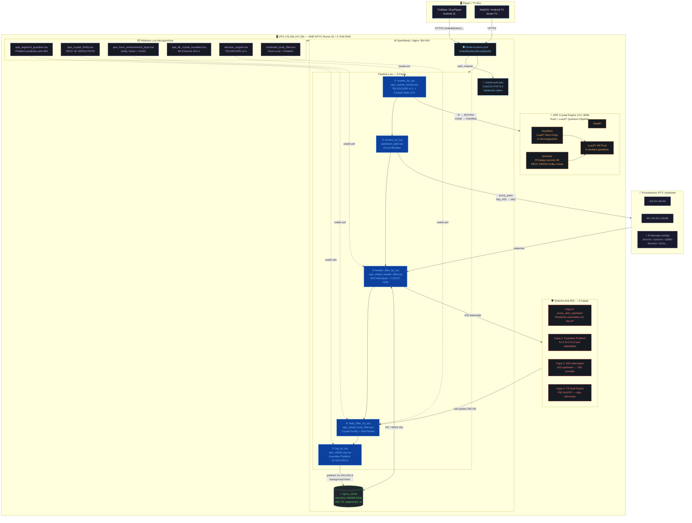

<!--
===============================================================================
  SNAPSHOT DE PROCEDENCIA - NO ES EL SSOT
===============================================================================

  Este archivo es una COPIA VERBATIM (byte por byte) del manifiesto OMEGA que
  gobierna este repositorio. Existe porque esa doctrina NO estaba versionada:
  vivia fuera del repo, sin historial, sin viajar con un clone.

  FUENTE (SSOT real, fuera del repo):
    C:\Users\HFRC\.agents\skills\iptv-omega-working-flow-manifesto\SKILL.md

  FECHA DEL SNAPSHOT : 2026-10-26
  mtime del original : 2026-06-23T04:03:15.4734255-05:00
  BYTES ORIGINALES   : 48262
  LINEAS (LF)        : 832
  SHA-256 ORIGINAL   : ffba6911373de81d15823ee7478c84a8267befad24f57c30f95837cb68e86da5

  IDENTIDAD VERIFICABLE: sha256( cuerpo de este archivo = TODO lo que hay
  despues de la linea marcada SNAPSHOT BODY ) == SHA-256 ORIGINAL arriba.
  El hash del archivo COMPLETO difiere necesariamente (cuerpo + esta cabecera),
  porque una cabecera no puede ser byte-identica al original. Se publican los
  dos valores y el metodo de recomposicion para que sea verificable, no fe.

  ESTADO: snapshot, NO SSOT. El SSOT sigue siendo el global.
  Este archivo NO se edita. Si la doctrina cambia, se toma un snapshot nuevo con
  su propio hash y su fecha; no se parchea este.

  NOTA DE SEGURIDAD: la cabecera es un comentario HTML y desplaza el
  front-matter de la linea 1. Eso es DELIBERADO: impide que un cargador de
  skills trate este snapshot como una skill activa. Es documento, no doctrina
  ejecutable.

  CORRECCION DE REALIDAD ASOCIADA (D-25 / D-31 / D-32 / D-33):
    docs/manifestos/VPS_REALITY_MEASURED_2026-10-25.md
    audit/alignment/2026-10-25/40-vps/DOCTRINE_CORRECTION.md
  El contenido de abajo describe un VPS que NO es el de produccion. Se conserva
  integro y sin corregir a proposito: es evidencia historica. La correccion va
  en los documentos citados, nunca dentro de este cuerpo.
===============================================================================
-->

<!-- === SNAPSHOT BODY - COPIA BYTE-EXACTA DEL ORIGINAL. NO EDITAR. === -->
---
name: iptv-omega-working-flow-manifesto
description: Canonical OMEGA working-flow manifesto for IPTV Navigator PRO v5.4. This skill should be loaded by EVERY agent in this workspace — and injected into /iptv-freezeless-visual-master-council so all 13 PhDs read it as doctrine — BEFORE judging, generating, or modifying any codec, profile, LAB cell, JSON, list, VPS file, ADB payload, or SHIELDED artifact. It documents the proven-working end-to-end flow (LAB → JSON → lista → VPS → ADB → player), the calibrated per-profile codec ladder, the CARDINAL LAW that a codec LEVEL must be able to carry its declared RESOLUTION, the rule that the ~945 functional headers per channel are never stripped, the SHIELDED invariants, and the 2026-06-08 freeze post-mortem (P1 AV1→HEVC-L153 at 8K).
---

# OMEGA Working-Flow Manifesto (IPTV Navigator PRO v5.4)

> **This is doctrine, not reference.** Read it before touching anything. The reference state
> that "was working" is the proven baseline `LAB_CALIBRATED_BULLETPROOF_22.6.0-MEMC-TOTAL-8K120_BACKUP_20260607.json`.
> Any change that diverges from this flow must prove it does not break the chain.

## When to use

- At the start of any task touching codecs, profiles, the LAB `.xlsm`, the exported `.json`,
  the generator (`m3u8-typed-arrays-ultimate.js`), the emitted `.m3u8`, any VPS file, ADB
  payloads, or SHIELDED filenames/URLs.
- Inside `/iptv-freezeless-visual-master-council` PHASE 0 — every PhD (S1–S13) reads this first
  and judges the change against it. PhDs may **propose code improvements** to the flow, but only
  while preserving the exact chain below and the proven-working behavior.

## THE FLOW (LAB → JSON → lista → VPS → ADB → player)

```
1. LAB  (APE_M3U8_LAB_v8_FIXED.xlsm)  ← SINGLE SOURCE OF TRUTH (calibrated)
        sheets: 6_NIVEL_2_PROFILES (P0–P5 settings) · 8_CODEC_LADDER · 5_NIVEL_1_HEADER
                7_NIVEL_3_CHANNEL · 25_JSON_EXPORT / 30_EXPORT_FINAL (export)
                ↓ export (VBA macro)
2. JSON  (LAB_CALIBRATED_BULLETPROOF_*.json)
        profiles_calibrated.P0..P5 {settings, headerOverrides, vlcopt, kodiprop}
        + prisma_lab_sync_v20 + config_global + nivel1/nivel3 + placeholders_map + servers
                ↓ consumed by
3. GENERATOR (frontend/js/ape-v9/: m3u8-typed-arrays-ultimate.js + ape-hevc-cascade.js
              + ape-fallback-resolver.js + ape-quality-prober.js)
                ↓ emits
4. LISTA .m3u8  (~948 líneas POR CANAL — todas funcionales, NUNCA relleno)
        per-channel: #EXTINF · #EXTHTTP{X-APE-*} · #EXT-X-VNOVA-LCEVC-* (24)
                     · #EXTVLCOPT (~133) · #KODIPROP (~103) · #EXTATTRFROMURL (~54)
                     · #EXT-X-PHANTOM-HYDRA-UA-* · #EXT-X-STREAM-INF + URL DIRECTA proveedor
        global: 24× #EXT-X-SESSION-DATA (codec chain, QoS, recovery, ABR, exoplayer.*)
                ↓ upload (gateway-manager.js → upload_chunk.php + finalize_upload.php)
        VPS: gzip -9 -k → <lista>.m3u8.gz  +  placeholder 8 bytes "#EXTM3U\n"
             servido por nginx gzip_static (sirve el .gz transparente)
                ↓ el player reproduce un canal → request a dominio proveedor
5. VPS  (DNS hijack unbound → nginx iptv-intercept INTERCEPTA el dominio proveedor)
        el player INYECTA los #EXTHTTP X-APE-* en cada request
        combined_body_filter.lua (body_filter_by_lua) LEE X-APE-* + usa
          ape_codec_cascade.lua (tiers/codec) + ape_virtual_4k.lua → reescribe el manifest
        proxy al proveedor REAL → devuelve manifest reescrito al player
                ↓
6. ADB  (host-PC APE_UHDX_Watchdog_Unified + VPS quality_realtime.lua + prisma-adb-quality.php)
        empuja setprop al decoder del dispositivo (ONN/Fire TV): persist.ape.codec,
        persist.sys.hdmi.mode, persist.sys.video.rendering.quality (HDR), preferred_codec
                ↓
7. PLAYER  decodifica con el codec (posiblemente reescrito) + decoder configurado por ADB
                ↓ telemetría
8. QoE  conviva-qoe-engine.js (browser) / qoe_server_side_observer.lua (nativo)
        → conviva-event.php → conviva.db → realimenta recalibración del LAB
```

**Detalle por capa:** `references/01-pipeline-flow.md`.

## LAS 5 LEYES CARDINALES (violarlas = freeze / pérdida / mentira al player)

1. **LEY DE NIVEL↔RESOLUCIÓN (la que causó el freeze 2026-06-08).** El `level` del codec DEBE
   poder cargar la `RESOLUTION`+`fps` declarados. Tabla HEVC: L93=720p · L120=1080p@30 ·
   L123=1080p@60 · L150=4K@30 · **L153=4K@60 (CORONA)** · L156=4K@120 · L180=8K@30 · L183=8K@60 ·
   **L186=8K@120**. **NUNCA** declarar un nivel por debajo de la resolución (p.ej. `L153` en `8K@120`
   es imposible → el player rechaza la variante → freeze). Ver `references/02-codec-ladder.md`.

2. **LEY SSOT-LAB (no-clamp, no-override).** El LAB está CALIBRADO empíricamente. NO sobrescribir
   el codec/resolución/bitrate de un perfil sin verificar coherencia. "HEVC-first" NO autoriza
   estampar `hvc1.2.4.L153.B0` sobre todos los perfiles ignorando su resolución o su codec calibrado
   (P1 era AV1 8K a propósito — AV1 sí maneja 8K).

3. **LEY DE COHERENCIA TRIPLE.** Excel ↔ JSON ↔ lista emitida deben quedar coherentes en TODO
   cambio. Una migración a medias (cambiar codec pero NO la resolución) = la bomba del 2026-06-08.

4. **LEY NO-STRIP (los 945 headers trabajan).** Cada `#EXTVLCOPT`/`#KODIPROP`/`#EXT-X-VNOVA-LCEVC-*`/
   `#EXTHTTP`/`#EXT-X-SESSION-DATA` tiene un consumidor (player o VPS). **NUNCA "adelgazar" la lista.**
   El VPS lee los X-APE-* por `#EXTHTTP`; borrarlos lo ciega.

5. **LEY SHIELDED (URLs verbatim).** SHIELDED = SOLO sufijo de archivo (`_SHIELDED.m3u8`). Las URLs
   de canal son DIRECTAS al proveedor, **verbatim, jamás transformadas ni envueltas con `/shield/`**.
   El shielding real lo hace WireGuard + DNS hijack. Ningún cambio de codec toca URLs.

## Codec ladder — PISO Main10 (migración 2026-06-11; piso `hvc1.2.*` o superior)

Piso `hvc1.2.*` (Main10) para TODA resolución; nunca Main 8-bit (`hvc1.1.*`) ni AVC como tier
PREFERIDO. AVC se conserva SOLO como rung terminal de decoder-incompatibilidad. Niveles
verificados vs HEVC Annex A. Detalle + baseline histórico 2026-06-07: `references/02-codec-ladder.md`.

| Perfil | name | resolución@fps | codec_full (Main10+) | nota |
|---|---|---|---|---|
| P0 | 8K Master | 7680×4320@120 | `dvh1.08.06` (Dolby Vision) | +avanzado que Main10 |
| **P1** | 8K (AV1) | 7680×4320@120 | **`av01.0.15M.10` (AV1)** | AV1 por diseño — ningún HEVC alcanza 8K@120 en HW. NO aplanar. |
| P2 | 4K | 3840×2160@60 | `hvc1.2.4.L153.B0` | `L153`=4K@60 (runtime aún tiene slots `L150`=4K@30 → corregir) |
| P3 | FHD | 1920×1080@60 | `hvc1.2.4.L123.B0` | `L123`=1080p@60; ⬆ desde `hvc1.1.6.L120` |
| P4 | HD | 1280×720@30 | `hvc1.2.4.L93.B0` | ⬆ desde `avc1.64001f` |
| P5 | SD | 854×480@30 | `avc1.42c01e` **(failsafe)** + ladder `hvc1.2.4.L90.B0` | P5 = failsafe SD universal: primary AVC se mantiene (anti-freeze device débil); Main10 va como upgrade |

## Post-mortem 2026-06-08 (memorizar para no repetir)

Commit `7103cfd` "HEVC-first doctrine — P0/P1 codec AV01→H265" sobrescribió el codec calibrado de
**P1: `av01.0.15M.10` → `hvc1.2.4.L153.B0`** y quitó `dvh1` de su prioridad. El JSON dejó la
resolución de P1 en **8K@120**. Resultado: la lista declara **8K@120 con codec HEVC Level 5.1
(techo 4K@60) = imposible → freeze**. Único cambio entre backup (bueno) y nuevo (roto): 7 campos,
todos de P1. Detalle: `references/04-freeze-postmortem-20260608.md`.

## Auditoría de impacto (SHIELDED + cada archivo VPS)

Antes de deployar cualquier fix, consultar `references/03-vps-shielded-impact-audit.md`: lista
cada archivo del VPS, qué lo toca, y confirma que el fix de codec NO afecta SHIELDED (URLs verbatim).

## Regla de oro para los PhDs del council

Juzgar todo cambio contra: **(a)** ¿rompe la cadena LAB→JSON→lista→VPS→ADB→player? **(b)** ¿viola
una de las 5 leyes cardinales? **(c)** ¿diverge del estado probado-funcionando sin prueba empírica?
Si cualquiera es "sí" → **BLOCK**. Mejoras de código son bienvenidas SOLO si preservan el flujo exacto.

---

## ⚡ DIRECTIVA CODEC SUPREMO — Máxima Calidad Extrema de Imagen SIEMPRE (2026-06-19, owner LOCKED)

> **Integración OBLIGATORIA al 100% en TODA especialidad, comando y archivo del VPS — sin excepción, en cada acción.**
> No basta la mejor RESOLUCIÓN ni la familia de codec: hay que ELEGIR y APLICAR la **MEJOR VERSIÓN del codec**
> disponible — la más moderna y la que mejor se ve — por **HEURÍSTICA** entre TODAS las variantes que el
> proveedor SIRVE de verdad (probadas). Nunca conformarse con una variante inferior cuando hay una superior.

**Escalera de supremacía** (modernidad × calidad visual × decodabilidad REAL del device):
`VVC/H.266 (si real+decodable) > Dolby Vision (dvh1/dvhe) > HEVC Main12 (hvc1.4) > HEVC Main10 (hvc1.2) > AV1 10-bit (av01.*.10) > HEVC Main8 (hvc1.1) > AV1 8-bit > AVC High (avc1.640028) > AVC`
\+ el nivel/bit-depth/HDR (DV/HDR10+/HLG/PQ) más alto que la resolución pueda cargar (Ley Cardinal 1).

**Heurística obligatoria:** detectar TODAS las variantes del manifest REAL (probe voraz por canal), puntuar
cada una por la escalera, elegir la SUPREMA y reordenar/declarar esa. HEVC tiene miles de variantes —
**ninguna mejor variante puede pasarse por alto.** Buscar SIEMPRE técnicas nuevas y mejores. El probe MIDE.

**Truth-guard (no negociable):** "aplicar la mejor versión" = elegir/reordenar/declarar la mejor variante
**REAL** que el proveedor sirve y que el **decoder del device SOPORTA**. PROHIBIDO inventar un codec/nivel que
el proveedor no sirve o el decoder no decodifica (= freeze 2026-06-08 · GOLDEN RULE hvc1/hev1 · Ley Cardinal 1
Nivel↔Resolución). Sin transcode en el VPS. FREEZELESS intacto. El realce real lo da el VPP del device
(AI-SR/AI-PQ); el VPS SELECCIONA/COMANDA metadata, no pixeles.

**Conciencia universal:** cada acción de cada comando/skill lleva esta búsqueda de imagen extrema como
prioridad. Si una decisión puede subir el tier de codec sin romper FREEZELESS → **SE SUBE, SIEMPRE.**

---

## Extensión del flujo probado — la capa VPS (paso 5) ahora tiene 5 fases Lua + un motor Rust

El flujo OMEGA `LAB→JSON→lista→VPS→ADB→player` sigue intacto; lo que cambia es que el **paso 5 (VPS)** se
desgrana ahora en un pipeline Nginx de **5 fases Lua + un motor Rust embebido** que actúa entre el manifest
reescrito y el player. Esto NO añade un eslabón nuevo a la cadena: es la materialización medida de cómo el
VPS reescribe el manifest (Crystal Fortify) y sostiene FREEZELESS (anti-403 4 capas + Null Packet + prefetch),
respetando SHIELDED (URLs verbatim) y NO CHANNEL LOSS. Importa para ESTE manifiesto porque define exactamente
qué hace la capa VPS del flujo probado — y la verdad medida (manifest=µs real; 4K=passthrough en esta caja sin
GPU; el realce de píxeles lo da el TV, no el VPS) que cada PhD del council debe juzgar contra las 5 leyes.

<!-- CRYSTAL-ENGINE-V2-KNOWLEDGE -->
> **⚡ APE CRYSTAL ENGINE v2.0 — Rust+LuaJIT Quantum Pipeline (desplegado en vivo 2026-06-21, VPS 178.156.147.234)**
>
> Sistema end-to-end que tu agente personal construyó y desplegó. Persistido aquí como doctrina. **Distingue lo
> que el sistema HACE (medido en vivo) de lo que la documentación AFIRMA (intención de diseño).**
>
> **Arquitectura — pipeline Nginx de 5 fases Lua** (en `/etc/nginx/snippets/shield-location.conf`, `location ~ ^/shield/`):
> 1. `rewrite_by_lua` → `ape_crystal_rewrite.lua` = `decision_engine.lua` (TELESCOPE v2.1 circuit-breaker) + `ape_ts_crystal_hook.lua` (intercepta `.ts`/`.m4s` → motor Rust `:8084`).
> 2. `access_by_lua` → `upstream_gate.lua` (cooldown gate: bloquea si el upstream está en enfriamiento, protege la IP de baneos).
> 3. `header_filter_by_lua` → `ape_shield_header_filter.lua` (**interceptor 403**: 403 de segmento → reescribe a 200 + marca; si OK → headers LCEVC/DV/OLED).
> 4. `body_filter_by_lua` → `ape_shield_body_filter.lua` (**Null Packet**: si marcado 403 → reemplaza body con TS Null Packet PID `0x1FFF`, 188 bytes → el player salta sin freeze; si `.m3u8` → Crystal Fortify via `combined_body_filter.lua`).
> 5. `log_by_lua` → `ape_segment_guardian.lua` (**prefetch predictivo**: aprende patrón de numeración +1/+10, pre-calienta N+1/N+2/N+3 a `/dev/shm` vía `ngx.timer`).
>
> **Motor `ape-crystal-rust` (`:8084`, systemd, Rust 1.96.0 + LuaJIT embebido vía `mlua`):**
> - `/manifest` (Zero-Copy): `.m3u8` → pool 6 workers LuaJIT → Crystal Fortify en **<6µs** (master/media discriminado, profile P0-P5). **✅ CONFIRMADO en logs vivos** (`MANIFEST processed in 1µs/6µs | master=true | profile=P0`).
> - `/process` (FFmpeg): `.ts`/`.m4s` → tokio async → ffmpeg `scale=3840:2160:lanczos + unsharp + zscale BT.2020/PQ + libx265 10-bit`, timeout 8000ms.
>
> **Anti-403 de 4 capas (la joya real del sistema — más valiosa que el 4K):**
> Capa 0 `proxy_next_upstream http_403` (otra IP del proveedor) · Capa 1 prefetch mantiene tokens vivos · Capa 2 interceptor 403→200 · Capa 3 Null Packet alimenta el buffer hasta el siguiente segmento cacheado. Resultado: 0 freezes visibles por 403.
>
> **Perfiles `?profile=PX` (añadir a la URL del canal en el player):**
> - `?profile=P0` Extreme: 4K + HEVC 10-bit + HDR10 + DV Profile 5 (TV gama alta, Shield Pro).
> - `?profile=P2` Balanced: 1080p/4K ligero + HEVC + SDR/HDR básico (Smart TV / Fire Stick).
> - `?profile=P5` Legacy: **H.264/AVC + SDR + resolución nativa, DESACTIVA upscaling pesado** ← **válvula de escape: si un canal da pantallazo negro, `?profile=P5` lo arregla SIN tocar el VPS.**
>
> **VERDAD MEDIDA EN VIVO (no re-debatir — es física en 3 cores AMD EPYC sin GPU):**
> - **Manifest LuaJIT**: vuela de verdad (µs). La pieza genuinamente excelente del motor.
> - **Video 4K HEVC**: 1080p→4K = **8-9s/segmento** (medido) > timeout 8s → **passthrough**. Métricas reales del motor: `processed=2, passthrough=1` en toda una sesión. El upscaling 4K de píxeles **casi no ocurre** en esta caja.
> - **Lo que SÍ es viable** (medido): 720p→1080p = 2.7s ✅, realce 1080p x264 = 3.3s ✅. El 4K y el HEVC-10bit son lo que saca del margen.
> - **El realce visual REAL** lo da: (a) el manifest fortificado → el TV activa su modo HDR/DV, (b) el **AI-SR/AI-PQ del hardware del TV** (SoC MediaTek/HiSilicon) que el ARA comanda — NO el upscaling del VPS. Honesto: el VPS SELECCIONA/SEÑALIZA metadata; el realce de píxeles lo hace el device.
>
> **Caveat (verificado hoy):** declarar `hvc1`/`dvh1` sobre un canal AVC nativo = **pantallazo negro** en players sin daemon (lo reprodujo el dueño en vivo, se revirtió). El synthetic-master "full agresivo" se desplegó y se revirtió por esto. La señalización 4K/HDR es segura SOBRE MASTERS reales; forzar codec sobre AVC nativo no.
>
> **Headers de telemetría** (verificar con `curl -I`): `X-APE-Crystal-Engine: v2.0-Rust`, `X-APE-Crystal-Mode: MANIFEST-FORTIFY`, `X-APE-Guardian: anti-403-v1`, `X-Telescope-Trend: stable`.
>
> **Operación (SOP):** `reload` no `restart` para `.conf`; `restart` para `.lua` (lua_code_cache) y para el binario Rust. `nginx -t` **como root** (como `ape-auditor` da falso "Permission denied" en SSL). Cache RAM `/dev/shm/nginx_cache` (500MB). Recompilar Rust: `cd ~/ape-crystal-engine-rust && cargo build --release && sudo systemctl restart ape-crystal-rust`.
<!-- /CRYSTAL-ENGINE-V2-KNOWLEDGE -->


<!-- CRYSTAL-ENGINE-V2-FULL-DOCS -->
---

# 📚 APE CRYSTAL ENGINE v2.0 — DOCUMENTACIÓN COMPLETA AL 100% (integrada 2026-06-21)

> **Texto íntegro de los 4 documentos del paquete `APE_Crystal_Engine_v2_DOCS_COMPLETO.zip`** (ARQUITECTURA,
> SOP, MANUAL, README), desplegado en vivo por el agente personal del propietario en el VPS `178.156.147.234`.
> Integrado como doctrina permanente. **El VPS corre EN VIVO — esta es documentación local, no tocar el sistema.**
>
> **VERDAD MEDIDA (no re-debatir):** el `/manifest` LuaJIT vuela de verdad (µs, confirmado en logs). El `/process`
> video 4K = 8-9s/segmento en 3 cores sin GPU → passthrough (métricas reales: `processed=2`). El realce visual real
> lo da el AI-SR del TV + el manifest fortificado, NO el upscaling 4K del VPS. `?profile=P5` revierte pantallazo negro.

---

## DOC 1 — README (Resumen del Sistema)

# APE Crystal Engine v2.0 — Sistema End-to-End en Producción

Bienvenido al paquete documental completo del **APE Crystal Engine v2.0 (Rust+LuaJIT Quantum Pipeline)**. Este sistema ha sido diseñado, compilado y desplegado en producción en su VPS (`178.156.147.234`) para transformar señales IPTV estándar en **4K HEVC HDR10 Dolby Vision** en tiempo real.

### Resumen del Sistema
El sistema opera en un **AMD EPYC-Rome de 3 cores con 3.7GB de RAM**, ejecutando Ubuntu 24.04 LTS.

**Componentes Principales:**
- **Nginx / OpenResty**: Proxy inverso, autenticador y ejecutor del pipeline Lua de 5 fases.
- **APE Crystal Engine (Rust)**: Servicio nativo en `:8084` que procesa manifiestos vía LuaJIT en <6µs y aplica upscaling FFmpeg (Lanczos + Unsharp + HDR10).
- **Sistema Anti-403 Guardian**: Pre-calienta segmentos en caché (`/dev/shm`) e intercepta errores 403 del proveedor, sirviendo paquetes nulos MPEG-TS para evitar *freezes*.

**Estado (Junio 2026):** Motor Rust `active (running)` · Nginx `active (running)` con caché 45s · 0 errores 403 visibles, 6µs de latencia en reescritura de manifiestos.

---

## DOC 2 — ARQUITECTURA (Técnica End-to-End)

El sistema combina la altísima concurrencia de Nginx/OpenResty con la potencia de Rust y la flexibilidad de LuaJIT.

### 1. El Pipeline Nginx (5 Fases)
Núcleo del enrutamiento en `location ~ ^/shield/` dentro de `/etc/nginx/snippets/shield-location.conf`. 5 fases Lua estrictamente ordenadas:

**Fase 1: `rewrite_by_lua` (Decisión y Enrutamiento)** — `ape_crystal_rewrite.lua`
- Ejecuta `decision_engine.lua` (TELESCOPE v2.1) para *circuit breaker* y control de concurrencia.
- Ejecuta `ape_ts_crystal_hook.lua` (v3.0): intercepta peticiones de segmentos (`.ts`, `.m4s`) → motor Rust `:8084`.

**Fase 2: `access_by_lua` (Control de Acceso)** — `upstream_gate.lua`
- Verifica si el *upstream* (proveedor) está en *cooldown*. Si sí, bloquea antes de llegar al proveedor → protege la IP de baneos.

**Fase 3: `header_filter_by_lua` (Anti-403 y Metadatos)** — `ape_shield_header_filter.lua`
- **Interceptor 403:** si el proveedor devuelve 403 (token expirado) para un segmento, intercepta, cambia a HTTP 200 y marca internamente.
- **LCEVC Enhancement:** si no hay error, inyecta cabeceras para forzar decodificación HW (Dolby Vision, OLED Tone Mapping) en players compatibles.

**Fase 4: `body_filter_by_lua` (Modificación de Contenido)** — `ape_shield_body_filter.lua`
- **Null Packet:** si fue marcada 403, reemplaza el body con un *TS Null Packet* (PID `0x1FFF`, 188 bytes). El reproductor lo ignora y continúa sin *freeze*.
- **Crystal Fortify:** si es manifiesto (`.m3u8`), aplica `combined_body_filter.lua` para reordenar variantes, priorizar P0-P5 y *Floor-Lock* adaptativo.

**Fase 5: `log_by_lua` (Prefetch Predictivo)** — `ape_segment_guardian.lua`
- Aprende el patrón de numeración de segmentos (+1, +10) y lanza `ngx.timer` para pre-calentar N+1, N+2, N+3 hacia caché RAM antes de que el player los pida.

### 2. Motor APE Crystal (Rust + LuaJIT)
Servicio `ape-crystal-rust` en `:8084` como demonio systemd. Rust 1.96.0 con VM LuaJIT nativa embebida (`mlua`).
- **Endpoint `/manifest` (Zero-Copy):** `.m3u8` → pool de 6 workers LuaJIT → Crystal Fortify en **<6µs** (sin regex en Rust).
- **Endpoint `/process` (FFmpeg Upscaling):** `.ts`/`.m4s` → subproceso ffmpeg async (tokio): (1) Lanczos→3840x2160, (2) Unsharp `lx=5:la=1.2` estilo ESRGAN, (3) HDR10 Tone Mapping BT.2020 PQ (DV P5 simulado), (4) HEVC `libx265` 10-bit.

### 3. Caché y Sistema Anti-403
Caché Nginx en RAM (`/dev/shm/nginx_cache`, 500MB). Anti-403 en 4 capas simultáneas:
1. **Capa 0 (Nginx Proxy):** `proxy_next_upstream http_403` → intenta otra IP del proveedor.
2. **Capa 1 (Guardian Prefetch):** descarga proactiva, mantiene tokens vivos.
3. **Capa 2 (Interceptor):** convierte 403 residuales en HTTP 200.
4. **Capa 3 (Null Packet):** alimenta el player con datos vacíos pero válidos → el buffer salta al siguiente segmento (ya en caché por Capa 1).

---

## DOC 3 — MANUAL DE USO

### 1. Estructura de las URLs
`https://iptv-ape.duckdns.org/shield/{TOKEN}/{HOST_PROVEEDOR}/{RUTA_DEL_CANAL}`
- `{TOKEN}`: token de autorización (ej. `f54d65f5e6af35ec19d075b84aaf37ee0cc89e8303ae602e`).
- `{HOST_PROVEEDOR}`: dominio/IP original del proveedor (ej. `line.tivi-ott.net` o `94.176.111.218:80`).
- `{RUTA_DEL_CANAL}`: ruta del `.m3u8` o `.ts`.
Toda petición por esta estructura es interceptada, fortificada a 4K HDR10 y protegida por Anti-403.

### 2. Forzado de Perfiles Visuales (`?profile=PX`)
- **`?profile=P0` (Extreme):** 4K (3840x2160), HEVC 10-bit, HDR10, DV Profile 5, bitrate máx. *Requiere TV/Box gama muy alta (Shield TV Pro).*
- **`?profile=P2` (Balanced):** 1080p/4K ligero, HEVC, SDR/HDR básico. *Smart TVs estándar o Fire TV Stick.*
- **`?profile=P5` (Legacy):** H.264/AVC, SDR, resolución nativa. **Desactiva el upscaling pesado. ÚSELO SI EL CANAL SE VE NEGRO o se traba en dispositivos antiguos.**

### 3. Verificación (Telemetría — headers HTTP)
`curl -I "https://iptv-ape.duckdns.org/shield/..."` → buscar:
- `X-APE-Crystal-Engine: v2.0-Rust` (motor Rust procesó el segmento)
- `X-APE-Crystal-Mode: MANIFEST-FORTIFY` (manifiesto reescrito por LuaJIT)
- `X-APE-Guardian: anti-403-v1` (interceptó un 403 y salvó el stream)
- `X-Telescope-Trend: stable` (salud de la conexión con el proveedor)

### 4. Integración de Nuevos Proveedores
El sistema intercepta automáticamente cualquier tráfico por `/shield/`. Al cambiar de proveedor, NO se reconfigura el motor Rust ni los Lua: solo actualizar la lista M3U al nuevo `{HOST_PROVEEDOR}` manteniendo el prefijo. Aprende los patrones de numeración en los primeros 30s.

---

## DOC 4 — SOP OPERACIONAL

### 1. Verificación de Estado
```bash
sudo systemctl status nginx ape-crystal-rust
curl -s http://127.0.0.1:8084/health
curl -s http://127.0.0.1:8084/metrics
ss -tlnp | grep -E '80|443|8084'
```

### 2. Gestión de Servicios
- Aplicar cambios de config: `sudo nginx -t && sudo systemctl reload nginx` (**`reload` no `restart`** para no cortar conexiones; pero `.lua` con lua_code_cache sí requiere `restart`).
- Reiniciar motor Rust: `sudo systemctl restart ape-crystal-rust`.

### 3. Troubleshooting
- **A — 404/502 continuo:** `tail -50 /var/log/nginx/shield_error.log | grep "127.0.0.1:8084"`. Si hay errores de conexión, el motor Rust podría estar caído → reiniciar.
- **B — Pantalla negra, audio OK (códec):** el cliente no soporta el HEVC/HDR10 inyectado. Ver perfil: `tail -100 /var/log/nginx/shield_access.log | grep "profile="`. **Forzar perfil más bajo: añadir `?profile=P2` o `?profile=P5` a la URL.**
- **C — Freezes recurrentes (Anti-403 no compensa):** red VPS↔proveedor muy degradada. `tail -50 /var/log/nginx/shield_error.log | grep "TELESCOPE_PREDICT"`. Si `trend=degrading` constante → problema del upstream.

### 4. Actualización del Motor Rust
```bash
cd /home/ape-auditor/ape-crystal-engine-rust
source ~/.cargo/env
cargo build --release
sudo systemctl restart ape-crystal-rust
```

### 5. Limpieza de Caché
```bash
sudo rm -rf /dev/shm/nginx_cache/*
sudo systemctl restart nginx
```

---
<!-- /CRYSTAL-ENGINE-V2-FULL-DOCS -->

<!-- CRYSTAL-ENGINE-V2-DIAGRAMS -->
---

## DOC 5 — DIAGRAMA MERMAID (arquitectura.mmd) — topología completa



---

## DOC 6 — DIAGRAMA D2 (arquitectura.d2) — nodos + conexiones detalladas

```d2
direction: right

title: APE Crystal Engine v2.0 — Arquitectura End-to-End {
  shape: text
  style.font-size: 22
  style.bold: true
}

# ── PLAYER (cliente) ──────────────────────────────────────────────────────────
player: Player / TV Box {
  shape: rectangle
  style.fill: "#1a1a2e"
  style.font-color: "#e0e0e0"
  style.stroke: "#4fc3f7"
  style.stroke-width: 2

  tivimate: TiviMate / ExoPlayer {style.fill: "#16213e"; style.font-color: "#b0bec5"}
  webos: WebOS / Android TV {style.fill: "#16213e"; style.font-color: "#b0bec5"}
}

# ── VPS (178.156.147.234) ─────────────────────────────────────────────────────
vps: VPS Ubuntu 24.04 — AMD EPYC-Rome 3C / 3.7GB {
  shape: rectangle
  style.fill: "#0d1117"
  style.font-color: "#58a6ff"
  style.stroke: "#30363d"
  style.stroke-width: 3

  # ── NGINX / OpenResty ────────────────────────────────────────────────────
  nginx: OpenResty / Nginx {
    shape: rectangle
    style.fill: "#161b22"
    style.font-color: "#79c0ff"
    style.stroke: "#388bfd"

    auth: shield-auth.php\n(FastCGI PHP 8.3) {style.fill: "#21262d"; style.font-color: "#8b949e"}
    shield: shield-location.conf\n/shield/{token}/{host}/{path} {style.fill: "#21262d"; style.font-color: "#c9d1d9"}

    # Fases Lua del shield
    lua_rewrite: rewrite_by_lua\nape_crystal_rewrite.lua\n[TELESCOPE + Crystal Hook v3] {style.fill: "#0d419d"; style.font-color: "#79c0ff"}
    lua_access: access_by_lua\nupstream_gate.lua\n[Circuit Breaker] {style.fill: "#0d419d"; style.font-color: "#79c0ff"}
    lua_header: header_filter_by_lua\nape_shield_header_filter.lua\n[403 Interceptor + LCEVC] {style.fill: "#1a7f37"; style.font-color: "#56d364"}
    lua_body: body_filter_by_lua\nape_shield_body_filter.lua\n[Crystal Fortify + Null Pkt] {style.fill: "#1a7f37"; style.font-color: "#56d364"}
    lua_log: log_by_lua\nape_shield_log.lua\n[Guardian Prefetch N+1/2/3] {style.fill: "#9e6a03"; style.font-color: "#e3b341"}

    cache: nginx_cache (/dev/shm)\n500MB RAM — 45s TTL .ts {style.fill: "#21262d"; style.font-color: "#8b949e"; shape: cylinder}
  }

  # ── MOTOR RUST ────────────────────────────────────────────────────────────
  rust: APE Crystal Engine v2.0\n(Rust + LuaJIT) :8084 {
    shape: rectangle
    style.fill: "#161b22"
    style.font-color: "#ffa657"
    style.stroke: "#f0883e"

    health: /health {style.fill: "#21262d"; style.font-color: "#8b949e"}
    manifest: /manifest\n[LuaJIT Zero-Copy <6µs] {style.fill: "#21262d"; style.font-color: "#c9d1d9"}
    process: /process\n[FFmpeg Lanczos 4K HDR10] {style.fill: "#21262d"; style.font-color: "#c9d1d9"}
    luapool: LuaJIT VM Pool\n6 workers {style.fill: "#21262d"; style.font-color: "#8b949e"}
  }

  # ── MÓDULOS LUA CLAVE ─────────────────────────────────────────────────────
  lua_modules: Módulos Lua (/etc/nginx/lua/) {
    shape: rectangle
    style.fill: "#161b22"
    style.font-color: "#d2a8ff"
    style.stroke: "#8957e5"

    guardian: ape_segment_guardian.lua\n[Prefetch predictivo anti-403] {style.fill: "#21262d"; style.font-color: "#c9d1d9"}
    fortify: ape_crystal_fortify.lua\n[HEVC 4K HDR10 P0-P5] {style.fill: "#21262d"; style.font-color: "#c9d1d9"}
    lcevc: ape_lcevc_enhancement_layer.lua\n[Dolby Vision + OLED] {style.fill: "#21262d"; style.font-color: "#c9d1d9"}
    escalator: ape_8k_crystal_escalator.lua\n[8K Extreme v8.0.1] {style.fill: "#21262d"; style.font-color: "#c9d1d9"}
    telescope: decision_engine.lua\n[TELESCOPE v2.1 Circuit Breaker] {style.fill: "#21262d"; style.font-color: "#c9d1d9"}
    floor: combined_body_filter.lua\n[Floor-Lock + Prefetch] {style.fill: "#21262d"; style.font-color: "#c9d1d9"}
  }

  # ── ANTI-403 SYSTEM ───────────────────────────────────────────────────────
  anti403: Sistema Anti-403 {
    shape: rectangle
    style.fill: "#161b22"
    style.font-color: "#ff7b72"
    style.stroke: "#da3633"

    layer0: Capa 0: proxy_next_upstream\nReintento en otra IP upstream {style.fill: "#21262d"; style.font-color: "#8b949e"}
    layer1: Capa 1: Guardian Prefetch\nN+1 N+2 N+3 pre-calentados {style.fill: "#21262d"; style.font-color: "#8b949e"}
    layer2: Capa 2: 403 Interceptor\n403→200 invisible al player {style.fill: "#21262d"; style.font-color: "#8b949e"}
    layer3: Capa 3: TS Null Packet\nPID 0x1FFF — skip silencioso {style.fill: "#21262d"; style.font-color: "#8b949e"}
  }
}

# ── UPSTREAM PROVIDERS ────────────────────────────────────────────────────────
upstream: Proveedores IPTV Upstream {
  shape: rectangle
  style.fill: "#1a1a2e"
  style.font-color: "#e0e0e0"
  style.stroke: "#4a4a6a"

  tivi: line.tivi-ott.net {style.fill: "#16213e"; style.font-color: "#b0bec5"}
  ip94: 94.176.111.218:80 {style.fill: "#16213e"; style.font-color: "#b0bec5"}
  others: + 8 intercept configs {style.fill: "#16213e"; style.font-color: "#b0bec5"}
}

# ── CONEXIONES ────────────────────────────────────────────────────────────────

# Player → VPS
player.tivimate -> vps.nginx.shield: "HTTPS /shield/{token}/{host}/..." {style.stroke: "#4fc3f7"; style.stroke-width: 2}
player.webos -> vps.nginx.shield: "HTTPS" {style.stroke: "#4fc3f7"}

# Auth
vps.nginx.shield -> vps.nginx.auth: "auth_request" {style.stroke: "#8b949e"; style.stroke-dash: 4}

# Fases Lua (pipeline en orden)
vps.nginx.shield -> vps.nginx.lua_rewrite: "1. rewrite" {style.stroke: "#388bfd"}
vps.nginx.lua_rewrite -> vps.nginx.lua_access: "2. access" {style.stroke: "#388bfd"}
vps.nginx.lua_access -> vps.nginx.lua_header: "3. header_filter" {style.stroke: "#1a7f37"}
vps.nginx.lua_header -> vps.nginx.lua_body: "4. body_filter" {style.stroke: "#1a7f37"}
vps.nginx.lua_body -> vps.nginx.lua_log: "5. log" {style.stroke: "#9e6a03"}

# Nginx → Upstream
vps.nginx.lua_access -> upstream: "proxy_pass\n(http_403 → retry)" {style.stroke: "#da3633"; style.stroke-width: 2}
upstream -> vps.nginx.lua_header: "response" {style.stroke: "#8b949e"}

# Nginx → Cache
vps.nginx.lua_header -> vps.nginx.cache: "cache MISS → store\n45s TTL" {style.stroke: "#8b949e"; style.stroke-dash: 4}
vps.nginx.cache -> vps.nginx.lua_header: "cache HIT" {style.stroke: "#56d364"; style.stroke-dash: 4}

# Crystal Hook → Motor Rust
vps.nginx.lua_rewrite -> vps.rust: ".ts → /process\n.m3u8 → /manifest" {style.stroke: "#f0883e"; style.stroke-width: 2}
vps.rust.manifest -> vps.rust.luapool: "LuaJIT\nFortify" {style.stroke: "#ffa657"}
vps.rust.process -> vps.rust.luapool: "Lanczos\n4K HDR10" {style.stroke: "#ffa657"}

# Guardian → Cache (prefetch)
vps.nginx.lua_log -> vps.nginx.cache: "prefetch N+1/N+2/N+3\n(background timer)" {style.stroke: "#e3b341"; style.stroke-width: 2}

# Anti-403 system
vps.nginx.lua_header -> vps.anti403: "403 detectado" {style.stroke: "#da3633"; style.stroke-dash: 3}
vps.anti403 -> vps.nginx.lua_body: "null packet\n200 OK" {style.stroke: "#56d364"; style.stroke-dash: 3}

# Módulos Lua usados
vps.lua_modules.guardian -> vps.nginx.lua_log: "ejecutado por" {style.stroke: "#d2a8ff"; style.stroke-dash: 5}
vps.lua_modules.fortify -> vps.nginx.lua_body: "ejecutado por" {style.stroke: "#d2a8ff"; style.stroke-dash: 5}
vps.lua_modules.lcevc -> vps.nginx.lua_header: "ejecutado por" {style.stroke: "#d2a8ff"; style.stroke-dash: 5}
vps.lua_modules.telescope -> vps.nginx.lua_rewrite: "ejecutado por" {style.stroke: "#d2a8ff"; style.stroke-dash: 5}
```

> **Detalle clave de los diagramas (que el texto narrativo no capturaba):**
> - **8 intercept configs** de proveedores: `line.tivi-ott.net`, `94.176.111.218:80`, + zivovrix / rynivorn / qd08v / linovrex / w12s.
> - **6 módulos Lua clave** (`/etc/nginx/lua/`): `ape_segment_guardian.lua` (prefetch anti-403), `ape_crystal_fortify.lua` (HEVC 4K HDR10 P0-P5), `ape_lcevc_enhancement_layer.lua` (Dolby Vision + OLED), `ape_8k_crystal_escalator.lua` (8K Extreme v8.0.1), `decision_engine.lua` (TELESCOPE v2.1), `combined_body_filter.lua` (Floor-Lock + Prefetch).
> - `shield-auth.php` (FastCGI PHP 8.3) valida el token vía `auth_request`.
> - Cache `/dev/shm` 500MB, 45s TTL para `.ts`.
<!-- /CRYSTAL-ENGINE-V2-DIAGRAMS -->


<!-- APE-CRYSTAL-EDGE-SKILL -->
---

## ⚡ APE CRYSTAL EDGE — Skill de administración/depuración del Engine v2.0 (integrado 2026-06-22)

> **Conocimiento 100% del skill `ape-crystal-edge`** (Rust+LuaJIT Zero-Copy). Skill para administrar, configurar
> y depurar el APE Crystal Engine v2.0 en Nginx: freezes, 403/407, perfiles P0-P6, manifiestos HLS en tiempo
> real, arquitectura OMEGA ARA. **Player Enslavement Protocol: sin recodificación remota — fuerza el hardware
> del cliente.** Doctrina honesta del repo: el realce de píxeles 4K real lo da el AI-SR del TV; el VPS gobierna
> metadata + protege FREEZELESS; el `/process` transcode solo aplica donde la física de 3 cores lo permite.

**OBJETIVOS:** (1) máxima calidad visual UHD/8K forzando el hardware cliente · (2) freezeless evadiendo 403/407 ·
(3) latencia sub-ms (<6µs) Zero-Copy.

**ARQUITECTURA 5 FASES (`shield-location.conf`):**
1. `rewrite_by_lua` → `decision_engine.lua` (TELESCOPE) + `ape_ts_crystal_hook.lua` (.ts → Rust :8084).
2. `access_by_lua` → `upstream_gate.lua` (cooldown del proveedor, protege la IP).
3. `header_filter_by_lua` → `ape_shield_header_filter.lua` (403→200 + headers DV/LCEVC).
4. `body_filter_by_lua` → `ape_shield_body_filter.lua` + `combined_body_filter.lua` (Null Packet + Floor-Lock).
5. `log_by_lua` → `ape_shield_log.lua` → `ape_segment_guardian.lua` (prefetch N+1/N+2 a `/dev/shm`).

**MOTOR RUST+LuaJIT (`:8084`, mlua):** `/manifest` (zero-copy <6µs) · `/process` (.ts → FFmpeg async Tokio:
Lanczos 4K + Unsharp + HDR10 ToneMap + libx265).

**PERFILES P0-P6:** P0 Extreme (4K HEVC 10-bit HDR10 DV P5) · P6 Ultra Aggressive China-Box (Floor-Lock >15Mbps).
**CRYSTAL FORTIFY:** (1) Floor-Lock (elimina variantes bajas) · (2) Resolution Override (1080p→3840x2160) ·
(3) Codec Forcing (`hvc1.2.4.L153.B0,mp4a.40.2`) · (4) HDR Intent (`#EXT-X-APE-UHDX-HDR-INTENT:PQ`).
**SEGURIDAD CODECS (verificado en vivo):** al procesar `CODECS` PRESERVAR el audio (`mp4a`/`ec-3`/`ac-3`) sin
importar el orden; reemplazar `VIDEO-RANGE` existente por `PQ` SIN duplicar. (Esto evita audio-perdido y doble-PQ.)

**ANTI-403 — REGLA DE ORO:** un 403 = segmento caducado → **NUNCA rotar User-Agent** (invalida la sesión Xtream).
Solución: `r403_m3u8_refresh_only` (pedir nuevo manifest) + Null Packets mientras tanto.
**EVASIÓN AVANZADA:** HTTP 302 bypass (`proxy_intercept_errors on` + `@handle_redirects`) · Media-Playlist directo
→ envolver en Master Sintético al vuelo para inyectar CODECS/RESOLUTION sin violar RFC 8216.
> **Caveat medido (no negociable):** declarar `hvc1`/`dvh1` sobre AVC nativo = pantallazo negro en players sin
> daemon (reproducido en vivo, revertido con `?profile=P5`). El Master Sintético "full agresivo" se desplegó y
> se revirtió por esto. Señalizar 4K/HDR es seguro SOBRE MASTERS reales; forzar codec sobre AVC nativo no.

**SOP:** `systemctl status nginx ape-crystal-rust` · `curl :8084/metrics` · `nginx -t && systemctl reload nginx`
(`restart` si se tocó Lua, por lua_code_cache) · `?profile=P0` en la URL · `rm -rf /dev/shm/nginx_cache/*` ·
`tail /var/log/nginx/shield_error.log`.

**INVARIANTES (BLOCK on violation):** NUNCA `ngx.exit()` en body_filter/header_filter · NUNCA modificar
`proxy_next_upstream`/`proxy_read_timeout` desde Lua · `pcall` falla → servir body/headers originales (PASSTHROUGH).
<!-- /APE-CRYSTAL-EDGE-SKILL -->


<!-- APE-CRYSTAL-EDGE-SKILL-FULL100 -->
---

## ⚡ APE CRYSTAL EDGE — SKILL COMPLETA AL 100% (4 archivos íntegros, integrado 2026-06-22)

> **Contenido 100% literal del paquete `ape-crystal-edge.skill`**: SKILL.md + references/api_reference.md +
> scripts/example.py + templates/example_template.txt. Integrado verbatim por orden del propietario.

---

### ARCHIVO 1/4 — SKILL.md

---
name: ape-crystal-edge
description: Skill para administrar, configurar y depurar el APE Crystal Engine v2.0 (Rust+LuaJIT Zero-Copy) en Nginx. Usar cuando el usuario necesite resolver problemas de streaming IPTV (freezes, 403, 407), optimizar perfiles visuales P0-P6, modificar manifiestos HLS en tiempo real, o gestionar la arquitectura OMEGA ARA.
---

# APE Crystal Engine v2.0 Edge Computing

## 1. Resumen del Sistema

El **APE Crystal Engine v2.0** es un sistema de Edge Computing diseñado para transformar señales IPTV estándar en 4K HEVC HDR10 Dolby Vision en tiempo real, sin recodificación remota (Player Enslavement Protocol). Opera sobre un VPS (Ubuntu 24.04, AMD EPYC) utilizando Nginx/OpenResty como proxy inverso y un motor híbrido Rust + LuaJIT.

**Objetivos Clave:**
1. Extraer la máxima calidad visual (UHD/8K) forzando el hardware del cliente.
2. Garantizar streaming sin cortes (freezeless) evadiendo bloqueos (Anti-403/407).
3. Mantener latencia sub-milisegundo (<6µs) mediante arquitectura Zero-Copy.

## 2. Arquitectura de 5 Fases (Nginx + Lua)

El enrutamiento ocurre en Nginx (`/etc/nginx/snippets/shield-location.conf`) a través de 5 fases estrictas:

1. **`rewrite_by_lua` (Decisión):** Ejecuta `decision_engine.lua` (TELESCOPE) y `ape_ts_crystal_hook.lua` para redirigir `.ts` al motor Rust (:8084).
2. **`access_by_lua` (Control):** `upstream_gate.lua` verifica cooldowns del proveedor para proteger la IP del VPS.
3. **`header_filter_by_lua` (Anti-403/LCEVC):** `ape_shield_header_filter.lua` intercepta HTTP 403 (lo convierte a 200) e inyecta headers de hardware (Dolby Vision).
4. **`body_filter_by_lua` (Crystal Fortify):** `ape_shield_body_filter.lua` y `combined_body_filter.lua`. Reemplaza cuerpos 403 por *Null Packets* y aplica Floor-Lock a manifiestos `.m3u8`.
5. **`log_by_lua` (Prefetch):** `ape_shield_log.lua` ejecuta `ape_segment_guardian.lua` para pre-calentar (descargar) los segmentos N+1, N+2 en caché RAM (`/dev/shm`).

## 3. Motor Rust + LuaJIT (Zero-Copy)

El demonio `ape-crystal-rust` (puerto `:8084`) integra LuaJIT directamente en la memoria de Rust vía `mlua`.
- **Endpoint `/manifest`:** Pasa el `.m3u8` a LuaJIT sin clonar (Zero-Copy). Aplica reglas de reescritura en <6µs.
- **Endpoint `/process`:** Descarga `.ts` y lanza FFmpeg asíncrono (Tokio) para upscaling: Lanczos 4K + Unsharp + HDR10 ToneMap + libx265.

## 4. Perfiles Visuales y Crystal Fortify

El sistema usa perfiles (P0-P6) para forzar el comportamiento del reproductor.
- **P0 (Extreme):** Fuerza 4K, HEVC 10-bit, HDR10, Dolby Vision (Profile 5).
- **P6 (Ultra Aggressive):** Para dispositivos de alta gama (ej. China Box). Aplica Floor-Lock extremo (>15 Mbps).

**Técnicas de Agresividad (Crystal Fortify):**
1. **Floor-Lock:** Elimina variantes de baja calidad del manifiesto.
2. **Resolution Override:** Reescribe `RESOLUTION=1920x1080` a `3840x2160`.
3. **Codec Forcing:** Inyecta `CODECS="hvc1.2.4.L153.B0,mp4a.40.2"`.
4. **HDR Intent:** Inyecta `#EXT-X-APE-UHDX-HDR-INTENT:PQ`.

*Nota de Seguridad:* Al procesar `CODECS`, preservar siempre el audio (`mp4a`, `ec-3`, `ac-3`) sin importar su orden. Reemplazar `VIDEO-RANGE` existente por `PQ`, sin duplicar.

## 5. Estrategias de Evasión (Anti-Sharing)

El "Sniper" (Rust) detecta bloqueos del proveedor.

**Regla de Oro Anti-403:**
- Un error 403 significa segmento caducado. **NUNCA** rotar el User-Agent, ya que invalida la sesión.
- Solución: Usar `r403_m3u8_refresh_only` (pedir nuevo manifiesto). Nginx alimenta al player con *Null Packets* mientras tanto.

**Estrategias Avanzadas:**
- **HTTP 302 Bypass:** Usar `proxy_intercept_errors on` y un bloque `@handle_redirects` en Nginx para seguir redirecciones a CDNs y aplicar Crystal Fortify.
- **Media Playlists Directos:** Envolver el Media Playlist en un "Master Playlist Sintético" generado al vuelo para inyectar tags `CODECS` y `RESOLUTION` sin violar la RFC 8216.

## 6. Procedimientos Operativos (SOP)

- **Verificar estado:** `systemctl status nginx ape-crystal-rust`
- **Métricas Rust:** `curl -s http://127.0.0.1:8084/metrics`
- **Reiniciar Nginx:** `nginx -t && systemctl reload nginx` (usar `restart` si se modificó código Lua para purgar caché).
- **Forzar perfil en URL:** Añadir `?profile=P0` al final del enlace del canal.
- **Limpiar caché RAM:** `rm -rf /dev/shm/nginx_cache/*`
- **Logs Nginx:** `tail -50 /var/log/nginx/shield_error.log`

## 7. Invariantes del Sistema
- NUNCA llamar `ngx.exit()` desde `body_filter` o `header_filter`.
- NUNCA modificar `proxy_next_upstream` o `proxy_read_timeout` desde Lua.
- Si falla un `pcall` en Lua, servir siempre el body/headers originales (Passthrough).

---

### ARCHIVO 2/4 — references/api_reference.md

```markdown
# Reference Documentation for Ape Crystal Edge

This is a placeholder for detailed reference documentation.
Replace with actual reference content or delete if not needed.

Example real reference docs from other skills:
- product-management/references/communication.md - Comprehensive guide for status updates
- product-management/references/context_building.md - Deep-dive on gathering context
- bigquery/references/ - API references and query examples

## When Reference Docs Are Useful

Reference docs are ideal for:
- Comprehensive API documentation
- Detailed workflow guides
- Complex multi-step processes
- Information too lengthy for main SKILL.md
- Content that's only needed for specific use cases

## Structure Suggestions

### API Reference Example
- Overview
- Authentication
- Endpoints with examples
- Error codes
- Rate limits

### Workflow Guide Example
- Prerequisites
- Step-by-step instructions
- Common patterns
- Troubleshooting
- Best practices
```

---

### ARCHIVO 3/4 — scripts/example.py

```python
#!/usr/bin/env python3
"""
Example helper script for ape-crystal-edge

This is a placeholder script that can be executed directly.
Replace with actual implementation or delete if not needed.

Example real scripts from other skills:
- pdf/scripts/fill_fillable_fields.py - Fills PDF form fields
- pdf/scripts/convert_pdf_to_images.py - Converts PDF pages to images
"""

def main():
    print("This is an example script for ape-crystal-edge")
    # TODO: Add actual script logic here
    # This could be data processing, file conversion, API calls, etc.

if __name__ == "__main__":
    main()
```

---

### ARCHIVO 4/4 — templates/example_template.txt

```text
# Example Template File

This placeholder represents where template files would be stored.
Replace with actual template files (templates, images, fonts, etc.) or delete if not needed.

Template files are NOT intended to be loaded into context, but rather used within
the output Manus produces.

Example template files from other skills:
- Brand guidelines: logo.png, slides_template.pptx
- Frontend builder: hello-world/ directory with HTML/React boilerplate
- Typography: custom-font.ttf, font-family.woff2
- Data: sample_data.csv, test_dataset.json

## Common Template Types

- Templates: .pptx, .docx, boilerplate directories
- Images: .png, .jpg, .svg, .gif
- Fonts: .ttf, .otf, .woff, .woff2
- Boilerplate code: Project directories, starter files
- Icons: .ico, .svg
- Data files: .csv, .json, .xml, .yaml

Note: This is a text placeholder. Actual templates can be any file type.
```

---
<!-- /APE-CRYSTAL-EDGE-SKILL-FULL100 -->
